# 🚀 100x Data Engineer — Week 4
# Database Indexes: Internals, Algorithms & Performance Engineering

> **Target Audience:** Engineers who can write SQL and design schemas, and now need to understand *how the database physically stores and retrieves data* — and how indexes fundamentally change that process.

---

## 📑 Table of Contents

1. [How PostgreSQL Stores Data on Disk](#1-how-postgresql-stores-data-on-disk)
   * 1.1 [Pages: The Fundamental Unit of I/O](#11-pages-the-fundamental-unit-of-io)
   * 1.2 [Heap Files and Tuple Layout](#12-heap-files-and-tuple-layout)
   * 1.3 [CTID: The Physical Address of Every Row](#13-ctid-the-physical-address-of-every-row)
   * 1.4 [TOAST: How Large Values Are Stored](#14-toast-how-large-values-are-stored)
   * 1.5 [The Buffer Cache and Shared Buffers](#15-the-buffer-cache-and-shared-buffers)
2. [Table Scans vs Index Scans: The Core Trade-Off](#2-table-scans-vs-index-scans)
   * 2.1 [Sequential Scan (Full Table Scan)](#21-sequential-scan-full-table-scan)
   * 2.2 [Index Scan](#22-index-scan)
   * 2.3 [Bitmap Index Scan](#23-bitmap-index-scan)
   * 2.4 [Index-Only Scan](#24-index-only-scan)
   * 2.5 [When PostgreSQL Chooses Each Scan Type](#25-when-postgresql-chooses-each-scan-type)
3. [I/O Costs: Why Disk Access Dominates Everything](#3-io-costs-why-disk-access-dominates-everything)
   * 3.1 [Random I/O vs Sequential I/O](#31-random-io-vs-sequential-io)
   * 3.2 [PostgreSQL Cost Model Parameters](#32-postgresql-cost-model-parameters)
   * 3.3 [Reading EXPLAIN ANALYZE Output](#33-reading-explain-analyze-output)
   * 3.4 [Effective Cache Size and Planning](#34-effective-cache-size-and-planning)
4. [What an Index Actually Is](#4-what-an-index-actually-is)
   * 4.1 [The Index Lookup Process Step by Step](#41-the-index-lookup-process-step-by-step)
   * 4.2 [Index Entries and Their Structure](#42-index-entries-and-their-structure)
   * 4.3 [Read/Write Trade-Offs](#43-readwrite-trade-offs)
   * 4.4 [Index Maintenance, Bloat, and VACUUM](#44-index-maintenance-bloat-and-vacuum)
   * 4.5 [When an Index Hurts Performance](#45-when-an-index-hurts-performance)
5. [Cardinality and Column Statistics](#5-cardinality-and-column-statistics)
   * 5.1 [COUNT(*) vs COUNT(column) vs COUNT(DISTINCT column)](#51-count-vs-countcolumn-vs-countdistinct-column)
   * 5.2 [Unique, Low-Cardinality, and High-Cardinality Columns](#52-unique-low-cardinality-and-high-cardinality-columns)
   * 5.3 [pg_stats: PostgreSQL's Column Statistics Catalog](#53-pg_stats-postgresqls-column-statistics-catalog)
   * 5.4 [Estimated Rows vs Actual Rows](#54-estimated-rows-vs-actual-rows)
   * 5.5 [Correlated Columns and Misleading Statistics](#55-correlated-columns-and-misleading-statistics)
   * 5.6 [Stale Statistics and Their Impact](#56-stale-statistics-and-their-impact)
6. [Selectivity: The Math Behind Index Decisions](#6-selectivity-the-math-behind-index-decisions)
   * 6.1 [High vs Low Selectivity](#61-high-vs-low-selectivity)
   * 6.2 [Equality vs Range Predicates](#62-equality-vs-range-predicates)
   * 6.3 [Uniform vs Skewed Data Distributions](#63-uniform-vs-skewed-data-distributions)
   * 6.4 [Why the Same Index May Help One Value but Not Another](#64-why-the-same-index-may-help-one-value-but-not-another)
   * 6.5 [ANALYZE, Histograms, and MCV Lists](#65-analyze-histograms-and-mcv-lists)
   * 6.6 [Why Selectivity Alone Does Not Determine the Best Plan](#66-why-selectivity-alone-does-not-determine-the-best-plan)
7. [B-Tree Indexes: The Workhorse of Databases](#7-b-tree-indexes-the-workhorse-of-databases)
   * 7.1 [What is a B-Tree? Origin and Algorithm](#71-what-is-a-b-tree-origin-and-algorithm)
   * 7.2 [B+Tree: What PostgreSQL Actually Uses](#72-btree-what-postgresql-actually-uses)
   * 7.3 [Root, Internal, and Leaf Pages: Physical Layout](#73-root-internal-and-leaf-pages-physical-layout)
   * 7.4 [How a Lookup Navigates the Tree](#74-how-a-lookup-navigates-the-tree)
   * 7.5 [Why Tree Height Grows Slowly](#75-why-tree-height-grows-slowly)
   * 7.6 [Operations Supported by B-Tree](#76-operations-supported-by-b-tree)
   * 7.7 [Unique Indexes and Uniqueness Enforcement](#77-unique-indexes-and-uniqueness-enforcement)
   * 7.8 [Page Splits, Fill Factor, and Maintenance](#78-page-splits-fill-factor-and-maintenance)
   * 7.9 [Index-Only Scans and the Visibility Map](#79-index-only-scans-and-the-visibility-map)
8. [Composite (Multicolumn) Indexes](#8-composite-multicolumn-indexes)
   * 8.1 [Column Ordering and the Leftmost-Prefix Principle](#81-column-ordering-and-the-leftmost-prefix-principle)
   * 8.2 [Equality Before Range: The Design Heuristic](#82-equality-before-range-the-design-heuristic)
   * 8.3 [WHERE, JOIN, and ORDER BY Interactions](#83-where-join-and-order-by-interactions)
   * 8.4 [Mixed Sort Directions (ASC/DESC)](#84-mixed-sort-directions-ascdesc)
   * 8.5 [Composite Indexes for Grouping and Pagination](#85-composite-indexes-for-grouping-and-pagination)
   * 8.6 [Can One Composite Index Replace Multiple Single-Column Indexes?](#86-can-one-composite-index-replace-multiple-single-column-indexes)
   * 8.7 [Bitmap Scans: Combining Separate Indexes](#87-bitmap-scans-combining-separate-indexes)
   * 8.8 [Column Order with Different Distributions](#88-column-order-with-different-distributions)
   * 8.9 [Write Amplification and Redundant Indexes](#89-write-amplification-and-redundant-indexes)
9. [Covering Indexes (INCLUDE Columns)](#9-covering-indexes-include-columns)
   * 9.1 [Key Columns vs Included Columns](#91-key-columns-vs-included-columns)
   * 9.2 [Index-Only Scans vs Ordinary Index Scans](#92-index-only-scans-vs-ordinary-index-scans)
   * 9.3 [Visibility Map and Heap Fetches](#93-visibility-map-and-heap-fetches)
   * 9.4 [Covering Indexes for Reporting Workloads](#94-covering-indexes-for-reporting-workloads)
   * 9.5 [Storage and Write Costs of Included Columns](#95-storage-and-write-costs-of-included-columns)
   * 9.6 [Why Very Wide Covering Indexes Are Counterproductive](#96-why-very-wide-covering-indexes-are-counterproductive)
   * 9.7 [Covering Indexes for Aggregation, Pagination, Dashboards](#97-covering-indexes-for-aggregation-pagination-dashboards)
10. [Hash Indexes](#10-hash-indexes)
    * 10.1 [How Hash Functions Work](#101-how-hash-functions-work)
    * 10.2 [Hash Collisions](#102-hash-collisions)
    * 10.3 [Why Hash Indexes Only Support Equality](#103-why-hash-indexes-only-support-equality)
    * 10.4 [Hash vs B-Tree: When to Choose Which](#104-hash-vs-b-tree-when-to-choose-which)
    * 10.5 [Bucket Pages, Overflow Pages, and Growth](#105-bucket-pages-overflow-pages-and-growth)
    * 10.6 [Durability, Crash Safety, and WAL Logging](#106-durability-crash-safety-and-wal-logging)
    * 10.7 [Storage and Performance Trade-Offs](#107-storage-and-performance-trade-offs)
11. [Other Index Types in PostgreSQL](#11-other-index-types-in-postgresql)
    * 11.1 [GIN (Generalized Inverted Index)](#111-gin-generalized-inverted-index)
    * 11.2 [GiST (Generalized Search Tree)](#112-gist-generalized-search-tree)
    * 11.3 [BRIN (Block Range Index)](#113-brin-block-range-index)
    * 11.4 [Partial Indexes](#114-partial-indexes)
    * 11.5 [Expression Indexes](#115-expression-indexes)
12. [Index Design Decision Framework](#12-index-design-decision-framework)
13. [Master Index Cheat Sheet & Anti-Patterns](#13-master-index-cheat-sheet--anti-patterns)

---

# 1. How PostgreSQL Stores Data on Disk

Before you can understand indexes, you **must** understand the physical reality of how a relational database stores data. Everything about index design — which type to choose, how many columns to include, when an index helps or hurts — flows from understanding the storage layer.

## 1.1 Pages: The Fundamental Unit of I/O

PostgreSQL does **not** read or write individual rows. It reads and writes **pages** (also called **blocks**). Every single I/O operation — whether reading from disk or writing to disk — operates on an entire page.

```text
┌──────────────────────────────────────────────────────────────────────┐
│                        One PostgreSQL Page (8 KB = 8192 bytes)       │
├──────────────────────────────────────────────────────────────────────┤
│  Page Header (24 bytes)                                              │
│    ┌─ pd_lsn          : Log Sequence Number (last WAL position)      │
│    ├─ pd_checksum      : CRC-16 integrity check                      │
│    ├─ pd_flags         : Page-level flags                            │
│    ├─ pd_lower         : Offset to end of line-pointer array         │
│    ├─ pd_upper         : Offset to start of free space               │
│    ├─ pd_special       : Offset to special space (used by indexes)   │
│    └─ pd_pagesize_version : 8192 | version number                    │
├──────────────────────────────────────────────────────────────────────┤
│  Line Pointer Array (Item Identifiers)                               │
│    ┌─ ItemId 1 → offset to tuple 1, length, flags                    │
│    ├─ ItemId 2 → offset to tuple 2, length, flags                    │
│    ├─ ItemId 3 → offset to tuple 3, length, flags                    │
│    └─ ...                                                            │
├──────────────────────────────────────────────────────────────────────┤
│   ► ► ► Free Space (grows toward the middle) ◄ ◄ ◄                   │
├──────────────────────────────────────────────────────────────────────┤
│  Tuple Data (grows from the end of the page backward)                │
│     ┌─ Tuple 3: [HeapTupleHeader | col1 | col2 | col3 | ...]         │
│     ├─ Tuple 2: [HeapTupleHeader | col1 | col2 | col3 | ...]         │
│     └─ Tuple 1: [HeapTupleHeader | col1 | col2 | col3 | ...]         │
├──────────────────────────────────────────────────────────────────────┤
│  Special Space (0 bytes for heap pages; used by index pages)         │
└──────────────────────────────────────────────────────────────────────┘
```

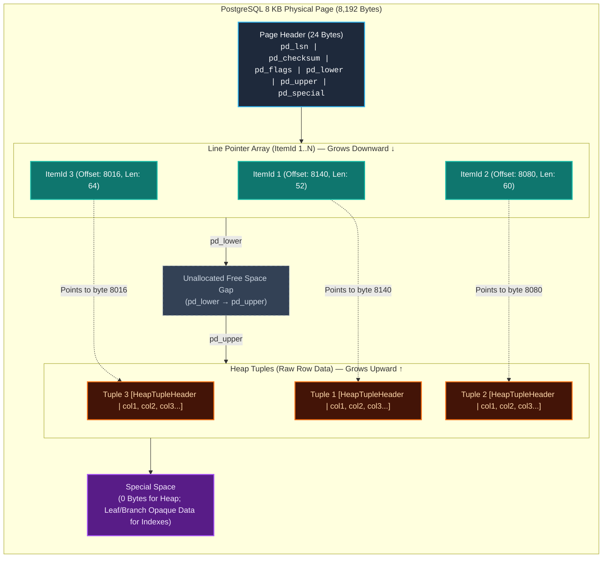

**Key facts about pages:**

1. **Fixed size:** 8 KB by default, compiled into the PostgreSQL binary. You cannot change it without recompiling.
2. **Atomic read/write unit:** When PostgreSQL needs even a single byte from a page, it reads the entire 8,192 bytes.
3. **Line pointers grow forward** from the top; **tuple data grows backward** from the bottom. Free space is in the middle.
4. **Every page is self-contained:** The page header has enough metadata to validate the page independently (checksums, LSN for crash recovery).

**Why this matters for indexes:** An index must ultimately tell the database *which page* and *which line pointer within that page* to read. This is the only addressing scheme available.

---

## 1.2 Heap Files and Tuple Layout

In PostgreSQL, a **table** is stored as a **heap file** — an unordered collection of pages. The word "heap" is important: it means rows are **not** stored in any particular order. When you `INSERT` a row, PostgreSQL puts it in the first page that has enough free space, or appends a new page to the end of the file.

```text
Table "orders" on disk:

  File: $PGDATA/base/<db_oid>/<table_oid>

  ┌─────────┐ ┌─────────┐ ┌─────────┐ ┌─────────┐ ┌─────────┐
  │ Page 0  │ │ Page 1  │ │ Page 2  │ │ Page 3  │ │ Page 4  │  ...
  │ 8 KB    │ │ 8 KB    │ │ 8 KB    │ │ 8 KB    │ │ 8 KB    │
  │         │ │         │ │         │ │         │ │         │
  │ Row 1   │ │ Row 51  │ │ Row 101 │ │ Row 151 │ │ Row 201 │
  │ Row 2   │ │ Row 52  │ │ Row 102 │ │ Row 152 │ │ Row 202 │
  │ ...     │ │ ...     │ │ ...     │ │ ...     │ │ ...     │
  │ Row 50  │ │ Row 100 │ │ Row 150 │ │ Row 200 │ │ Row 250 │
  └─────────┘ └─────────┘ └─────────┘ └─────────┘ └─────────┘
```

Each row (tuple) has an internal header:

```text
HeapTupleHeader (23 bytes minimum):
  ┌─ t_xmin     : Transaction ID that inserted this row
  ├─ t_xmax     : Transaction ID that deleted/updated this row (0 if live)
  ├─ t_cid      : Command ID within the transaction
  ├─ t_ctid     : Current TID (page, offset) — points to self, or to newer version
  ├─ t_infomask : Bitmask flags (committed, aborted, has nulls, has varlen, etc.)
  ├─ t_infomask2: Number of columns + more flags
  ├─ t_hoff     : Offset to actual user data
  └─ t_bits[]   : NULL bitmap (1 bit per column, only if any NULLs)
```

**Critical MVCC insight:** PostgreSQL uses **Multi-Version Concurrency Control**. When you `UPDATE` a row, PostgreSQL does **not** modify the existing tuple in place. Instead:
1. The old tuple's `t_xmax` is set to the updating transaction's ID (marking it as "dead" once committed).
2. A **new** tuple with the updated values is inserted (possibly on a different page).
3. The old tuple's `t_ctid` is updated to point to the new tuple's location.

This means **every UPDATE creates a new physical copy of the row**. This is why `VACUUM` exists — to reclaim space from dead tuples.

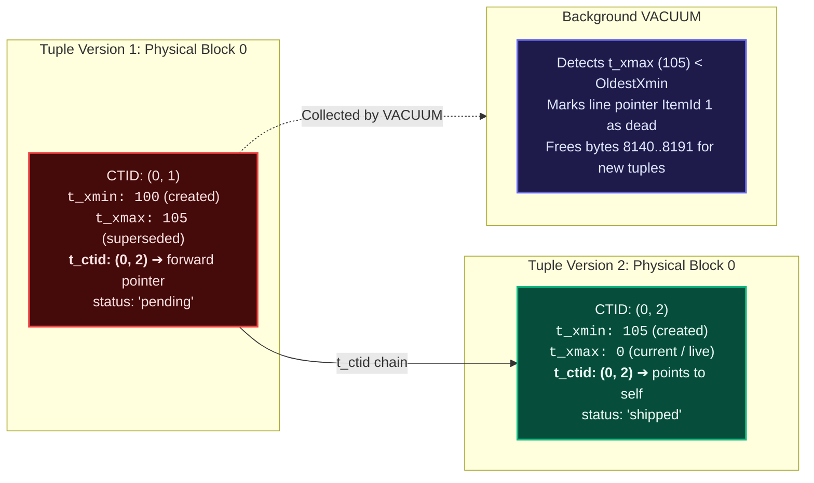

---

## 1.3 CTID: The Physical Address of Every Row

Every tuple in PostgreSQL has a **CTID** (Current Tuple ID), which is a pair `(page_number, item_number)`:

```sql
-- You can actually see the physical location of every row:
SELECT ctid, order_id, customer_id, total_amount
FROM orders
LIMIT 10;

-- Output:
--  ctid   | order_id | customer_id | total_amount
-- --------+----------+-------------+--------------
--  (0,1)  |     1001 |          42 |       299.99
--  (0,2)  |     1002 |          17 |        59.50
--  (0,3)  |     1003 |         108 |      1250.00
--  (1,1)  |     1004 |          42 |       175.25
--  ...
```

* `(0,1)` means: Page 0, Item 1 (first line pointer on that page).
* `(1,1)` means: Page 1, Item 1.

**This is exactly what an index stores.** An index entry maps a key value (like `customer_id = 42`) to a CTID `(0,1)`, telling PostgreSQL: "Go to page 0, read it, find line pointer 1, follow it to the tuple data."

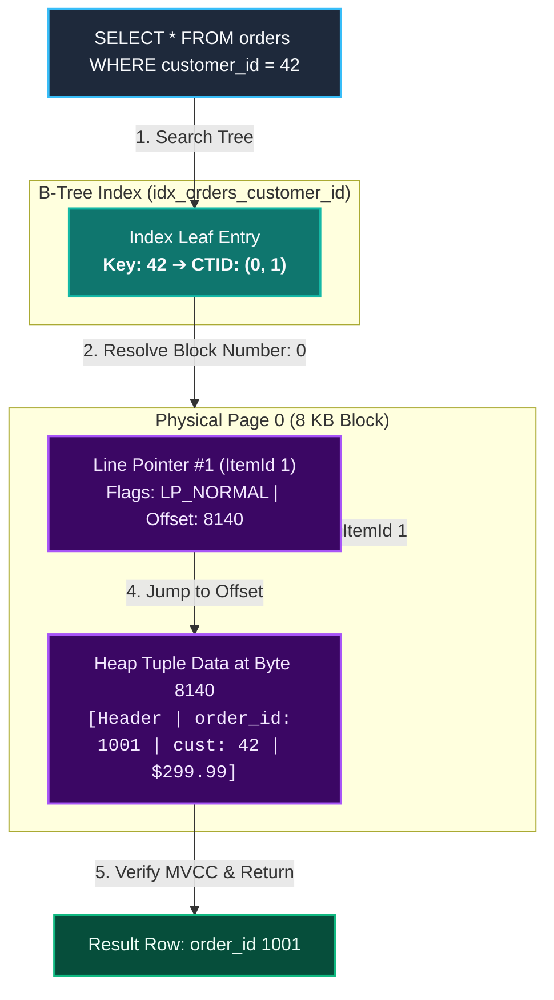

---

## 1.4 TOAST: How Large Values Are Stored

When a single row's data exceeds approximately 2 KB (roughly ¼ of a page), PostgreSQL uses **TOAST (The Oversized Attribute Storage Technique)**:

```text
Main Heap Page                          TOAST Table (separate heap file)
┌─────────────────────┐                 ┌──────────────────────────────┐
│  Tuple:             │                 │  Chunk 1: bytes 0–1999       │
│   col1 = 42         │     ┌──────────►│  Chunk 2: bytes 2000–3999    │
│   col2 = "short"    │     │           │  Chunk 3: bytes 4000–5200    │
│   col3 = TOAST_PTR  ┼─────┘           └──────────────────────────────┘
│   col4 = 99.99      │
└─────────────────────┘
```

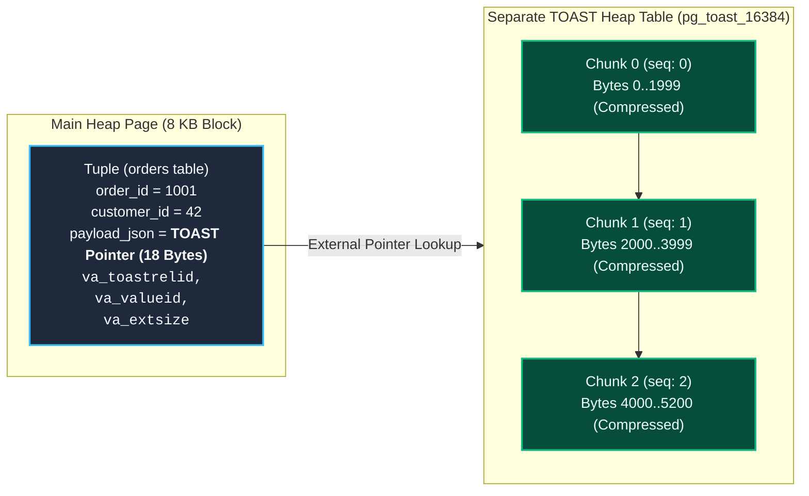

TOAST strategies:
* **PLAIN:** Never TOAST (only for fixed-length types like `integer`).
* **EXTENDED:** Compress first, then store externally if still too large (default for `text`, `bytea`).
* **EXTERNAL:** Store externally without compression (useful for pre-compressed data).
* **MAIN:** Try compression, but keep inline if possible.

**Index implications:** Indexes typically store only the indexed column values. If you index a very large `text` column, the index entries themselves can be large, leading to fewer entries per index page and a taller, less efficient tree.

---

## 1.5 The Buffer Cache and Shared Buffers

PostgreSQL never reads pages directly from disk into your query. It reads them into **shared buffers** — a region of shared memory that acts as a page cache.

```text
┌──────────────────────────────────────────────────────┐
│                     Shared Buffers                   │
│                  (e.g., 4 GB of RAM)                 │
│                                                      │
│  ┌────┐ ┌────┐ ┌────┐ ┌────┐ ┌────┐ ┌────┐           │
│  │Pg 0│ │Pg 7│ │Pg 2│ │Pg 1│ │Pg 9│ │Pg 4│  ...      │
│  │tbl │ │idx │ │tbl │ │tbl │ │idx │ │tbl │           │
│  └────┘ └────┘ └────┘ └────┘ └────┘ └────┘           │
│                                                      │
│  Clock-sweep eviction algorithm                      │
└───────────────────────┬──────────────────────────────┘
                        │
                        │  Cache Miss → Read from OS page cache or disk
                        ▼
┌──────────────────────────────────────────────────────┐
│              OS Page Cache (Kernel)                  │
│         (Uses remaining RAM not allocated            │
│          to shared_buffers)                          │
└───────────────────────┬──────────────────────────────┘
                        │
                        │  OS Cache Miss → Physical disk read
                        ▼
┌──────────────────────────────────────────────────────┐
│                Physical Disk / SSD                   │
│         (HDD: ~10ms seek; SSD: ~0.1ms)               │
└──────────────────────────────────────────────────────┘
```

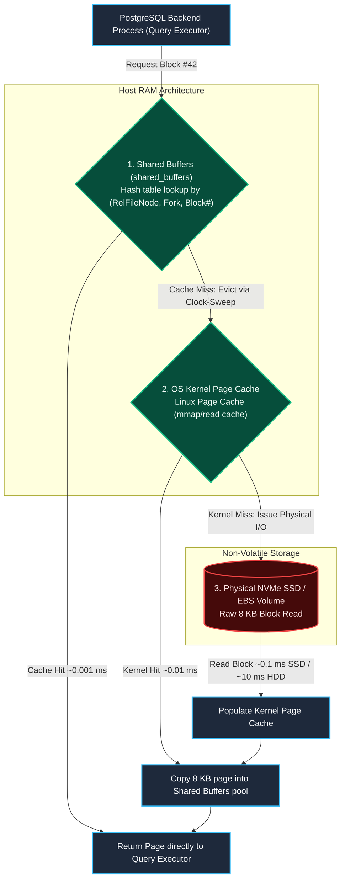

**The double-caching problem:** PostgreSQL's shared buffers sit *on top of* the OS page cache. A page can be cached in both layers. This is why `effective_cache_size` (a planner hint, not an allocation) should be set to `shared_buffers + estimated OS page cache`.

**Why this matters for indexes:** When the planner decides between a sequential scan and an index scan, it estimates how many pages are already in cache. If the table is small enough to be fully cached, random I/O (from index lookups) is nearly as cheap as sequential I/O, making indexes more likely to be chosen.

---

# 2. Table Scans vs Index Scans

This is the single most important concept in index performance. Understanding the difference between these access methods is what separates a developer who "adds indexes" from an engineer who **designs** them.

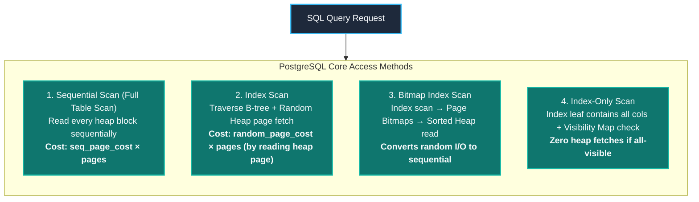

## 2.1 Sequential Scan (Full Table Scan)

A sequential scan reads **every page** of the table, from first to last, examining **every tuple** to see if it matches the `WHERE` clause.

```text
Query: SELECT * FROM orders WHERE status = 'shipped';

Sequential Scan Process:
  ┌─────────┐ ┌─────────┐ ┌─────────┐ ┌─────────┐ ┌─────────┐
  │ Page 0  │→│ Page 1  │→│ Page 2  │→│ Page 3  │→│ Page 4  │→ ...
  │ Read    │ │ Read    │ │ Read    │ │ Read    │ │ Read    │
  │ all 50  │ │ all 50  │ │ all 50  │ │ all 50  │ │ all 50  │
  │ tuples  │ │ tuples  │ │ tuples  │ │ tuples  │ │ tuples  │
  │ Check   │ │ Check   │ │ Check   │ │ Check   │ │ Check   │
  │ each    │ │ each    │ │ each    │ │ each    │ │ each    │
  └─────────┘ └─────────┘ └─────────┘ └─────────┘ └─────────┘
       ↓           ↓           ↓           ↓           ↓
  3 matches   1 match    0 matches  2 matches   1 match

Total: Read ALL 10,000 pages to find 200 matching rows.
```

**Characteristics:**
* **I/O pattern:** Strictly sequential — the OS can prefetch pages efficiently.
* **Cost formula:** `seq_page_cost × number_of_pages + cpu_tuple_cost × number_of_rows`
* **When it wins:** When the query will touch a large fraction of the table (e.g., >5–15% of rows), the sequential read pattern is more efficient than random jumps.
* **Parallelism:** PostgreSQL can parallelize sequential scans across multiple workers.

---

## 2.2 Index Scan

An index scan first consults the index to find which pages contain matching rows, then fetches only those specific pages from the heap.

```text
Query: SELECT * FROM orders WHERE customer_id = 42;

Index Scan Process:

Step 1: Navigate the B-tree index on customer_id
  ┌────────────┐
  │   Root     │  customer_id = 42
  │  [50, 150] │  → 42 < 50, go left
  └─────┬──────┘
        ▼
  ┌────────────┐
  │ Internal   │
  │ [10,25,40] │  → 42 > 40, go right
  └─────┬──────┘
        ▼
  ┌────────────────┐
  │   Leaf Page    │
  │ 40→(7,3)       │
  │ 41→(12,1)      │
  │ 42→(0,1)  ←HIT │  Found! CTID = (0,1)
  │ 42→(1,1)  ←HIT │  Found! CTID = (1,1)
  │ 42→(5,8)  ←HIT │  Found! CTID = (5,8)
  │ 43→(3,2)       │
  └────────────────┘

Step 2: Fetch rows from heap using CTIDs
  Fetch page 0, item 1 → row data
  Fetch page 1, item 1 → row data   (random I/O!)
  Fetch page 5, item 8 → row data   (random I/O!)

Total: Read 3 index pages + 3 heap pages = 6 page reads
  (vs 10,000 pages for a sequential scan)
```

**Characteristics:**
* **I/O pattern:** Random — jumping to arbitrary pages in the heap.
* **Cost formula:** `(random_page_cost × index_pages_read) + (random_page_cost × heap_pages_fetched) + cpu_costs`
* **When it wins:** When the query is highly selective (returns a small fraction of rows).
* **Danger:** If many matching rows are spread across many different heap pages, the random I/O cost can exceed a sequential scan.

---

## 2.3 Bitmap Index Scan

A bitmap scan is PostgreSQL's clever **hybrid** approach. It's used when an index scan would return too many rows for efficient random I/O, but a sequential scan would read too many irrelevant pages.

```text
Query: SELECT * FROM orders WHERE status = 'pending';
       (status has 5 distinct values; 'pending' matches ~20% of rows)

Bitmap Index Scan Process:

Step 1: Scan the index, build a bitmap of pages (NOT individual tuples)
  Index on status:
    'pending' → CTIDs: (0,1), (0,3), (1,2), (1,4), (2,1), (3,3), (5,7), ...

  Bitmap (one bit per page):
  Page: 0  1  2  3  4  5  6  7  8  9  ...
  Bit:  1  1  1  1  0  1  0  0  1  0  ...
        ↑  ↑  ↑  ↑     ↑        ↑
        These pages contain at least one matching row

Step 2: Sequentially read only the marked pages (in physical order!)
  Read Page 0 → check all tuples for status='pending'
  Read Page 1 → check all tuples for status='pending'
  Read Page 2 → check all tuples for status='pending'
  Read Page 3 → check all tuples for status='pending'
  Read Page 5 → check all tuples for status='pending'
  Read Page 8 → check all tuples for status='pending'

Total: Read 6 pages in sequential order (not random!)
```

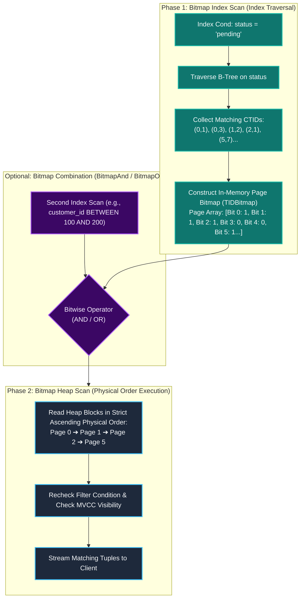

**Key insight:** The bitmap scan converts random I/O into sequential I/O by sorting the page numbers before fetching. This is why it can be much faster than a plain index scan for medium-selectivity queries.

**Bitmap AND/OR:** PostgreSQL can combine bitmaps from **multiple indexes**:
```sql
-- PostgreSQL can use TWO separate indexes and combine their bitmaps:
SELECT * FROM orders
WHERE status = 'pending'         -- index on status
  AND customer_id BETWEEN 100 AND 200;  -- index on customer_id

-- Internally:
-- bitmap_status  = pages matching status='pending'
-- bitmap_custid  = pages matching customer_id 100..200
-- final_bitmap   = bitmap_status AND bitmap_custid  (intersection)
```

---

## 2.4 Index-Only Scan

The fastest possible index access. If **all columns** needed by the query are present in the index, PostgreSQL can answer the query entirely from the index without touching the heap at all.

```text
-- Covering index:
CREATE INDEX idx_orders_cust_total
ON orders (customer_id) INCLUDE (total_amount);

Query: SELECT customer_id, total_amount FROM orders WHERE customer_id = 42;

Index-Only Scan:
  ┌────────────────────────┐
  │   B-tree Leaf Page     │
  │ 42 | total=299.99      │  ← All data is right here!
  │ 42 | total=175.25      │  ← No need to visit the heap!
  │ 42 | total=89.00       │
  └────────────────────────┘

  ⚠️ BUT: Must check the Visibility Map first!
  If the page was recently VACUUMed → all tuples visible → skip heap
  If not → must still fetch from heap to check MVCC visibility
```

```mermaid
flowchart TD
    Query["Query: SELECT customer_id, total_amount FROM orders WHERE customer_id = 42"]
    CoveringIdx["Covering Index: idx_orders_cust_total (customer_id) INCLUDE (total_amount)"]
    FindLeaf["Leaf Page Lookup:<br/>Found key 42 with total_amount in index leaf payload!"]
    
    CheckVM{"Check Visibility Map (VM)<br/>Is target heap page bit = 1?"}
    
    FastPath["✅ Fast Path: Heap Fetch Skipped!<br/>Row is definitely visible to all transactions.<br/>Directly return (customer_id, total_amount)."]
    SlowPath["⚠️ Fallback Path: Heap Fetch Required<br/>Page has recent UPDATEs / unvacuumed tuples.<br/>Fetch heap block to check MVCC (t_xmin, t_xmax)."]

    Query --> CoveringIdx --> FindLeaf --> CheckVM
    CheckVM -->|Bit = 1 (All-Visible)| FastPath
    CheckVM -->|Bit = 0 (Dirty / Recent)| SlowPath

    classDef qry fill:#1e293b,stroke:#38bdf8,stroke-width:2px,color:#f8fafc;
    classDef hit fill:#064e3b,stroke:#10b981,stroke-width:2px,color:#ecfdf5;
    classDef miss fill:#7c2d12,stroke:#f97316,stroke-width:2px,color:#ffedd5;

    class Query,CoveringIdx,FindLeaf,CheckVM qry;
    class FastPath hit;
    class SlowPath miss;
```

---

## 2.5 When PostgreSQL Chooses Each Scan Type

```text
Selectivity Spectrum (% of table rows matching the WHERE clause):

0.01%        1%          5%         15%         50%        100%
  │           │           │           │           │           │
  ▼           ▼           ▼           ▼           ▼           ▼
  ┌───────────┬───────────┬───────────┬───────────┬───────────┐
  │ Index     │ Index     │ Bitmap    │ Bitmap    │Sequential │
  │ Scan      │ Scan      │ Index     │ or Seq    │ Scan      │
  │           │           │ Scan      │ Scan      │           │
  └───────────┴───────────┴───────────┴───────────┴───────────┘
      Best for               Hybrid               Best for
     few rows              territory             many rows

Crossover point depends on:
  • Table size (number of pages)
  • Correlation (physical row order vs index order)
  • Available memory (work_mem for bitmap)
  • Cache residency (how much of the table is in RAM)
  • random_page_cost setting
```

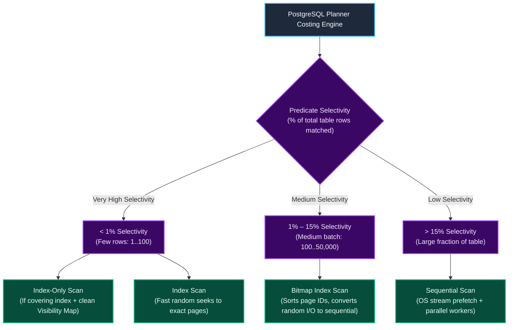

---

# 3. I/O Costs: Why Disk Access Dominates Everything

## 3.1 Random I/O vs Sequential I/O

This is the single most important performance distinction in database systems:

```text
Sequential I/O (Reading pages in order):
┌────┐┌────┐┌────┐┌────┐┌────┐┌────┐┌────┐┌────┐
│ P0 ││ P1 ││ P2 ││ P3 ││ P4 ││ P5 ││ P6 ││ P7 │
└────┘└────┘└────┘└────┘└────┘└────┘└────┘└────┘
  →    →    →    →    →    →    →    →
One continuous read stream. OS prefetches ahead.
HDD: ~200 MB/s throughput
SSD: ~3000 MB/s throughput

Random I/O (Jumping to arbitrary pages):
┌────┐      ┌────┐              ┌────┐   ┌────┐
│ P0 │      │ P7 │              │ P3 │   │ P9 │
└────┘      └────┘              └────┘   └────┘
  ↑           ↑                   ↑        ↑
  └─ seek ────┘─── seek ─────────┘── seek──┘
Each jump = HDD: 5-10ms seek + rotational delay
            SSD: 0.05-0.1ms (50-100x faster than HDD)
HDD: ~100-200 IOPS (random)
SSD: ~50,000-500,000 IOPS (random)
```

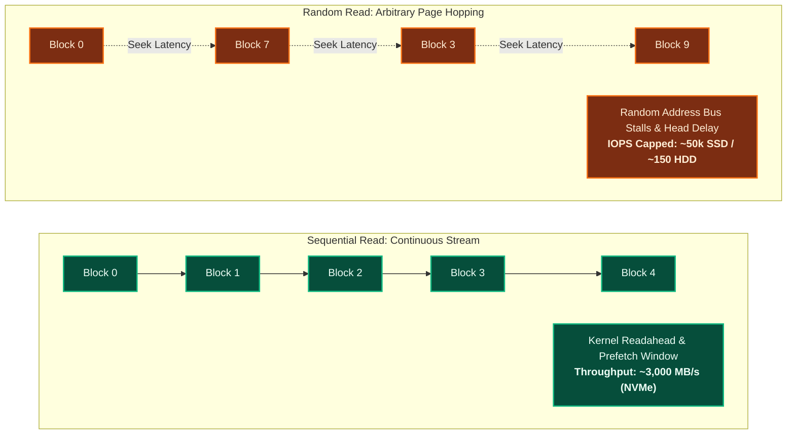

**Why this matters:** On an HDD, one random read takes ~10ms. A sequential scan of 10,000 pages (80 MB) takes ~400ms. But 10,000 random reads would take ~100 seconds. This is why PostgreSQL defaults `random_page_cost` to 4× `seq_page_cost`.

On SSDs, the gap is much smaller, which is why tuning `random_page_cost` downward (1.1–1.5) on SSD-backed systems makes the planner more willing to use index scans.

---

## 3.2 PostgreSQL Cost Model Parameters

PostgreSQL's query planner uses a **cost model** to estimate the total expense of each possible execution plan. The costs are in arbitrary units (not seconds or milliseconds).

```text
Parameter               Default    What It Represents
─────────────────────── ────────── ──────────────────────────────────────────
seq_page_cost           1.0        Cost of reading one page sequentially
random_page_cost        4.0        Cost of reading one page randomly
cpu_tuple_cost          0.01       Cost of processing one row
cpu_index_tuple_cost    0.005      Cost of processing one index entry
cpu_operator_cost       0.0025     Cost of evaluating one operator (=, <, etc.)
effective_cache_size    4 GB       Planner's estimate of total available cache
                                    (shared_buffers + OS cache)
```

**Cost calculation example:**
```text
Table: orders (10,000 pages, 500,000 rows)
Query: SELECT * FROM orders WHERE customer_id = 42; (returns 50 rows)
Index: B-tree on customer_id (height = 3, so 3 index page reads)

Sequential Scan cost:
  = seq_page_cost × pages + cpu_tuple_cost × rows
  = 1.0 × 10,000 + 0.01 × 500,000
  = 10,000 + 5,000
  = 15,000

Index Scan cost:
  = random_page_cost × (index_pages + heap_pages) + cpu costs
  = 4.0 × (3 + 50) + cpu costs
  = 4.0 × 53 + small
  = 212 + small
  ≈ 220

  220 ≪ 15,000 → Planner chooses index scan ✓
```

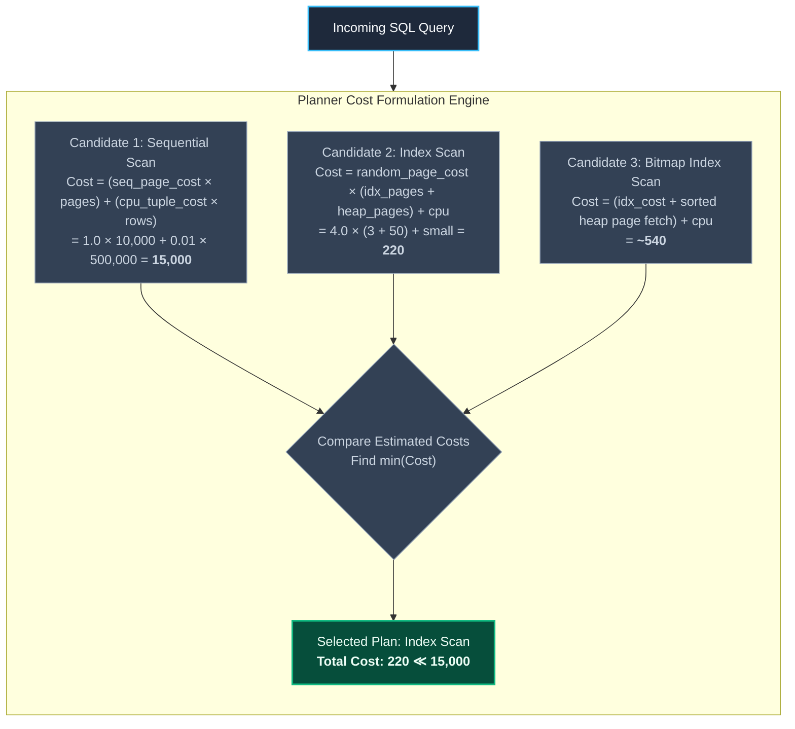

---

## 3.3 Reading EXPLAIN ANALYZE Output

```sql
EXPLAIN (ANALYZE, BUFFERS, FORMAT TEXT) 
SELECT * FROM orders WHERE customer_id = 42;
```

```text
Index Scan using idx_orders_customer_id on orders
    (cost=0.42..45.28 rows=50 width=128)
    (actual time=0.035..0.412 rows=47 loops=1)
    Index Cond: (customer_id = 42)
    Buffers: shared hit=12 read=3
Planning Time: 0.125 ms
Execution Time: 0.487 ms
```

Breaking down every field:

| Field | Meaning |
|:---|:---|
| `cost=0.42..45.28` | Startup cost..Total cost (in planner units) |
| `rows=50` | **Estimated** rows the planner thinks will be returned |
| `width=128` | Average width of each output row in bytes |
| `actual time=0.035..0.412` | Real wall-clock time in milliseconds (first row..last row) |
| `rows=47` | **Actual** rows returned (compare with estimated 50!) |
| `loops=1` | How many times this node was executed |
| `shared hit=12` | Pages found in shared_buffers (cache hits — no disk I/O!) |
| `shared read=3` | Pages read from OS cache or disk (cache misses) |

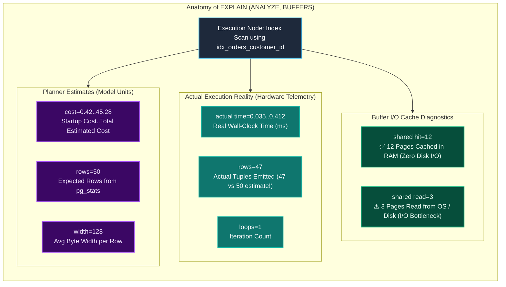

**The `BUFFERS` output is gold.** `shared hit` = free (already in RAM). `shared read` = potentially expensive disk I/O. If you see a large `shared read` number, that's your bottleneck.

---

## 3.4 Effective Cache Size and Planning

`effective_cache_size` doesn't allocate any memory. It's a **hint** to the planner about how much of the total dataset is likely already cached (in shared_buffers + OS page cache combined).

```text
effective_cache_size = 12 GB (on a 16 GB server)

Planner reasoning:
  "The orders table is 800 MB. That fits entirely in 12 GB of cache.
   So random_page_cost for cached pages ≈ seq_page_cost.
   → I'll be more aggressive about using index scans."

vs.

effective_cache_size = 512 MB (conservative setting)

Planner reasoning:
  "The orders table is 800 MB. Most of it is probably NOT in cache.
   Random I/O will actually hit disk at 4× the cost.
   → I'll prefer sequential scans for medium-selectivity queries."
```

---

# 4. What an Index Actually Is

An index is a **separate data structure**, stored in its own set of pages on disk, that maintains a **sorted or hashed mapping** from column values to the physical locations (CTIDs) of the corresponding rows in the heap.

```text
Conceptual Model:

Heap (unordered):                            Index (ordered by customer_id):
┌─────────────────────────────┐              ┌───────────────────────────┐
│ Page 0:                     │              │ Key: 10 → CTID (2,3)      │
│   (0,1) order=1001 cust=42  │              │ Key: 17 → CTID (0,2)      │
│   (0,2) order=1002 cust=17  │              │ Key: 42 → CTID (0,1)      │
│   (0,3) order=1003 cust=108 │              │ Key: 42 → CTID (1,1)      │
│ Page 1:                     │              │ Key: 55 → CTID (2,1)      │
│   (1,1) order=1004 cust=42  │              │ Key: 99 → CTID (1,2)      │
│   (1,2) order=1005 cust=99  │              │ Key: 108 → CTID (0,3)     │
│ Page 2:                     │              │ Key: 200 → CTID (2,2)     │
│   (2,1) order=1006 cust=55  │              └───────────────────────────┘
│   (2,2) order=1007 cust=200 │              Sorted! Binary-searchable!
│   (2,3) order=1008 cust=10  │       
└─────────────────────────────┘
  Unordered! Must scan all to find cust=42.
```

---

## 4.1 The Index Lookup Process Step by Step

When PostgreSQL executes `SELECT * FROM orders WHERE customer_id = 42`:

```text
1. PLANNER PHASE:
   ┌───────────────────────────────────────────────────────────────┐
   │ Check pg_stats for customer_id:                               │
   │   n_distinct = 1000 (1000 unique customers)                   │
   │   Table has 500,000 rows                                      │
   │   Estimated selectivity = 1/1000 = 0.001                      │
   │   Estimated rows = 500,000 × 0.001 = 500                      │
   │   Compare cost of Seq Scan vs Index Scan vs Bitmap Scan       │
   │   → Choose Index Scan (500 rows out of 500K = very selective) │
   └───────────────────────────────────────────────────────────────┘

2. EXECUTOR PHASE — Index Traversal:
   ┌─────────────────────────────────────────────────────────────┐
   │ a) Read root page of B-tree index                           │
   │    Root contains separator keys: [100, 300, 500, 700]       │
   │    42 < 100 → follow pointer to left-most child             │
   │                                                             │
   │ b) Read internal page                                       │
   │    Contains separator keys: [20, 40, 60, 80]                │
   │    40 < 42 ≤ 60 → follow pointer between 40 and 60          │
   │                                                             │
   │ c) Read leaf page                                           │
   │    Contains sorted entries:                                 │
   │    [40→(7,3), 41→(12,1), 42→(0,1), 42→(1,1), 42→(5,8)]      │
   │    Start at first 42, scan right until key > 42             │
   │    Collect CTIDs: (0,1), (1,1), (5,8)                       │
   │                                                             │
   │ d) Follow sibling pointer to next leaf page if needed       │
   │    (B+tree leaf pages are linked in a doubly-linked list)   │
   └─────────────────────────────────────────────────────────────┘

3. EXECUTOR PHASE — Heap Fetch:
   ┌─────────────────────────────────────────────────────────────┐
   │ For each CTID:                                              │
   │   a) Check if heap page is in shared_buffers                │
   │   b) If not, read page from OS cache / disk                 │
   │   c) Follow line pointer to tuple                           │
   │   d) Check MVCC visibility (is this tuple visible to my     │
   │      transaction snapshot?)                                 │
   │   e) If visible, return row to client                       │
   └─────────────────────────────────────────────────────────────┘
```

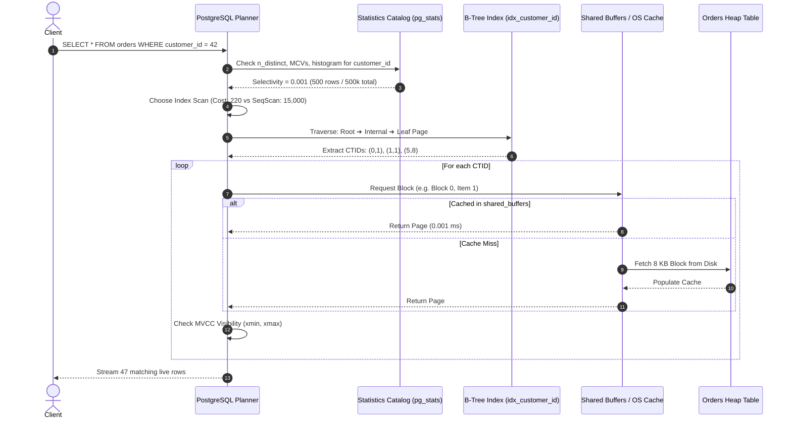

---

## 4.2 Index Entries and Their Structure

Each index entry in a B-tree leaf page contains:

```text
┌───────────────────────────────────────────────────┐
│  Index Tuple:                                     │
│  ┌─ t_tid    : (block_number, offset_number)      │  ← Points to heap tuple
│  ├─ t_info   : Size and flags                     │
│  └─ Key data : The actual indexed column value    │  ← e.g., customer_id = 42
│                (possibly multiple columns         │
│                 for composite indexes)            │
└───────────────────────────────────────────────────┘
```

An index page (8 KB) can hold many index entries. How many depends on the key size:
* `INTEGER` key (4 bytes) + CTID (6 bytes) + overhead (~8 bytes) ≈ 18 bytes per entry → ~400 entries per page
* `VARCHAR(100)` key (avg 50 bytes) + CTID + overhead ≈ 64 bytes per entry → ~120 entries per page
* `UUID` key (16 bytes) + CTID + overhead ≈ 30 bytes per entry → ~250 entries per page

**This is why integer keys make better index columns than long strings.** More entries per page = shorter tree = fewer I/O operations.

---

## 4.3 Read/Write Trade-Offs

Indexes are not free. Every index adds overhead to write operations:

```text
Without index:
  INSERT INTO orders (...) VALUES (...);
    → Write 1 heap page (append new tuple)
    → Write 1 WAL record
    Total: 1 page write

With 1 B-tree index:
  INSERT INTO orders (...) VALUES (...);
    → Write 1 heap page (append new tuple)
    → Write 1 WAL record for heap
    → Navigate B-tree to find insertion point
    → Write 1 index leaf page (insert new entry)
    → Write 1 WAL record for index
    → Possibly split a full leaf page (write 2-3 more pages)
    Total: 2-4 page writes

With 5 indexes:
  INSERT INTO orders (...) VALUES (...);
    → Write 1 heap page
    → Write 5 index leaf pages (one per index)
    → Write 6 WAL records
    → Possible page splits in any of the 5 indexes
    Total: 6-15+ page writes
```

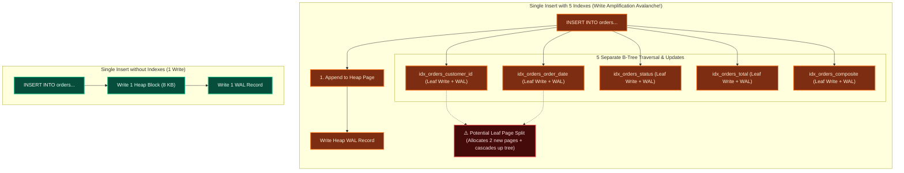

**The write amplification formula:**
```
Total write cost ≈ heap_write + N × index_write
where N = number of indexes on the table
```

**UPDATE is even worse in PostgreSQL:**
```text
UPDATE orders SET status = 'shipped' WHERE order_id = 1001;

What actually happens:
  1. Find the old tuple → mark t_xmax (dead)
  2. Insert a NEW tuple in the heap (new page possibly)
  3. Insert a NEW entry in EVERY index (even indexes on unchanged columns!)
     Because the new tuple has a different CTID, all indexes must be updated.
  4. The old index entries are now "dead" pointers (cleaned up by VACUUM)

Exception: HOT updates (Heap-Only Tuples)
  If the new tuple fits on the SAME page AND no indexed columns changed,
  PostgreSQL can do a HOT update — no index modifications needed!
  This is why you should not index columns that are frequently updated.
```

---

## 4.4 Index Maintenance, Bloat, and VACUUM

### Index Bloat

When rows are deleted or updated, the old index entries are not immediately removed. They become **dead entries** that waste space:

```text
Before many UPDATEs:                    After many UPDATEs (bloated):
┌────────────────────┐                  ┌───────────────────┐
│ Leaf Page          │                  │ Leaf Page         │
│ [40→(7,3)] LIVE    │                  │ [40→(7,3)] DEAD   │ ← old version
│ [41→(12,1)] LIVE   │                  │ [40→(99,2)] LIVE  │ ← new version
│ [42→(0,1)] LIVE    │                  │ [41→(12,1)] DEAD  │
│ [43→(3,2)] LIVE    │                  │ [41→(50,4)] LIVE  │
│ FREE SPACE         │                  │ [42→(0,1)] LIVE   │
│                    │                  │ [43→(3,2)] DEAD   │
│                    │                  │ [43→(80,1)] LIVE  │
│                    │                  │ NO FREE SPACE!    │ ← Must split!
└────────────────────┘                  └───────────────────┘
```

### VACUUM and Index Cleanup

```text
VACUUM Process for Indexes:

1. Scan the heap, collect list of dead tuple CTIDs
2. For EACH index on the table:
   a. Scan the entire index (!)
   b. Remove any entries pointing to dead CTIDs
   c. Mark freed space as reusable
3. Return to the heap, mark dead tuple space as reusable
4. Update the Free Space Map (FSM)
5. Update the Visibility Map (VM)
```

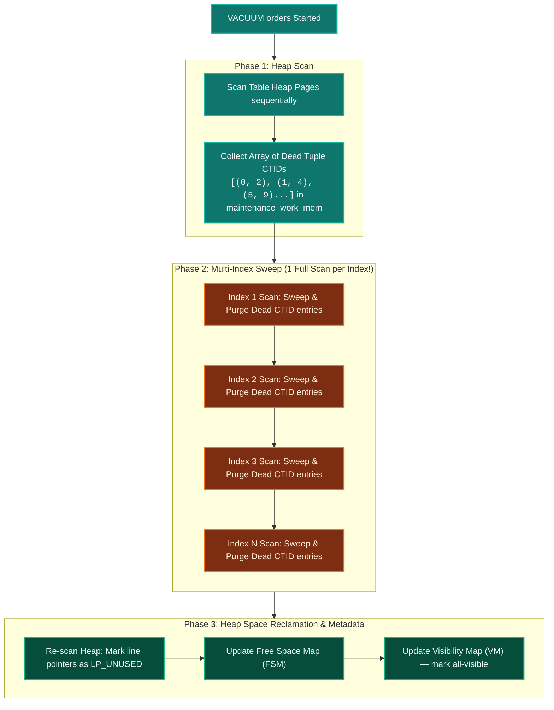

**Critical insight:** VACUUM must scan **every index** on the table to remove dead entries. A table with 10 indexes requires 10 full index scans during VACUUM. This is why excessive indexing dramatically increases VACUUM time, which in turn delays transaction ID wraparound protection.

### Monitoring Index Bloat

```sql
-- Check index size vs estimated minimal size:
SELECT
    schemaname || '.' || indexrelname AS index_name,
    pg_size_pretty(pg_relation_size(indexrelid)) AS index_size,
    idx_scan AS times_used,
    idx_tup_read AS tuples_read,
    idx_tup_fetch AS tuples_fetched
FROM pg_stat_user_indexes
ORDER BY pg_relation_size(indexrelid) DESC;
```

### REINDEX: The Nuclear Option

When an index becomes severely bloated (e.g., 3× its optimal size), you can rebuild it:

```sql
-- Blocks writes during rebuild:
REINDEX INDEX idx_orders_customer_id;

-- Non-blocking rebuild (PostgreSQL 12+):
REINDEX INDEX CONCURRENTLY idx_orders_customer_id;

-- Rebuild all indexes on a table:
REINDEX TABLE orders;
```

---

## 4.5 When an Index Hurts Performance

Indexes are not always beneficial. Here are specific scenarios where indexes **hurt**:

### 1. Low-Selectivity Queries on Indexed Columns
```sql
-- Table has 1M rows, status has 3 values: 'active', 'pending', 'archived'
-- 'active' = 600,000 rows (60%)!

SELECT * FROM users WHERE status = 'active';
-- Index scan would do 600,000 random I/O operations!
-- Sequential scan reads all pages once sequentially — much faster.
```

### 2. Write-Heavy Tables
```sql
-- A logging table with 50 INSERTs per second
-- Each INSERT must update ALL indexes
-- 10 indexes × 50 INSERTs = 500 index writes/sec overhead
```

### 3. Small Tables
```sql
-- Table with 100 rows fits in ~2 pages
-- Sequential scan: read 2 pages
-- Index scan: read 2-3 index pages + 1 heap page = 3-4 pages
-- Index is SLOWER for small tables!
```

### 4. Indexes on Frequently Updated Columns
```sql
-- status column changes from 'pending' → 'processing' → 'shipped' → 'delivered'
-- Each UPDATE creates new index entries in the status index
-- Old entries become dead, causing bloat
-- HOT updates are impossible because an indexed column changed
```

### 5. Too Many Indexes
```text
Table with 20 columns and 15 indexes:
  • INSERT time: 15× longer (one index update per index)
  • VACUUM time: 15× longer (must scan all 15 indexes)
  • Storage: Indexes can exceed the table size!
  • Planner time: More indexes = more plans to evaluate
```

**Rule of thumb:** A well-designed OLTP table typically has 3–7 indexes. If you have more than 10, audit them aggressively.

---

# 5. Cardinality and Column Statistics

The query planner's decisions are only as good as its **statistics**. PostgreSQL maintains detailed statistics about every column in every table, and these statistics directly determine whether an index is used.

## 5.1 COUNT(*) vs COUNT(column) vs COUNT(DISTINCT column)

These three functions answer fundamentally different questions:

```sql
-- Sample data in orders table:
-- order_id | customer_id | discount_code
-- ---------|-------------|---------------
--    1     |     42      |    'SAVE10'
--    2     |     42      |     NULL
--    3     |     17      |    'SAVE10'
--    4     |     99      |    'VIP20'
--    5     |     42      |    'SAVE10'

SELECT COUNT(*)                    FROM orders;  -- 5 (counts ALL rows, including NULLs)
SELECT COUNT(discount_code)        FROM orders;  -- 4 (counts NON-NULL values only)
SELECT COUNT(DISTINCT customer_id) FROM orders;  -- 3 (counts unique values: 42, 17, 99)
SELECT COUNT(DISTINCT discount_code) FROM orders; -- 2 (unique non-NULL: 'SAVE10', 'VIP20')
```

**Why this matters for indexes:**
* `COUNT(*)` never uses an index (it must count all rows, including those with NULLs in every column). In PostgreSQL specifically, `COUNT(*)` requires visiting the heap because of MVCC — the index doesn't know which rows are visible to your transaction.
* `COUNT(DISTINCT column)` on an indexed column **can** use an index for scanning unique values, but typically still scans the full index or uses a Hash Aggregate.
* The **number of distinct values** (`n_distinct`) in a column is a critical statistic that determines selectivity.

---

## 5.2 Unique, Low-Cardinality, and High-Cardinality Columns

**Cardinality** = the number of distinct values in a column.

```text
Column Cardinality Spectrum:

Very Low          Low              Medium           High            Unique
Cardinality       Cardinality      Cardinality      Cardinality     (1:1)
────────────────────────────────────────────────────────────────────────────
gender            status           city             email           order_id
(2-3 values)      (5-10 values)    (100s values)    (near-unique)   (unique)
is_active         payment_type     product_id       phone_number    uuid
(boolean)         (4-5 values)     (1000s values)   (near-unique)   (primary key)

  ◄── Indexing less useful ───────────────────── Indexing more useful ──►

  Selectivity per value:                          Selectivity per value:
  ~50% (gender='M')                               ~0.001% (email='x@y.com')
  → Sequential scan wins                          → Index scan wins
```

```mermaid
flowchart LR
    subgraph CardLow["Low Cardinality (2 – 10 Distinct)"]
        direction TB
        L1["Examples: is_active (2), status (5), gender (3)"]
        L2["Selectivity: 20% – 50% per value"]
        L3["<b>Action: Sequential Scan</b> or <i>Partial Index</i>"]
    end

    subgraph CardMed["Medium Cardinality (100 – 10,000)"]
        direction TB
        M1["Examples: city, product_category, zip_code"]
        M2["Selectivity: 0.01% – 5% per value"]
        M3["<b>Action: Value-Dependent Index / Bitmap Scan</b>"]
    end

    subgraph CardHigh["High Cardinality / Unique (100k – 1:1)"]
        direction TB
        H1["Examples: order_id, user_uuid, email, ssn"]
        H2["Selectivity: &lt; 0.0001% (Point lookups)"]
        H3["<b>Action: B-Tree Index / Unique Index (Sweet Spot!)</b>"]
    end

    CardLow --> CardMed --> CardHigh

    classDef clow fill:#7c2d12,stroke:#f97316,stroke-width:2px,color:#ffedd5;
    classDef cmed fill:#1e293b,stroke:#38bdf8,stroke-width:2px,color:#f8fafc;
    classDef chigh fill:#064e3b,stroke:#10b981,stroke-width:2px,color:#ecfdf5;

    class CardLow clow;
    class CardMed cmed;
    class CardHigh chigh;
```

**General guidelines:**
* **Very low cardinality (2–10 values):** B-tree index is rarely useful because each value matches too many rows. Consider a **partial index** or **BRIN index** instead.
* **Medium cardinality:** Depends on the specific value being queried. An index might help for rare values but not for common ones.
* **High cardinality / Unique:** Ideal for B-tree indexes. Each lookup returns very few rows.

---

## 5.3 pg_stats: PostgreSQL's Column Statistics Catalog

`pg_stats` is a view over `pg_statistic` that provides human-readable column statistics. The planner consults these statistics for **every query**.

```sql
SELECT
    schemaname,
    tablename,
    attname AS column_name,
    n_distinct,        -- Number of distinct values (or fraction if negative)
    null_frac,         -- Fraction of NULLs (0.0 to 1.0)
    avg_width,         -- Average width in bytes
    correlation,       -- Physical-to-logical ordering correlation (-1 to +1)
    most_common_vals,  -- Array of most common values
    most_common_freqs, -- Frequency of each MCV
    histogram_bounds   -- Boundaries of equal-frequency histogram buckets
FROM pg_stats
WHERE tablename = 'orders' AND attname = 'customer_id';
```

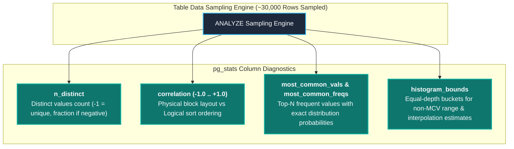

**Understanding each statistic:**

### n_distinct
```text
n_distinct = 1000        → Exactly 1000 distinct values
n_distinct = -0.5        → Distinct values ≈ 50% of total rows
                           (negative = fraction; used when distinct count
                            scales with table size)
n_distinct = -1           → Every value is unique (like a primary key)
```

### null_frac
```text
null_frac = 0.0          → No NULLs in this column
null_frac = 0.15         → 15% of rows have NULL
null_frac = 1.0          → Every row is NULL (useless column!)
```

### correlation
```text
correlation = 1.0        → Physical order matches logical sort order perfectly
                           (e.g., auto-increment ID — row 1 is on page 0,
                            row 2 is on page 0, ..., row 1000 is on page 20)
                           → Index range scans are VERY efficient (sequential I/O!)

correlation = 0.0        → No correlation (random distribution)
                           → Index range scans cause random I/O

correlation = -1.0       → Perfectly reverse-correlated
                           → Reverse index scans are efficient

WHY THIS MATTERS:
  Table with correlation = 0.95 on order_date:
    WHERE order_date BETWEEN '2024-01-01' AND '2024-01-31'
    → Matching rows are physically clustered on ~30 consecutive pages
    → Index scan reads 30 pages sequentially → FAST

  Table with correlation = 0.01 on customer_id:
    WHERE customer_id = 42
    → 50 matching rows are scattered across 50 different pages
    → Index scan reads 50 random pages → SLOW (might prefer seq scan)
```

### most_common_vals and most_common_freqs
```text
most_common_vals  = {pending, shipped, delivered, cancelled, returned}
most_common_freqs = {0.35,    0.30,    0.25,      0.07,       0.03}

Interpretation:
  35% of rows have status = 'pending'
  30% of rows have status = 'shipped'
  25% of rows have status = 'delivered'
   7% of rows have status = 'cancelled'
   3% of rows have status = 'returned'

Planner uses these for equality predicates:
  WHERE status = 'returned'  → selectivity = 0.03 → might use index
  WHERE status = 'pending'   → selectivity = 0.35 → probably seq scan
```

### histogram_bounds
```text
histogram_bounds = {1, 100, 205, 310, 420, 533, 650, 780, 900, 1000}

Interpretation (10 buckets = ~10% of data in each):
  10% of values fall between 1 and 100
  10% of values fall between 100 and 205
  10% of values fall between 205 and 310
  ...

Planner uses these for range predicates:
  WHERE customer_id BETWEEN 100 AND 310
  → Spans 2 buckets → ~20% of rows → might use bitmap scan
```

---

## 5.4 Estimated Rows vs Actual Rows

The planner's row estimate is the single most impactful factor in plan quality. Bad estimates lead to bad plans.

```sql
EXPLAIN ANALYZE SELECT * FROM orders WHERE customer_id = 42;

-- Good estimate:
-- Index Scan ... (rows=50) (actual rows=47)    ← Close! Good plan.

-- Bad estimate:
-- Seq Scan ... (rows=5) (actual rows=50000)    ← Off by 10000×! Bad plan!
```

**Common causes of bad estimates:**

1. **Stale statistics:** Data changed but `ANALYZE` hasn't run.
2. **Correlated columns:** Planner assumes column independence.
3. **Complex expressions:** `WHERE UPPER(email) = 'FOO@BAR.COM'` — planner can't use column stats.
4. **Parameterized queries:** Prepared statements use generic estimates.
5. **Skewed distributions not captured:** Default histogram has only 100 buckets.

---

## 5.5 Correlated Columns and Misleading Statistics

PostgreSQL maintains statistics on **individual columns independently**. It does not (by default) track correlations between columns.

```text
Example: orders table
  country   = 'Japan'     in 2% of rows
  currency  = 'JPY'       in 2% of rows

Planner's assumption (independence):
  WHERE country = 'Japan' AND currency = 'JPY'
  Estimated selectivity = 0.02 × 0.02 = 0.0004 (0.04%)
  On 1M rows: estimated 400 rows

Reality (strong correlation):
  Almost ALL Japanese orders use JPY.
  Actual selectivity ≈ 0.02 (2%)
  Actual rows ≈ 20,000

  Planner thinks 400 rows → chooses Index Scan
  Actually 20,000 rows → Bitmap or Seq Scan would be better!
```

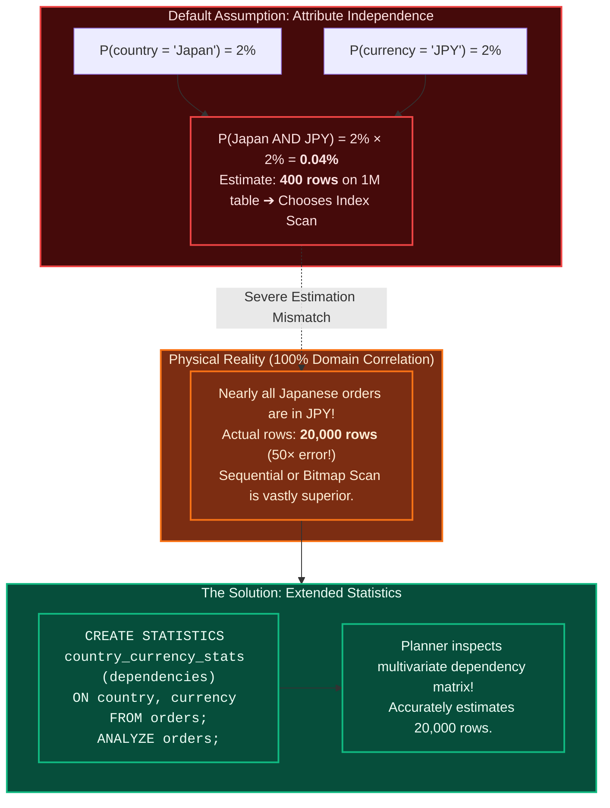

**Solution:** PostgreSQL 10+ supports **extended statistics** for correlated columns:
```sql
CREATE STATISTICS country_currency_stats (dependencies)
ON country, currency FROM orders;

ANALYZE orders;
-- Now the planner knows country and currency are correlated!
```

---

## 5.6 Stale Statistics and Their Impact

When you load, delete, or update a significant fraction of rows without running `ANALYZE`, the planner works with **outdated statistics**:

```text
Scenario: orders table has 100,000 rows. Statistics say n_distinct for status = 5.

You bulk-insert 900,000 new rows, all with status = 'processing' (new value).

Stale statistics:
  n_distinct = 5 (should be 6)
  most_common_freqs for existing values sum to 1.0 (no room for 'processing')
  Planner has no idea 'processing' exists or that it's 90% of the table now

  WHERE status = 'processing'
  Planner estimate: ~0 rows (unknown value → default selectivity 0.005)
  Actual: 900,000 rows
  → Planner chooses Index Scan for 900,000 rows → DISASTER
```

**Autovacuum runs ANALYZE automatically** when `autovacuum_analyze_threshold + autovacuum_analyze_scale_factor × n_tuples` rows have been inserted/updated/deleted. Default: analyze after 10% of rows change.

For large tables, you may want more aggressive settings:
```sql
ALTER TABLE orders SET (
    autovacuum_analyze_threshold = 1000,
    autovacuum_analyze_scale_factor = 0.02  -- 2% instead of 10%
);
```

---

# 6. Selectivity: The Math Behind Index Decisions

**Selectivity** is the fraction of rows that satisfy a predicate. It ranges from 0 (no rows match) to 1 (all rows match). The planner uses selectivity to estimate the number of rows returned and to choose between scan methods.

```text
Selectivity = (number of matching rows) / (total rows)
Estimated rows = selectivity × total rows
```

## 6.1 High vs Low Selectivity

⚠️ **Terminology warning:** "High selectivity" means **few rows match** (the predicate is very *selective*, filtering out most rows). This is confusing but standard.

```text
HIGH Selectivity (small fraction, index-friendly):
  WHERE order_id = 12345            → selectivity ≈ 0.000001
  WHERE email = 'alice@example.com' → selectivity ≈ 0.00001
  WHERE ssn = '123-45-6789'        → selectivity ≈ 0.000001
  ✓ Index scan is efficient

LOW Selectivity (large fraction, seq-scan-friendly):
  WHERE is_active = true           → selectivity ≈ 0.90
  WHERE gender = 'M'               → selectivity ≈ 0.50
  WHERE created_at > '2020-01-01'  → selectivity ≈ 0.80
  ✗ Index scan would be wasteful
```

---

## 6.2 Equality vs Range Predicates

```text
Equality predicate:  WHERE customer_id = 42
  Selectivity = 1 / n_distinct
  For n_distinct = 10,000: selectivity = 0.0001 (very selective)

Range predicate:     WHERE customer_id BETWEEN 100 AND 500
  Selectivity depends on the histogram:
  If values range from 1 to 10,000 uniformly:
    selectivity = (500 - 100) / (10000 - 1) ≈ 0.04 (4%)

Range predicate:     WHERE customer_id > 0
  selectivity ≈ 1.0 (matches almost everything)

Key insight:
  Equality predicates are typically MORE selective than range predicates.
  This is why the "equality before range" rule exists for composite indexes.
```

---

## 6.3 Uniform vs Skewed Data Distributions

```text
Uniform Distribution (equal frequency):
  customer_id: each of 1000 customers has ~500 orders (in 500K total)
  Selectivity for any customer = 1/1000 = 0.001
  Index equally effective for all customers.

Skewed Distribution (Zipf/Pareto):
  customer_id distribution in orders:
    Customer 1 (Amazon):      50,000 orders (10%)
    Customer 2 (Walmart):     25,000 orders (5%)
    Customer 3 (Target):      10,000 orders (2%)
    ...
    Customer 998 (Mom's Shop):     5 orders (0.001%)
    Customer 999 (Bob's Store):    3 orders (0.0006%)
    Customer 1000 (Tiny Inc):      1 order  (0.0002%)

  Index on customer_id:
    WHERE customer_id = 999  → 3 rows → Index Scan ✓ (great!)
    WHERE customer_id = 1    → 50,000 rows → Seq Scan ✓ (index would be slow)
    
  The SAME index has different utility for different values!
```

---

## 6.4 Why the Same Index May Help One Value but Not Another

This is one of the most counterintuitive aspects of query optimization:

```sql
-- Same query structure, same index, DIFFERENT execution plans:

EXPLAIN ANALYZE SELECT * FROM orders WHERE status = 'returned';
-- Index Scan using idx_orders_status on orders
-- rows=15000 (actual rows=14,832)
-- Execution Time: 25 ms
-- (3% of rows → index is efficient)

EXPLAIN ANALYZE SELECT * FROM orders WHERE status = 'pending';
-- Seq Scan on orders
-- Filter: (status = 'pending')
-- rows=175000 (actual rows=174,500)
-- Execution Time: 180 ms
-- (35% of rows → sequential scan is chosen!)
```

The planner uses the **most_common_vals** and **most_common_freqs** to make different decisions for different parameter values. This is called **value-dependent costing**.

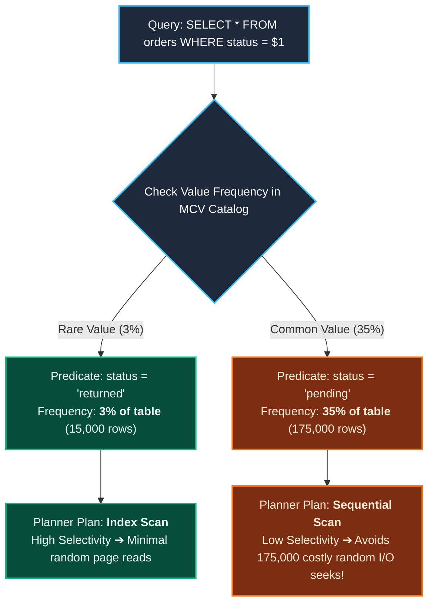

**Implication for prepared statements:**
```sql
PREPARE find_by_status(text) AS SELECT * FROM orders WHERE status = $1;

-- PostgreSQL initially creates custom plans per execution:
EXECUTE find_by_status('returned');   -- Index Scan (custom plan for 'returned')
EXECUTE find_by_status('pending');    -- Seq Scan (custom plan for 'pending')

-- After 5+ executions, PostgreSQL may switch to a GENERIC plan
-- that uses average selectivity — which might be wrong for extreme values!
```

---

## 6.5 ANALYZE, Histograms, and MCV Lists

### ANALYZE Command

```sql
-- Analyze a specific table:
ANALYZE orders;

-- Analyze a specific column (PostgreSQL 11+):
ANALYZE orders (customer_id);

-- Analyze the entire database:
ANALYZE;

-- Set statistics target (more buckets = better estimates, more ANALYZE time):
ALTER TABLE orders ALTER COLUMN customer_id SET STATISTICS 1000;
-- Default is 100 histogram buckets. Max is 10,000.
ANALYZE orders;
```

### How PostgreSQL Builds Statistics

```text
ANALYZE Process:

1. Sample ~30,000 rows randomly from the table
   (controlled by default_statistics_target × 300)

2. For each column:
   a) Count NULLs → null_frac
   b) Count distinct values → n_distinct
   c) Find the most common values (MCV list):
      - Track top-N most frequent values
      - N = default_statistics_target (default 100)
      - Store values and their frequencies
   d) Build equal-height histogram from remaining non-MCV values:
      - Divide non-MCV values into N equal-frequency buckets
      - Store bucket boundaries

3. Calculate correlation:
   - Compare physical row order with sorted column values
   - Perfect correlation = 1.0, no correlation = 0.0

4. Store results in pg_statistic (read via pg_stats view)
```

### How the Planner Uses These Statistics

```text
Query: WHERE customer_id = 42

Step 1: Is 42 in most_common_vals?
  If yes: selectivity = most_common_freqs[position of 42]
  If no: continue to step 2

Step 2: Calculate selectivity for non-MCV values
  remaining_fraction = 1.0 - null_frac - sum(most_common_freqs)
  remaining_distinct = n_distinct - length(most_common_vals)
  selectivity = remaining_fraction / remaining_distinct

Query: WHERE customer_id BETWEEN 100 AND 500

Step 1: Find histogram buckets that overlap [100, 500]
Step 2: For each fully-contained bucket: add 1/num_buckets to selectivity
Step 3: For partially-contained buckets: interpolate linearly
Step 4: Add frequencies of MCV values that fall in [100, 500]
Step 5: selectivity = sum of all above
```

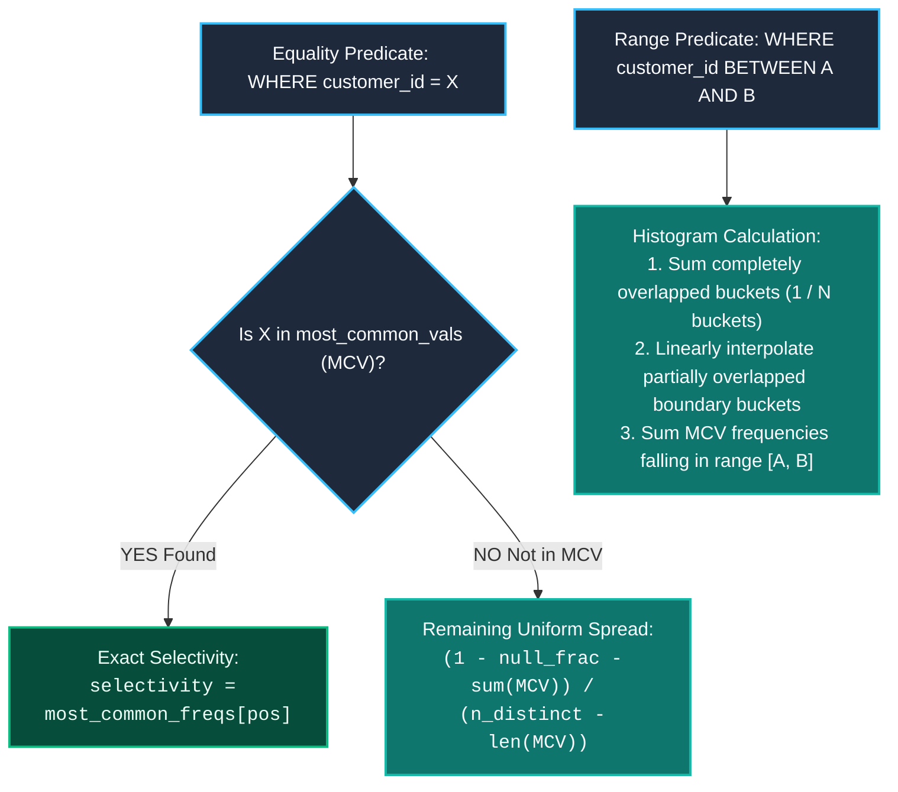

---

## 6.6 Why Selectivity Alone Does Not Determine the Best Plan

Selectivity tells you *how many rows* will be returned, but the planner must also consider:

```text
Factor 1: CORRELATION (physical clustering)
  Low selectivity + high correlation → index range scan might still win
  (because rows are physically adjacent, so I/O is sequential)

Factor 2: WIDTH (row size)
  Narrow rows → more rows per page → fewer pages to read
  Wide rows → fewer rows per page → more random page fetches

Factor 3: OUTPUT COLUMNS
  SELECT customer_id FROM orders WHERE customer_id = 42
  → Index-only scan (don't need heap at all!)

  SELECT * FROM orders WHERE customer_id = 42
  → Must fetch from heap (all columns needed)

Factor 4: JOINS
  Even if a subquery returns many rows, an index on the joined table
  makes the join efficient (Nested Loop + Index Scan)

Factor 5: ORDERING
  If the query has ORDER BY customer_id, an index scan returns rows
  pre-sorted, avoiding an expensive Sort node.

Factor 6: MEMORY (work_mem)
  If work_mem is large enough, a Hash Join with sequential scan
  might beat Nested Loop with index lookups.

Factor 7: PARALLELISM
  Parallel sequential scans can be very fast for large tables,
  potentially beating index scans even for somewhat selective queries.
```

---

# 7. B-Tree Indexes: The Workhorse of Databases

The B-tree is the **default and most important** index type in PostgreSQL (and virtually every relational database). When you write `CREATE INDEX`, you get a B-tree. It supports equality, range, sorting, and uniqueness constraints.

## 7.1 What is a B-Tree? Origin and Algorithm

The B-tree was invented by Rudolf Bayer and Edward McCreight at Boeing Scientific Research Labs in 1970. The "B" most likely stands for "Balanced" (though Bayer never confirmed this — it could stand for Boeing, Bayer, or Broad).

**Core properties of a B-tree of order `m`:**
1. Every node has at most `m` children.
2. Every non-root internal node has at least `⌈m/2⌉` children.
3. The root has at least 2 children (unless it's a leaf).
4. All leaves appear on the same level (perfectly balanced).
5. A non-leaf node with `k` children contains `k−1` keys.

```text
B-tree of order 5 (each node holds 2–4 keys):

                    ┌──────────┐
                    │  [30, 70]│ ← Root
                    └──┬───┬───┘
                       │   │
          ┌────────────┘   └────────────┐
          ▼                             ▼
    ┌──────────┐                  ┌──────────────┐
    │ [10, 20] │                  │ [50, 60, 80] │ ← Internal nodes
    └┬───┬───┬─┘                  └┬───┬───┬───┬─┘
     │   │   │                     │   │   │   │
     ▼   ▼   ▼                     ▼   ▼   ▼   ▼
   [1-9] [11-19] [21-29]      [31-49] [51-59] [61-69] [71-100]
     ↑ Leaf nodes contain the actual data/pointers
```

**The key invariant:** For any key `K` in an internal node:
* All keys in the left subtree are **< K**
* All keys in the right subtree are **≥ K**

This invariant allows binary-search-like navigation from root to leaf.

---

## 7.2 B+Tree: What PostgreSQL Actually Uses

PostgreSQL uses a **B+tree** variant (as do MySQL, Oracle, SQL Server, and virtually all production databases). The B+tree differs from a classic B-tree in critical ways:

```text
Classic B-tree:                          B+tree (what PostgreSQL uses):
─────────────                            ─────────────────────────────
• Data pointers in ALL nodes             • Data pointers ONLY in leaf nodes
• Keys may not repeat                    • Internal node keys are copies/separators
• No leaf-level linking                  • Leaf nodes linked in a doubly-linked list

         ┌────────────┐                          ┌────────────┐
         │ Root       │                          │ Root       │
         │ K=50 → data│                          │ K=50       │  (no data here)
         └──┬─────┬───┘                          └──┬─────┬───┘
            │     │                                 │     │
     ┌──────┘     └──────┐                   ┌──────┘     └──────┐
     ▼                   ▼                   ▼                   ▼
  ┌────────┐        ┌────────┐          ┌─────────┐         ┌─────────┐
  │K=20    │        │K=75    │          │K=20     │         │K=75     │
  │ →data  │        │ →data  │          │(no data)│         │(no data)│
  └┬───┬───┘        └┬───┬───┘          └┬────┬───┘         └─┬───┬───┘
   ▼   ▼              ▼   ▼              ▼    ▼               ▼   ▼
 [leaves]           [leaves]          [10,20]→←→[30,40,50]→←→[60,75]→←→[80,90]
                                        ↑ Leaves linked!      All data here ↑
                                          (enables range scans)
```

**Why B+tree is superior for databases:**

| Feature | B-tree | B+tree |
|:---|:---|:---|
| Data location | All nodes | Leaf nodes only |
| Range scans | Must traverse tree for each next value | Follow leaf-level linked list — O(range_size) |
| Fan-out (keys per internal node) | Lower (data takes space) | **Higher** (internal nodes are pure separators) |
| Tree height for same data | Taller | **Shorter** (more keys per node = wider tree) |
| Sequential scan of all data | Complex tree traversal | Simple linked list walk |
| Cache efficiency | Lower (data mixed with navigation) | **Higher** (internal nodes fit in cache) |

---

## 7.3 Root, Internal, and Leaf Pages: Physical Layout

In PostgreSQL's B+tree implementation, each node is exactly one **8 KB page**:

```text
PostgreSQL B+tree Physical Layout:

Level 0 (Root): 1 page
┌──────────────────────────────────────────────────────────────┐
│ Page Header (24 bytes) | BTreePageOpaque (special space)     │
│                                                              │
│ High Key: ∞ (root has no high key)                           │
│                                                              │
│ ┌────────────┬────────────┬────────────┬────────────┐        │
│ │ sep_key=100│ sep_key=500│ sep_key=900│            │        │
│ │ →child_pg_2│ →child_pg_3│ →child_pg_4│ →child_pg_5│        │
│ └────────────┴────────────┴────────────┴────────────┘        │
│                                                              │
│ BTreePageOpaque:                                             │
│   btpo_prev = 0 (no sibling)                                 │
│   btpo_next = 0 (no sibling)                                 │
│   btpo_level = 2 (root level)                                │
│   btpo_flags = BTP_ROOT                                      │
└──────────────────────────────────────────────────────────────┘

Level 1 (Internal): Multiple pages
┌────────────────────────────┐   ┌────────────────────────────┐
│ Internal Page 2            │   │ Internal Page 3            │
│ High Key: 100              │   │ High Key: 500              │
│                            │   │                            │
│ sep_key=25 → leaf_pg_10    │   │ sep_key=200 → leaf_pg_20   │
│ sep_key=50 → leaf_pg_11    │   │ sep_key=350 → leaf_pg_21   │
│ sep_key=75 → leaf_pg_12    │   │ sep_key=450 → leaf_pg_22   │
│          → leaf_pg_13      │   │          → leaf_pg_23      │
│                            │   │                            │
│ btpo_prev=0  btpo_next=3   │   │ btpo_prev=2  btpo_next=4   │
│ btpo_level=1               │   │ btpo_level=1               │
└────────────────────────────┘   └────────────────────────────┘

Level 2 (Leaf): Many pages (linked list)
┌───────────────────┐ → ┌───────────────────┐ → ┌───────────────────┐
│ Leaf Page 10      │   │ Leaf Page 11      │   │ Leaf Page 12      │
│ High Key: 25      │   │ High Key: 50      │   │ High Key: 75      │
│                   │   │                   │   │                   │
│ key=1 →CTID(0,1)  │   │ key=26 →CTID(5,2) │   │ key=51 →CTID(9,1) │
│ key=3 →CTID(0,3)  │   │ key=27 →CTID(5,4) │   │ key=52 →CTID(9,3) │
│ key=5 →CTID(1,1)  │   │ key=30 →CTID(6,1) │   │ key=55 →CTID(10,2)│
│ key=8 →CTID(1,4)  │   │ key=33 →CTID(6,3) │   │ key=60 →CTID(11,1)│
│ ...               │   │ ...               │   │ ...               │
│ key=24→CTID(4,2)  │   │ key=49→CTID(8,5)  │   │ key=74→CTID(14,3) │
│                   │   │                   │   │                   │
│ prev=0  next=11   │   │ prev=10  next=12  │   │ prev=11  next=13  │
└───────────────────┘   └───────────────────┘   └───────────────────┘
       ↑                        ↑                        ↑
  Doubly-linked list enables forward AND backward range scans
```

```mermaid
flowchart TD
    subgraph Root["Level 0: Root Page (Block 3) — Stored in RAM"]
        RKey["Separator Keys: [100 | 500 | 900]<br/>Child Pointers: [Block 2 | Block 4 | Block 7]"]
    end

    subgraph Internal["Level 1: Internal Branch Pages"]
        direction LR
        I1["Internal Block 2<br/>Keys: [25 | 50 | 75]<br/>Pointers: [L10 | L11 | L12 | L13]"]
        I2["Internal Block 4<br/>Keys: [200 | 350 | 450]<br/>Pointers: [L20 | L21 | L22 | L23]"]
    end

    subgraph Leaves["Level 2: Leaf Pages (Doubly-Linked List)"]
        direction LR
        L10["Leaf Page 10<br/>Keys: 1..24<br/>CTIDs: (0,1)..(4,2)"]
        L11["Leaf Page 11<br/>Keys: 25..49<br/>CTIDs: (5,2)..(8,5)"]
        L12["Leaf Page 12<br/>Keys: 50..74<br/>CTIDs: (9,1)..(14,3)"]
        L13["Leaf Page 13<br/>Keys: 75..99<br/>CTIDs: (15,1)..(19,4)"]
    end

    subgraph Heap["Table Heap Pages (Raw Row Storage)"]
        direction LR
        HP0["Heap Block 0<br/>Row at (0,1)"]
        HP5["Heap Block 5<br/>Row at (5,2)"]
        HP9["Heap Block 9<br/>Row at (9,1)"]
    end

    Root -->|key &lt; 100| I1
    Root -->|100 ≤ key &lt; 500| I2
    I1 -->|key &lt; 25| L10
    I1 -->|25 ≤ key &lt; 50| L11
    I1 -->|50 ≤ key &lt; 75| L12
    I1 -->|key ≥ 75| L13

    L10 <===>|btpo_next / btpo_prev| L11
    L11 <===>|btpo_next / btpo_prev| L12
    L12 <===>|btpo_next / btpo_prev| L13

    L10 -.->|"CTID (0,1)"| HP0
    L11 -.->|"CTID (5,2)"| HP5
    L12 -.->|"CTID (9,1)"| HP9

    classDef rt fill:#1e1b4b,stroke:#6366f1,stroke-width:2px,color:#e0e7ff;
    classDef int fill:#0f766e,stroke:#14b8a6,stroke-width:2px,color:#f8fafc;
    classDef lf fill:#3b0764,stroke:#a855f7,stroke-width:2px,color:#f3e8ff;
    classDef hp fill:#431407,stroke:#f97316,stroke-width:2px,color:#fed7aa;

    class Root,RKey rt;
    class I1,I2 int;
    class L10,L11,L12,L13 lf;
    class HP0,HP5,HP9 hp;
```

**The BTreePageOpaque structure** (stored in the "special space" at the end of each page):
```text
typedef struct BTPageOpaqueData {
    BlockNumber btpo_prev;     /* left sibling page number */
    BlockNumber btpo_next;     /* right sibling page number */
    uint32      btpo_level;    /* tree level (0 = leaf) */
    uint16      btpo_flags;    /* BTP_LEAF, BTP_ROOT, BTP_DELETED, etc. */
} BTPageOpaqueData;
```

---

## 7.4 How a Lookup Navigates the Tree

### Equality Lookup: `WHERE customer_id = 42`

```text
Step 1: Start at root page (always cached in shared_buffers)
  Keys: [100, 500, 900]
  42 < 100 → follow leftmost child pointer → Internal Page 2

Step 2: Read Internal Page 2
  Keys: [25, 50, 75]
  25 ≤ 42 < 50 → follow pointer between 25 and 50 → Leaf Page 11

Step 3: Read Leaf Page 11
  Binary search within the page for key = 42
  Found: key=42 → CTID(7,3)
  
  Check for duplicates: next entry has key=42 → CTID(7,5)
  Next entry has key=42 → CTID(12,1)
  Next entry has key=43 → STOP (key > 42)

  Possible: if duplicates span to the next leaf page,
  follow btpo_next pointer to Leaf Page 12 and continue.

Step 4: Fetch heap tuples using collected CTIDs
  Read heap page 7, items 3 and 5
  Read heap page 12, item 1
  Return rows after MVCC visibility check

Total I/O: 1 root + 1 internal + 1-2 leaf + 2 heap = 5-6 page reads
```

```mermaid
flowchart TD
    Start["Query Predicate: WHERE customer_id = 42"]
    
    subgraph Step1["Step 1: Root Node Inspection (Always RAM Cached)"]
        RKeys{"Root Keys: [100, 500, 900]<br/>Evaluate 42 vs 100"}
        GoL1["42 &lt; 100 ➔ Descend to Leftmost Child Pointer (Internal Block 2)"]
        RKeys --> GoL1
    end

    subgraph Step2["Step 2: Internal Branch Inspection"]
        IKeys{"Internal Keys: [25, 50, 75]<br/>Evaluate 25 ≤ 42 &lt; 50"}
        GoLeaf["Follow Pointer between 25 and 50 ➔ Leaf Page 11"]
        IKeys --> GoLeaf
    end

    subgraph Step3["Step 3: Binary Search on Leaf Page 11"]
        SearchLeaf["Scan Leaf Array for Key = 42<br/>Matches: 42 ➔ CTID (7,3) and CTID (7,5) and CTID (12,1)"]
        CheckNext["Key 43 encountered ➔ Cease Leaf Scan"]
        SearchLeaf --> CheckNext
    end

    subgraph Step4["Step 4: Resolve Physical Heap Tuples"]
        FetchH["Read Heap Blocks 7 & 12 ➔ Check MVCC xmin/xmax Snapshot ➔ Stream Rows to Client"]
    end

    Start --> Step1
    GoL1 --> Step2
    GoLeaf --> Step3
    CheckNext --> Step4

    classDef st fill:#1e293b,stroke:#38bdf8,stroke-width:2px,color:#f8fafc;
    classDef tr fill:#0f766e,stroke:#14b8a6,stroke-width:2px,color:#f8fafc;
    classDef hp fill:#064e3b,stroke:#10b981,stroke-width:2px,color:#ecfdf5;

    class Start,Step1,RKeys,GoL1 st;
    class Step2,IKeys,GoLeaf,Step3,SearchLeaf,CheckNext tr;
    class Step4,FetchH hp;
```

### Range Scan: `WHERE customer_id BETWEEN 30 AND 60`

```text
Step 1-2: Same tree descent to find first key ≥ 30
  → Arrives at Leaf Page 11

Step 3: Scan leaf pages sequentially using sibling pointers
  Leaf Page 11: return entries with keys 30, 33, 35, ..., 49
  Follow btpo_next → Leaf Page 12
  Leaf Page 12: return entries with keys 51, 52, 55, 60
  Next entry has key=61 → STOP (key > 60)

Step 4: Fetch all heap tuples

Total I/O: 1 root + 1 internal + 2 leaf pages + N heap pages
  (N = number of matching rows scattered across the heap)
```

### Ordering: `ORDER BY customer_id ASC`

```text
The B+tree leaf pages are already sorted!
To return rows in order:
  1. Start at the leftmost leaf page
  2. Scan all entries on this page
  3. Follow btpo_next to the next leaf page
  4. Repeat until all leaf pages are scanned

This is why an index scan can ELIMINATE a Sort node from the plan.
Without an index: Seq Scan → Sort (O(n log n) in work_mem or on disk)
With an index: Index Scan → already sorted → no Sort needed
```

### Backward Scan: `ORDER BY customer_id DESC`

```text
B+tree pages have btpo_prev pointers!
  1. Start at the rightmost leaf page
  2. Scan entries in reverse order
  3. Follow btpo_prev to the previous leaf page
  4. Repeat

This is why B-tree indexes support both ASC and DESC ordering.
```

---

## 7.5 Why Tree Height Grows Slowly

The height of a B+tree grows **logarithmically** with the number of rows. Because each page can hold hundreds of keys, the tree stays remarkably short:

```text
Fan-out = number of child pointers per internal node
For INTEGER keys: ~400 entries per page (8 KB page, ~20 bytes per entry)

Height Calculation (fan-out = 400):

Height 1 (root only):        1 page, holds 400 entries
Height 2 (root + leaves):    1 + 400 = 401 pages
                              Max rows: 400 × 400 = 160,000
Height 3:                     1 + 400 + 160,000 = 160,401 pages
                              Max rows: 400³ = 64,000,000 (64 million)
Height 4:                     Max rows: 400⁴ = 25,600,000,000 (25.6 billion)

┌──────────────────────────────────────────────────────────────┐
│  Table Rows       │ Tree Height │ Pages Read per Lookup      │
│───────────────────┼─────────────┼────────────────────────────│
│  < 400            │     1       │  1 page                    │
│  400 – 160K       │     2       │  2 pages                   │
│  160K – 64M       │     3       │  3 pages (most OLTP tables)│
│  64M – 25.6B      │     4       │  4 pages (very large)      │
└──────────────────────────────────────────────────────────────┘

Key insight: Even a table with 100 MILLION rows needs only 3–4 page
reads to find any single row via a B-tree index on an integer column!
And the root page is almost always cached, so effectively 2–3 reads.
```

**Why this is revolutionary:** Without an index, finding one row in 100M rows requires scanning all ~2 million pages. With a B-tree, it requires 3 page reads. That's a **700,000× improvement**.

---

## 7.6 Operations Supported by B-Tree

```text
┌───────────────────────────────────────────────────────────────────────┐
│ Operation              │ B-tree Support  │ How It Works               │
│────────────────────────┼─────────────────┼────────────────────────────│
│ = (equality)           │ ✅ Excellent   │ Tree descent to leaf       │
│ < > <= >=              │ ✅ Excellent   │ Descent + leaf scan        │
│ BETWEEN                │ ✅ Excellent   │ Descent + range scan       │
│ IN (val1, val2, ...)   │ ✅ Good        │ Multiple tree descents     │
│ ORDER BY col ASC       │ ✅ Excellent   │ Forward leaf scan          │
│ ORDER BY col DESC      │ ✅ Excellent   │ Backward leaf scan         │
│ IS NULL / IS NOT NULL  │ ✅ Yes         │ NULLs stored at end        │
│ LIKE 'abc%'            │ ✅ Yes         │ Range scan on prefix       │
│ LIKE '%abc'            │ ❌ No          │ Cannot use index!          │
│ LIKE '%abc%'           │ ❌ No          │ Cannot use index!          │
│ != / <>                │ ❌ No*         │ Would need to scan most    │
│ Functions on column    │ ❌ No**        │ WHERE UPPER(name) = 'FOO'  │
└──────────────────────────────────────────────────────────────────────┘

* <> technically could scan two ranges, but it's almost never selective enough
** Use expression indexes: CREATE INDEX ON t (UPPER(name));
```

### LIKE and Pattern Matching Details

```text
LIKE 'abc%' (prefix match):
  B-tree treats this as a range scan: key >= 'abc' AND key < 'abd'
  ✅ Efficient — uses the index

LIKE '%abc' (suffix match):
  No way to use B-tree — the sorted order doesn't help.
  Must scan every value and check the suffix.
  ❌ Requires sequential scan or GIN/trigram index

LIKE '%abc%' (contains):
  Same problem — B-tree ordering doesn't help.
  ❌ Use pg_trgm extension with GIN index instead:
  CREATE EXTENSION pg_trgm;
  CREATE INDEX idx_name_trgm ON users USING gin (name gin_trgm_ops);

⚠️ COLLATION CAVEAT:
  For LIKE 'abc%' to use a B-tree index, the index must use
  the correct operator class. With non-C locale:
  CREATE INDEX idx_name ON users (name text_pattern_ops);
  -- or varchar_pattern_ops for VARCHAR columns
```

---

## 7.7 Unique Indexes and Uniqueness Enforcement

```sql
-- Explicit unique index:
CREATE UNIQUE INDEX idx_users_email ON users (email);

-- Primary key automatically creates a unique index:
ALTER TABLE users ADD PRIMARY KEY (user_id);
-- Internally: CREATE UNIQUE INDEX users_pkey ON users (user_id);

-- Unique constraint also creates a unique index:
ALTER TABLE users ADD CONSTRAINT uq_email UNIQUE (email);
-- Internally: CREATE UNIQUE INDEX users_email_key ON users (email);
```

**How uniqueness is enforced during INSERT:**

```text
1. Navigate B-tree to find the leaf page where the new key would go
2. Check if any existing entry on that leaf page has the same key
3. If duplicate found:
   a. Check if the duplicate's heap tuple is still visible
      (it might be from an aborted transaction — in that case, not a real duplicate)
   b. If visible and committed → raise ERROR: duplicate key violation
4. If no duplicate: insert the new index entry
5. This check is performed while holding a lock on the index page,
   ensuring concurrent INSERTs can't create duplicates
```

**Partial unique indexes** — enforce uniqueness only for a subset:
```sql
-- Only one active user per email (deleted users can share emails):
CREATE UNIQUE INDEX idx_users_active_email
ON users (email)
WHERE is_deleted = false;
```

---

## 7.8 Page Splits, Fill Factor, and Maintenance

### Page Splits

When a leaf page is full and a new entry must be inserted, PostgreSQL performs a **page split**:

```text
Before split (leaf page is full):
┌─────────────────────────────────────────┐
│ Leaf Page 11 (FULL)                     │
│ [25, 27, 30, 33, 35, 38, 40, 42, 45,    │
│  46, 47, 48, 49]                        │
│ No room for new entry: key=36           │
└─────────────────────────────────────────┘

After split:
┌─────────────────────────┐   ┌─────────────────────────┐
│ Leaf Page 11            │   │ Leaf Page 99 (NEW)      │
│ [25, 27, 30, 33, 35,    │   │ [40, 42, 45, 46, 47,    │
│  36, 38]                │   │  48, 49]                │
│                         │   │                         │
│ next → Page 99          │   │ prev → Page 11          │
│                         │   │ next → Page 12          │
└─────────────────────────┘   └─────────────────────────┘
                                    ↑
                              Also update the parent
                              internal node to add a new
                              separator key (40) pointing
                              to Page 99

Parent page cascade:
  If the parent is also full, IT splits too!
  Splits cascade upward. If the root splits, tree height increases by 1.
```

```mermaid
flowchart TD
    subgraph Before["Before Split: Leaf Page 11 is 100% Full (No Free Space)"]
        direction TB
        FullPage["Leaf Page 11: [25, 27, 30, 33, 35, 38, 40, 42, 45, 46, 47, 48, 49]<br/>New Entry to insert: Key = 36 ➔ 💥 Page Overflow!"]
    end

    subgraph Action["Splitting Operation (Atomic WAL-Logged Event)"]
        direction TB
        Alloc["1. Allocate New 8 KB Block: Leaf Page 99"]
        Distribute["2. Split 50/50: Move keys ≥ 40 to Page 99<br/>Page 11 keeps: [25, 27, 30, 33, 35, 36, 38]<br/>Page 99 holds: [40, 42, 45, 46, 47, 48, 49]"]
        Rewire["3. Rewire Sibling Pointers in Opaque Space:<br/>Page 11.next = 99 | Page 99.prev = 11 | Page 99.next = 12"]
        UpCascade["4. Propagate High Key (40) Upward to Parent Internal Node!"]
        Alloc --> Distribute --> Rewire --> UpCascade
    end

    subgraph After["Resulting Linked Hierarchy"]
        direction LR
        P11["Leaf Page 11"] <===>|prev / next| P99["Leaf Page 99"] <===>|prev / next| P12["Leaf Page 12"]
    end

    Before --> Action --> After

    classDef ov fill:#450a0a,stroke:#ef4444,stroke-width:2px,color:#fee2e2;
    classDef ac fill:#7c2d12,stroke:#f97316,stroke-width:2px,color:#ffedd5;
    classDef res fill:#064e3b,stroke:#10b981,stroke-width:2px,color:#ecfdf5;

    class FullPage ov;
    class Alloc,Distribute,Rewire,UpCascade ac;
    class P11,P99,P12 res;
```

### Fill Factor

PostgreSQL lets you control how full each leaf page is initially, leaving room for future inserts:

```sql
-- Default fill factor: 90% (10% reserved for updates/inserts)
CREATE INDEX idx_orders_customer_id ON orders (customer_id)
WITH (fillfactor = 90);

-- For read-heavy tables with rare inserts:
CREATE INDEX idx_archive_date ON archive (created_at)
WITH (fillfactor = 100);  -- Pack pages fully, no wasted space

-- For write-heavy tables with many inserts between existing values:
CREATE INDEX idx_events_ts ON events (event_time)
WITH (fillfactor = 70);  -- 30% free space for future inserts
```

```text
fillfactor = 90 (default):
┌────────────────────────────────────────────┐
│ ████████████████████████████████░░░░       │
│ ← 90% filled with data →    ← 10% free →   │
│                                            │
│ Future inserts that sort into this page    │
│ range can use the free space without       │
│ causing a page split.                      │
└────────────────────────────────────────────┘

fillfactor = 100 (fully packed):
┌────────────────────────────────────────────┐
│ ████████████████████████████████████████   │
│ ← 100% filled →   No free space!           │
│                                            │
│ ANY new insert into this page range        │
│ will immediately cause a page split.       │
└────────────────────────────────────────────┘
```

**Heuristic:** For monotonically increasing keys (like `SERIAL`, `TIMESTAMP` on append-only tables), use `fillfactor = 100` because new values always go to the rightmost page — old pages are never modified.

---

## 7.9 Index-Only Scans and the Visibility Map

An **index-only scan** (IOS) is the holy grail of index usage. The query is answered entirely from the index, without touching the heap. But PostgreSQL's MVCC model creates a complication.

### The Problem: Index Entries Don't Know About Visibility

```text
Transaction A (started at time T1): SELECT * FROM orders WHERE customer_id = 42;
Transaction B (committed at time T2): DELETE FROM orders WHERE order_id = 1001;

Index entry: customer_id=42 → CTID(0,1)

The index entry still exists and points to the tuple.
But is the tuple visible to Transaction A?
  - If T2 < T1: the DELETE is visible → tuple should NOT be returned
  - If T2 > T1: the DELETE is NOT visible → tuple SHOULD be returned

The index entry itself has NO transaction visibility information!
Only the heap tuple header (t_xmin, t_xmax) contains this.
```

### The Solution: Visibility Map (VM)

PostgreSQL maintains a **Visibility Map** — a bitmap with one bit per heap page:

```text
Visibility Map (VM):
Page: 0  1  2  3  4  5  6  7  8  9  ...
Bit:  1  1  0  1  1  0  1  1  1  1  ...
      ↑  ↑  ↑
      │  │  └─ Page 2: NOT all-visible (has dead tuples or recent changes)
      │  └──── Page 1: All-visible (all tuples visible to all transactions)
      └─────── Page 0: All-visible

Index-Only Scan Logic:
  For each matching index entry (customer_id=42 → CTID(page, item)):
    1. Check VM bit for the target page
    2. If VM bit = 1 (all-visible):
       → Return data from the index entry directly. NO heap fetch!
    3. If VM bit = 0 (not all-visible):
       → Must fetch the heap tuple to check MVCC visibility.
       → This is a "heap fetch" — defeats the purpose of IOS.
```

### VACUUM's Role in Index-Only Scans

```text
VACUUM marks pages as all-visible in the VM.

Before VACUUM:
  VM: [0, 0, 0, 0, 0, 0, 0, 0]  (no pages marked all-visible)
  Index-only scan: must fetch EVERY heap page → same as regular index scan

After VACUUM:
  VM: [1, 1, 1, 1, 0, 1, 1, 1]  (most pages all-visible)
  Index-only scan: only 1 heap fetch (page 4) → much faster!
```

**Key insight:** Index-only scans are only effective on tables that have been recently VACUUMed. On heavily-updated tables, the VM has many zero bits, and the IOS degrades to a regular index scan.

```sql
-- Check how effective your index-only scans are:
EXPLAIN (ANALYZE, BUFFERS) 
SELECT customer_id FROM orders WHERE customer_id = 42;

-- Look for: "Heap Fetches: 0" → perfect index-only scan
-- Bad: "Heap Fetches: 47" → VM bits not set, run VACUUM
```

---

# 8. Composite (Multicolumn) Indexes

A composite index indexes **multiple columns** in a single B-tree. The column order is critical and determines which queries can benefit from the index.

## 8.1 Column Ordering and the Leftmost-Prefix Principle

```sql
CREATE INDEX idx_orders_cust_date ON orders (customer_id, order_date);
```

This creates a B-tree sorted first by `customer_id`, then by `order_date` within each `customer_id`:

```text
Composite B-tree leaf entries (sorted by customer_id, then order_date):

  customer_id │ order_date  │ CTID
  ────────────┼─────────────┼──────
       10     │ 2024-01-15  │ (2,3)
       10     │ 2024-03-22  │ (4,1)
       10     │ 2024-07-10  │ (7,5)
       42     │ 2024-01-05  │ (0,1)   ← Within customer_id=42,
       42     │ 2024-02-14  │ (1,1)      order_date is sorted!
       42     │ 2024-06-30  │ (5,8)
       42     │ 2024-11-25  │ (9,2)
       55     │ 2024-04-18  │ (3,4)
       55     │ 2024-09-01  │ (6,2)
       99     │ 2024-08-12  │ (8,1)
```

**The Leftmost-Prefix Principle:** A composite index `(A, B, C)` can be used for queries that filter on:
```text
✅ (A)                    → Full use of first column
✅ (A, B)                 → Full use of first two columns
✅ (A, B, C)              → Full use of all columns
⚠️ (A, C)                → Uses A, then scans for C within A's range
❌ (B)                    → Cannot use the index at all!
❌ (C)                    → Cannot use the index at all!
❌ (B, C)                 → Cannot use the index at all!

Think of it like a phone book sorted by (Last Name, First Name):
  ✅ Find all "Smith" → scan the Smith section
  ✅ Find "Smith, Alice" → binary search within Smith
  ❌ Find all "Alice" → must scan the entire phone book!
     (because Alices are scattered: "Adams, Alice", "Baker, Alice", "Smith, Alice", ...)
```

```mermaid
flowchart TD

    subgraph Queries["Query Predicate Compatibility"]
        direction TB
        Q1["WHERE A = 1<br/>➔ ✅ Fast B-Tree Seek (Uses leftmost leading prefix)"]
        Q2["WHERE A = 1 AND B = 2<br/>➔ ✅ Fast B-Tree Seek (Uses composite prefix A + B)"]
        Q3["WHERE A = 1 AND B = 2 AND C = 3<br/>➔ ✅ Point Seek (Tightly constrained on all 3 keys)"]
        Q4["WHERE B = 2<br/>➔ ❌ Unusable for Tree Descent (Scattered across every A value!)"]
        Q5["WHERE C = 3<br/>➔ ❌ Unusable for Tree Descent (Scattered across every A and B!)"]
        Q6["WHERE A = 1 AND C = 3<br/>➔ ⚠️ Seeks to A=1, but must scan all items to test C"]
    end

    subgraph TreeIndex["Composite B-Tree Hierarchy: INDEX (A, B, C)"]
        direction TB
        ColA["Leading Column: A<br/><i>(Sorted globally across the entire tree)</i>"]
        ColB["Sub-Column: B<br/><i>(Sorted ONLY within identical values of A)</i>"]
        ColC["Sub-Column: C<br/><i>(Sorted ONLY within identical values of A and B)</i>"]
        ColA --> ColB --> ColC
    end


    classDef tr fill:#1e293b,stroke:#38bdf8,stroke-width:2px,color:#f8fafc;
    classDef ok fill:#064e3b,stroke:#10b981,stroke-width:2px,color:#ecfdf5;
    classDef bad fill:#450a0a,stroke:#ef4444,stroke-width:2px,color:#fee2e2;
    classDef wrn fill:#7c2d12,stroke:#f97316,stroke-width:2px,color:#ffedd5;

    class ColA,ColB,ColC tr;
    class Q1,Q2,Q3 ok;
    class Q4,Q5 bad;
    class Q6 wrn;
```

---

## 8.2 Equality Before Range: The Design Heuristic

When designing a composite index, **put equality-predicate columns first and range-predicate columns last**:

```text
Query: WHERE customer_id = 42 AND order_date BETWEEN '2024-01-01' AND '2024-06-30'

Option A: INDEX (customer_id, order_date)  ← BETTER
  Step 1: Navigate tree to customer_id = 42 (equality → pinpoint exact location)
  Step 2: Scan order_date from '2024-01-01' to '2024-06-30' (range within that section)
  
  Index entries scanned: Only the matching range within customer_id=42
  ┌─────────────────────────────────────────────────────┐
  │ 42 │ 2024-01-05 │ ← START scanning here             │
  │ 42 │ 2024-02-14 │ ← match                           │
  │ 42 │ 2024-06-30 │ ← match                           │
  │ 42 │ 2024-11-25 │ ← STOP (past range)               │
  └─────────────────────────────────────────────────────┘
  Scanned: 4 entries ✓

Option B: INDEX (order_date, customer_id)  ← WORSE
  Step 1: Navigate tree to order_date = '2024-01-01' (range start)
  Step 2: Scan forward until order_date = '2024-06-30'
  Step 3: For EACH date entry, check if customer_id = 42
  
  Index entries scanned: ALL entries in the date range for ALL customers
  ┌─────────────────────────────────────────────────────┐
  │ 2024-01-05 │ 42  │ ← match                          │
  │ 2024-01-15 │ 10  │ ← skip (wrong customer)          │
  │ 2024-02-14 │ 42  │ ← match                          │
  │ 2024-03-22 │ 10  │ ← skip                           │
  │ 2024-04-18 │ 55  │ ← skip                           │
  │ 2024-06-30 │ 42  │ ← match                          │
  └─────────────────────────────────────────────────────┘
  Scanned: 6 entries (read 3 extra non-matching entries)
```

```mermaid
flowchart TD

    subgraph Worse["Option B: INDEX (order_date, customer_id) — RANGE FIRST (Suboptimal)"]
        direction TB
        R1["1. Range Seek start: order_date = '2024-01-01'"]
        R2["2. Must scan ALL orders across EVERY customer in the date window!"]
        R3["⚠️ Wide Scan: Inspects non-matching customers row-by-row. Slower!"]
        R1 --> R2 --> R3
    end
    
    subgraph Better["Option A: INDEX (customer_id, order_date) — EQUALITY FIRST (Optimal)"]
        direction TB
        E1["1. Direct Tree Seek to customer_id = 42 (Equality pinpoint)"]
        E2["2. Contiguous leaf scan on order_date range [Jan 1 .. Jun 30]"]
        E3["✅ Tight Range: Scans ONLY 4 matching entries. Zero wasted reads!"]
        E1 --> E2 --> E3
    end


    classDef bt fill:#064e3b,stroke:#10b981,stroke-width:2px,color:#ecfdf5;
    classDef ws fill:#7c2d12,stroke:#f97316,stroke-width:2px,color:#ffedd5;
    class Better,E1,E2,E3 bt;
    class Worse,R1,R2,R3 ws;
```

**The rule:** `= column, = column, ..., range column` gives the tightest possible index scan range.

---

## 8.3 WHERE, JOIN, and ORDER BY Interactions

A composite index can serve **multiple purposes** in a single query:

```sql
-- Query:
SELECT o.order_id, o.total_amount, c.customer_name
FROM orders o
JOIN customers c ON o.customer_id = c.customer_id
WHERE o.customer_id = 42
  AND o.order_date >= '2024-01-01'
ORDER BY o.order_date DESC;

-- Ideal composite index:
CREATE INDEX idx_orders_cust_date ON orders (customer_id, order_date DESC);

-- This single index serves THREE purposes:
-- 1. WHERE customer_id = 42        → uses column 1 (equality)
-- 2. WHERE order_date >= '2024-01-01' → uses column 2 (range)
-- 3. ORDER BY order_date DESC      → index is already sorted DESC!
--                                     No separate Sort node needed.
```

```text
Without the index:
  Seq Scan → Filter → Sort → Nested Loop Join
  Cost: High (sort in memory/disk)

With the composite index:
  Index Scan (backward) → Nested Loop Join
  Cost: Low (no sort, minimal pages read)
```

---

## 8.4 Mixed Sort Directions (ASC/DESC)

By default, B-tree indexes sort all columns in ascending order. But queries may need mixed directions:

```sql
-- Query: "Latest orders first, within each date show cheapest first"
SELECT * FROM orders
ORDER BY order_date DESC, total_amount ASC
LIMIT 100;

-- Default index won't help efficiently:
CREATE INDEX idx_date_amount ON orders (order_date, total_amount);
-- This sorts: order_date ASC, total_amount ASC
-- For DESC/ASC: PostgreSQL would need to scan backward for date
-- but forward for amount — these conflict!

-- Solution: Match the sort directions exactly:
CREATE INDEX idx_date_desc_amount_asc 
ON orders (order_date DESC, total_amount ASC);
-- Now the leaf-level order EXACTLY matches the query's ORDER BY
-- → Forward index scan, no sorting needed
```

```text
Index with (order_date DESC, total_amount ASC):

  order_date  │ total_amount │ CTID
  ────────────┼──────────────┼──────
  2024-12-31  │    15.00     │ (99,1)    ← Latest date first
  2024-12-31  │    45.00     │ (99,3)    ← Within same date, cheapest first
  2024-12-31  │   250.00     │ (99,5)
  2024-12-30  │    10.00     │ (98,2)
  2024-12-30  │    89.00     │ (98,4)
  ...
```

---

## 8.5 Composite Indexes for Grouping and Pagination

### GROUP BY Optimization

```sql
-- Query:
SELECT customer_id, COUNT(*), SUM(total_amount)
FROM orders
GROUP BY customer_id;

-- With INDEX (customer_id):
-- The index returns rows pre-grouped by customer_id
-- → GroupAggregate node (streaming, no hash table needed)
-- → Memory-efficient for high-cardinality grouping columns
```

### Keyset Pagination (Seek Method)

```sql
-- Traditional OFFSET pagination (SLOW for large offsets):
SELECT * FROM orders ORDER BY created_at DESC LIMIT 20 OFFSET 10000;
-- Must scan and discard 10,000 rows!

-- Keyset pagination (FAST, uses index):
SELECT * FROM orders 
WHERE created_at < '2024-06-15T10:30:00'  -- last seen timestamp
ORDER BY created_at DESC 
LIMIT 20;

-- With INDEX (created_at DESC): instant seek to the right position
-- No rows discarded!

-- For ties in created_at, add a tiebreaker:
CREATE INDEX idx_orders_pagination ON orders (created_at DESC, order_id DESC);

SELECT * FROM orders
WHERE (created_at, order_id) < ('2024-06-15T10:30:00', 5432)
ORDER BY created_at DESC, order_id DESC
LIMIT 20;
```

---

## 8.6 Can One Composite Index Replace Multiple Single-Column Indexes?

```text
Given: INDEX (A, B, C)

Can it replace...?

INDEX (A):          ✅ YES — leftmost prefix
INDEX (B):          ❌ NO  — B is not the leftmost column
INDEX (C):          ❌ NO  — C is not the leftmost column
INDEX (A, B):       ✅ YES — leftmost prefix
INDEX (B, C):       ❌ NO  — B is not the leftmost column
INDEX (A, C):       ⚠️ PARTIALLY — uses A, but C requires filter within A's results
INDEX (A, B, C):    ✅ YES — exact match

Practical strategy:
  If you have queries on (A), (A,B), and (A,B,C):
    → ONE index (A, B, C) serves all three!
    → Delete the separate (A) and (A,B) indexes — they're redundant!

  If you also have queries on (B) alone:
    → You still need a separate INDEX (B)
    → The composite index (A, B, C) cannot help with B-only queries
```

**Finding redundant indexes:**
```sql
-- Find indexes that are prefixes of other indexes (candidates for removal):
SELECT
    i1.indexrelid::regclass AS redundant_index,
    i2.indexrelid::regclass AS covering_index,
    pg_size_pretty(pg_relation_size(i1.indexrelid)) AS wasted_space
FROM pg_index i1
JOIN pg_index i2 ON i1.indrelid = i2.indrelid
    AND i1.indexrelid <> i2.indexrelid
    AND i1.indkey::text = (
        SELECT string_agg(x::text, ' ')
        FROM unnest(i2.indkey[1:array_length(i1.indkey, 1)]) x
    )
WHERE i1.indrelid = 'orders'::regclass;
```

---

## 8.7 Bitmap Scans: Combining Separate Indexes

When a query filters on multiple columns and separate single-column indexes exist, PostgreSQL can combine them using **Bitmap AND/OR**:

```sql
-- Separate indexes:
CREATE INDEX idx_orders_status ON orders (status);
CREATE INDEX idx_orders_customer ON orders (customer_id);

-- Query using both:
SELECT * FROM orders
WHERE status = 'pending' AND customer_id = 42;
```

```text
Execution Plan:

BitmapAnd
  ├── Bitmap Index Scan on idx_orders_status
  │   Index Cond: (status = 'pending')
  │   → Bitmap: pages {0,1,3,5,7,8,12,15,...}  (pages with 'pending' rows)
  │
  └── Bitmap Index Scan on idx_orders_customer
      Index Cond: (customer_id = 42)
      → Bitmap: pages {0,1,5,9,12,...}  (pages with customer_id=42 rows)

  → BitmapAnd result: pages {0,1,5,12,...}  (intersection)
  → Bitmap Heap Scan: read only those pages, recheck both conditions

vs. Composite Index (customer_id, status):
  → Single index lookup: one tree descent
  → Usually faster than bitmap combination
  → BUT requires maintaining one more composite index
```

**Trade-off:** Bitmap combination is clever but generally slower than a single composite index. However, bitmap combination avoids the maintenance cost of extra indexes.

---

## 8.8 Column Order with Different Distributions

```text
Scenario: Query filters on both region (5 values) and product_id (10,000 values)

WHERE region = 'APAC' AND product_id = 7890

Option A: INDEX (region, product_id)
  Selectivity of first column: 1/5 = 20%
  Within that 20%, find product_id = 7890: 1/10000
  Combined: 0.002%
  Index reads: Navigate to region='APAC' section (big),
               then find product_id=7890 within it

Option B: INDEX (product_id, region)
  Selectivity of first column: 1/10000 = 0.01%
  Within that 0.01%, find region='APAC': ~always 1 or few entries
  Combined: 0.002% (same result)
  Index reads: Navigate to product_id=7890 section (tiny),
               then find region='APAC' within it

Both give the same FINAL selectivity, but Option B is slightly
more efficient because the first column narrows down more aggressively,
meaning fewer index entries are scanned at the leaf level.

HEURISTIC: Put the more selective (higher cardinality) column first
when both are equality predicates.
```

---

## 8.9 Write Amplification and Redundant Indexes

```text
Table: orders with these indexes:
  1. PRIMARY KEY (order_id)
  2. INDEX (customer_id)
  3. INDEX (customer_id, order_date)     ← INDEX 2 is redundant!
  4. INDEX (status)
  5. INDEX (order_date, status)
  6. INDEX (customer_id, status)
  7. INDEX (customer_id, status, order_date)  ← INDEX 6 is redundant!

Every INSERT must update ALL 7 indexes.
Indexes 2 and 6 are redundant (covered by 3 and 7 respectively).

Removing redundant indexes:
  - Saves 2 index writes per INSERT
  - Saves 2 index scans per VACUUM
  - Saves disk space
  - Reduces WAL volume
  - Faster replication

Audit query:
SELECT
    indexrelname,
    idx_scan,
    pg_size_pretty(pg_relation_size(indexrelid)) AS size
FROM pg_stat_user_indexes
WHERE schemaname = 'public'
  AND indexrelname NOT LIKE '%_pkey'
ORDER BY idx_scan ASC;
-- idx_scan = 0 means the index has NEVER been used → candidate for removal
```

---

# 9. Covering Indexes (INCLUDE Columns)

A **covering index** is an index that contains **all columns** needed by a query, enabling index-only scans. PostgreSQL 11 introduced the `INCLUDE` clause for this purpose.

## 9.1 Key Columns vs Included Columns

```sql
-- Regular composite index:
CREATE INDEX idx_orders_cust_date ON orders (customer_id, order_date);
-- Both columns are KEY columns → sorted, searchable, used for comparisons

-- Covering index with INCLUDE:
CREATE INDEX idx_orders_cust_cover ON orders (customer_id)
INCLUDE (order_date, total_amount, status);
-- customer_id is a KEY column → sorted, searchable
-- order_date, total_amount, status are INCLUDED → stored but NOT sorted, NOT searchable
```

```text
Key Column vs Included Column:

┌──────────────────────────────────────────────────────────────────┐
│ Feature              │ Key Column        │ Included Column       │
│──────────────────────┼───────────────────┼───────────────────────│
│ Stored in index?     │ ✅ Yes            │ ✅ Yes               │
│ Sorted?              │ ✅ Yes            │ ❌ No                │
│ Used in tree search? │ ✅ Yes            │ ❌ No                │
│ WHERE clause?        │ ✅ Yes            │ ❌ No                │
│ ORDER BY?            │ ✅ Yes            │ ❌ No                │
│ Affects tree shape?  │ ✅ Yes            │ ❌ No                │
│ Index-only scan?     │ ✅ Yes            │ ✅ Yes               │
│ In internal nodes?   │ ✅ Yes            │ ❌ No (leaf only!)   │
│ Uniqueness?          │ ✅ Checked        │ ❌ Ignored           │
└──────────────────────────────────────────────────────────────────┘

Critical insight: INCLUDE columns are stored ONLY in leaf pages,
not in internal (branch) pages. This means:
  - Internal pages stay small → higher fan-out → shorter tree
  - Leaf pages are wider → fewer entries per leaf page
  - Net effect: tree is slightly wider but same height
```

```text
Internal node (NO included columns):
┌────────────────────────────────────┐
│ sep_key=42 → child_pg  (compact!)  │
│ sep_key=55 → child_pg              │
│ sep_key=99 → child_pg              │
│ ... (many more keys fit)           │
└────────────────────────────────────┘

Leaf node (WITH included columns):
┌──────────────────────────────────────────────────────────┐
│ key=42 │ order_date=2024-01-05 │ total=299.99 │ status   │ → CTID(0,1)
│ key=42 │ order_date=2024-02-14 │ total=175.25 │ status   │ → CTID(1,1)
│ key=42 │ order_date=2024-06-30 │ total=89.00  │ status   │ → CTID(5,8)
│ (fewer entries fit per page because each entry is wider) │
└──────────────────────────────────────────────────────────┘
```

```mermaid
flowchart TD
    subgraph NonCover["Standard Composite Index: (customer_id, total_amount)"]
        direction TB
        NC_Branch["Branch/Internal Node:<br/>Stores BOTH (customer_id, total_amount)<br/>⚠️ Fewer keys per 8 KB page ➔ Taller tree"]
        NC_Leaf["Leaf Page:<br/>Stores BOTH keys (sorted)"]
        NC_Branch --> NC_Leaf
    end

    subgraph Cover["Covering Index with INCLUDE: (customer_id) INCLUDE (total_amount)"]
        direction TB
        C_Branch["Branch/Internal Node:<br/>Stores ONLY customer_id (Compact!)<br/>✅ High fan-out (~400/page) ➔ Short tree"]
        C_Leaf["Leaf Page:<br/>Key: customer_id (sorted)<br/>Payload: total_amount (unordered data)"]
        C_Branch --> C_Leaf
    end

    classDef nc fill:#7c2d12,stroke:#f97316,stroke-width:2px,color:#ffedd5;
    classDef cv fill:#064e3b,stroke:#10b981,stroke-width:2px,color:#ecfdf5;

    class NonCover,NC_Branch,NC_Leaf nc;
    class Cover,C_Branch,C_Leaf cv;
```

---

## 9.2 Index-Only Scans vs Ordinary Index Scans

```sql
-- Ordinary index (no covering):
CREATE INDEX idx_cust ON orders (customer_id);

-- Query needs total_amount, which is NOT in the index:
SELECT customer_id, total_amount FROM orders WHERE customer_id = 42;
-- Plan: Index Scan → heap fetch for every row (to get total_amount)
-- I/O: 3 index pages + 50 heap pages = 53 pages

-- Covering index:
CREATE INDEX idx_cust_cover ON orders (customer_id) INCLUDE (total_amount);

-- Same query:
SELECT customer_id, total_amount FROM orders WHERE customer_id = 42;
-- Plan: Index Only Scan → NO heap fetches (if VM bits are set)
-- I/O: 3 index pages + 0 heap pages = 3 pages
--                                      ↑ 17× fewer page reads!
```

```mermaid
flowchart LR
    subgraph Ord["Ordinary Index: idx_cust (customer_id)"]
        direction TB
        O_Idx["1. Read 3 Index Pages"]
        O_Heap["2. Fetch 50 Heap Pages for total_amount (Random I/O)"]
        O_Total["<b>Total I/O: 53 Pages Read</b>"]
        O_Idx --> O_Heap --> O_Total
    end

    subgraph Cov["Covering Index: (customer_id) INCLUDE (total_amount)"]
        direction TB
        C_Idx["1. Read 3 Index Pages (Payload included in leaf!)"]
        C_Heap["2. Heap Fetches: 0 (Visibility Map = 1)"]
        C_Total["<b>Total I/O: 3 Pages Read (17× Reduction!)</b>"]
        C_Idx --> C_Heap --> C_Total
    end

    classDef ord fill:#7c2d12,stroke:#f97316,stroke-width:2px,color:#ffedd5;
    classDef cov fill:#064e3b,stroke:#10b981,stroke-width:2px,color:#ecfdf5;

    class Ord,O_Idx,O_Heap,O_Total ord;
    class Cov,C_Idx,C_Heap,C_Total cov;
```

---

## 9.3 Visibility Map and Heap Fetches

Even with a covering index, an index-only scan may still need heap fetches:

```sql
EXPLAIN (ANALYZE, BUFFERS)
SELECT customer_id, total_amount FROM orders WHERE customer_id = 42;

-- After VACUUM:
-- Index Only Scan using idx_cust_cover on orders
--   Heap Fetches: 0          ← Perfect! All VM bits set
--   Buffers: shared hit=3

-- Before VACUUM (on recently-modified table):
-- Index Only Scan using idx_cust_cover on orders
--   Heap Fetches: 47         ← Bad! Must visit heap for most rows
--   Buffers: shared hit=3 read=35
```

**Recipe for effective covering indexes:**
1. Create the covering index with `INCLUDE` columns
2. Ensure `autovacuum` runs frequently enough to maintain the VM
3. For critical tables, consider more aggressive vacuum settings:
```sql
ALTER TABLE orders SET (
    autovacuum_vacuum_threshold = 50,
    autovacuum_vacuum_scale_factor = 0.01  -- 1% instead of default 20%
);
```

---

## 9.4 Covering Indexes for Reporting Workloads

Covering indexes shine for **reporting queries** that aggregate over a few columns:

```sql
-- Dashboard query: daily revenue by customer tier
SELECT
    d.fiscal_quarter,
    c.customer_tier,
    SUM(f.net_amount) AS total_revenue,
    COUNT(*) AS order_count
FROM fact_sales_order_lines f
JOIN dim_date d ON f.order_date_fk = d.date_key
JOIN dim_customer c ON f.customer_fk = c.customer_sk
WHERE d.calendar_year = 2024
GROUP BY d.fiscal_quarter, c.customer_tier;

-- Covering index on the fact table:
CREATE INDEX idx_fact_cover ON fact_sales_order_lines
    (order_date_fk, customer_fk)
    INCLUDE (net_amount);

-- This allows an index-only scan on the fact table,
-- which is the largest table in the join.
-- The dimension joins still need heap access, but they're small.
```

---

## 9.5 Storage and Write Costs of Included Columns

```text
Without INCLUDE:
  Index entry: key(4 bytes) + CTID(6 bytes) + overhead(8 bytes) = 18 bytes
  Per page: ~400 entries
  For 1M rows: ~2,500 pages = 20 MB

With INCLUDE (total_amount NUMERIC(10,2), status VARCHAR(20)):
  Index entry: key(4) + CTID(6) + overhead(8) + total(8) + status(avg 10) = 36 bytes
  Per page: ~200 entries
  For 1M rows: ~5,000 pages = 40 MB  (2× the size!)

Write overhead:
  Every INSERT/UPDATE must write the included column values to the index too.
  If total_amount or status changes → new index entry (even though they're not key columns).
```

---

## 9.6 Why Very Wide Covering Indexes Are Counterproductive

```sql
-- Anti-pattern: "covering everything"
CREATE INDEX idx_orders_everything ON orders (customer_id)
INCLUDE (order_date, total_amount, status, shipping_address,
         billing_address, notes, created_at, updated_at,
         payment_method, discount_code, tax_amount, ...);

-- Problems:
-- 1. Index is nearly as large as the table itself → defeats the purpose
-- 2. EVERY write to ANY included column triggers an index update
-- 3. Fewer entries per leaf page → taller tree → more pages to read
-- 4. More data to write to WAL → slower replication
-- 5. VACUUM takes longer to process the larger index
```

**Rule of thumb:** Include only the 2–4 columns that your most frequent queries need. If you find yourself including more than 5 columns, you're probably better off with a sequential scan or a materialized view.

---

## 9.7 Covering Indexes for Aggregation, Pagination, Dashboards

### Aggregation

```sql
-- "How many orders per customer?" (runs every minute on a dashboard)
SELECT customer_id, COUNT(*) 
FROM orders 
GROUP BY customer_id;

-- Covering index (customer_id is the only column needed):
CREATE INDEX idx_orders_cust ON orders (customer_id);
-- Index-only scan: scans leaf pages, counts entries per customer_id
-- No heap access at all!
```

### Keyset Pagination with Covering

```sql
-- Paginated order list showing order_id, date, amount:
SELECT order_id, order_date, total_amount
FROM orders
WHERE customer_id = 42
  AND (order_date, order_id) < ('2024-06-15', 5432)
ORDER BY order_date DESC, order_id DESC
LIMIT 20;

-- Perfect covering index:
CREATE INDEX idx_orders_pagination ON orders 
    (customer_id, order_date DESC, order_id DESC)
    INCLUDE (total_amount);
-- Index-only scan: seek to position, read 20 entries, return immediately
```

---

# 10. Hash Indexes

Hash indexes use a hash function to map key values to bucket locations. They are a specialized index type optimized for **equality lookups only**.

## 10.1 How Hash Functions Work

```text
A hash function takes an input value and produces a fixed-size integer (hash code):

  hash("alice@example.com")  →  4,271,893,021
  hash("bob@example.com")    →  1,838,472,956
  hash("carol@example.com")  →  3,492,108,774

Properties of a good hash function:
  1. Deterministic: same input always produces same output
  2. Uniform distribution: outputs are spread evenly across the output range
  3. Avalanche effect: small input changes cause large output changes
     hash("alice@example.com")  → 4,271,893,021
     hash("alicf@example.com")  → 987,234,112   (completely different!)
  4. Fast to compute: O(n) where n is the input length

PostgreSQL uses a variant of the Jenkins hash function for hash indexes.
```

### Hash Index Structure

```text
Hash Index Physical Layout:

┌───────────────────────────────────────────────────────────────┐
│ Meta Page (Page 0)                                            │
│   - Number of buckets (power of 2)                            │
│   - High mask / Low mask (for bucket calculation)             │
│   - Max bucket                                                │
│   - Number of overflow pages                                  │
│   - Free page list                                            │
└───────────────────────────────────────────────────────────────┘

┌──────────────┐  ┌──────────────┐  ┌──────────────┐  ┌──────────────┐
│ Bucket 0     │  │ Bucket 1     │  │ Bucket 2     │  │ Bucket 3     │
│ (Primary     │  │ (Primary     │  │ (Primary     │  │ (Primary     │
│  Page)       │  │  Page)       │  │  Page)       │  │  Page)       │
│              │  │              │  │              │  │              │
│ hash=0       │  │ hash=1       │  │ hash=2       │  │ hash=3       │
│ "alice"→(2,3)│  │ "bob"→(0,1)  │  │ "dave"→(5,2) │  │ "carol"→(1,4)│
│ "eve"→(7,1)  │  │ "frank"→(3,2)│  │              │  │ "grace"→(4,1)│
│              │  │              │  │              │  │ "heidi"→(6,3)│
│              │  │    │         │  │              │  │    │         │
│              │  │    ▼         │  │              │  │    ▼         │
│              │  │ ┌──────────┐ │  │              │  │ ┌──────────┐ │
│              │  │ │ Overflow │ │  │              │  │ │ Overflow │ │
│              │  │ │ Page     │ │  │              │  │ │ Page     │ │
│              │  │ │"ivan"→   │ │  │              │  │ │"judy"→   │ │
│              │  │ │  (8,2)   │ │  │              │  │ │  (9,1)   │ │
│              │  │ └──────────┘ │  │              │  │ └──────────┘ │
└──────────────┘  └──────────────┘  └──────────────┘  └──────────────┘
```

```mermaid
flowchart TD
    subgraph HashMeta["Hash Index Meta Page (Page 0)"]
        MP["Meta Page Header<br/>• Bucket Count: 4 (2^2)<br/>• High/Low Bitmasks<br/>• Max Bucket Pointer<br/>• Overflow Page Map"]
    end

    subgraph Buckets["Primary Bucket Pages"]
        B0["Bucket 0 (Primary Page)<br/>Hash % 4 = 0<br/>• 'alice' → CTID (2,3)<br/>• 'eve' → CTID (7,1)"]
        B1["Bucket 1 (Primary Page)<br/>Hash % 4 = 1<br/>• 'bob' → CTID (0,1)<br/>• 'frank' → CTID (3,2)"]
        B2["Bucket 2 (Primary Page)<br/>Hash % 4 = 2<br/>• 'dave' → CTID (5,2)"]
        B3["Bucket 3 (Primary Page)<br/>Hash % 4 = 3<br/>• 'carol' → CTID (1,4)<br/>• 'grace' → CTID (4,1)<br/>• 'heidi' → CTID (6,3)"]
    end

    subgraph Overflows["Overflow Pages (Chained Singly-Linked)"]
        OV1["Overflow Page 1A<br/>• 'ivan' → CTID (8,2)"]
        OV3["Overflow Page 3A<br/>• 'judy' → CTID (9,1)"]
    end

    MP --> B0
    MP --> B1
    MP --> B2
    MP --> B3
    B1 -.->|"Bucket Full (Ovf Pointer)"| OV1
    B3 -.->|"Bucket Full (Ovf Pointer)"| OV3

    classDef meta fill:#4a148c,stroke:#ab47bc,stroke-width:2px,color:#ffffff
    classDef bucket fill:#0d47a1,stroke:#42a5f5,stroke-width:2px,color:#ffffff
    classDef ovf fill:#b71c1c,stroke:#ef5350,stroke-width:2px,color:#ffffff
    class MP meta
    class B0,B1,B2,B3 bucket
    class OV1,OV3 ovf
```

---

## 10.2 Hash Collisions

A **hash collision** occurs when two different values produce the same hash code (or map to the same bucket):

```text
hash("alice") mod 4 = 0
hash("eve")   mod 4 = 0    ← COLLISION! Same bucket as "alice"

This does NOT mean alice = eve!

Collision handling:
  1. Both entries are stored in Bucket 0
  2. During lookup for WHERE name = 'eve':
     a. Compute hash('eve') mod 4 = 0
     b. Go to Bucket 0
     c. Find entry: "alice" → compare with 'eve' → NOT equal, skip
     d. Find entry: "eve"   → compare with 'eve' → EQUAL, return CTID
  3. The hash narrows the search to one bucket;
     then a linear scan within the bucket checks exact values

With a good hash function and enough buckets, collisions are rare,
and each bucket contains very few entries → near O(1) lookup.
```

```mermaid
flowchart TD
    Q["Query: SELECT * FROM users WHERE name = 'eve'"] --> HASH["Compute 32-bit Hash<br/>Jenkins Hash('eve') = 0x8A42..."]
    HASH --> MOD["Calculate Bucket Index<br/>hash & low_mask = Bucket 0"]
    MOD --> READ_META["Read Meta Page / Buffer Cache<br/>Locate physical block for Bucket 0"]
    READ_META --> BUCKET0["Read Bucket 0 Primary Page<br/>Linear scan through items"]
    BUCKET0 --> COMP1["Check Item 1: 'alice'<br/>Exact match? ❌ NO (Collision: skip)"]
    COMP1 --> COMP2["Check Item 2: 'eve'<br/>Exact match? ✅ YES! (Match found)"]
    COMP2 --> CTID["Extract CTID (7,1)"]
    CTID --> HEAP["Fetch Heap Tuple from Block 7, Offset 1"]

    classDef query fill:#1a237e,stroke:#3949ab,stroke-width:2px,color:#ffffff
    classDef process fill:#004d40,stroke:#00897b,stroke-width:2px,color:#ffffff
    classDef branch fill:#bf360c,stroke:#f4511e,stroke-width:2px,color:#ffffff
    classDef hit fill:#1b5e20,stroke:#4caf50,stroke-width:2px,color:#ffffff

    class Q query
    class HASH,MOD,READ_META,BUCKET0 process
    class COMP1 branch
    class COMP2,CTID,HEAP hit
```

---

## 10.3 Why Hash Indexes Only Support Equality

```text
Hash function behavior:
  hash(10) = 83742
  hash(11) = 29183
  hash(12) = 57291

Notice: hash(10) < hash(12) but 10 < 11 < 12 in natural order.
The hash values do NOT preserve the ordering of the original values!

Consequences:
  WHERE customer_id = 42          → hash(42), go to bucket → ✅ Works
  WHERE customer_id > 42          → hash(43)? hash(44)? hash(45)?...
                                    Would need to compute hash for EVERY
                                    possible value and check each bucket → ❌ Useless
  WHERE customer_id BETWEEN 10 AND 50 → Same problem → ❌ Useless
  ORDER BY customer_id            → Hash order ≠ value order → ❌ Useless
  WHERE customer_id IN (1,2,3)    → Can do hash(1), hash(2), hash(3) separately → ✅ Works

B-tree preserves order → supports =, <, >, <=, >=, BETWEEN, ORDER BY
Hash destroys order   → supports = only
```

---

## 10.4 Hash vs B-Tree: When to Choose Which

```text
┌─────────────────────────────────────────────────────────────────────────┐
│ Criterion              │ B-tree                │ Hash                   │
│────────────────────────┼───────────────────────┼────────────────────────│
│ Equality (=)           │ O(log n) pages        │ O(1) pages (amortized) │
│ Range (<, >, BETWEEN)  │ ✅ Supported          │ ❌ Not supported      │
│ ORDER BY               │ ✅ Supported          │ ❌ Not supported      │
│ UNIQUE constraint      │ ✅ Supported          │ ❌ Not supported      │
│ Multicolumn            │ ✅ Up to 32 columns   │ ❌ Single column only │
│ INCLUDE (covering)     │ ✅ Supported (PG 11+) │ ❌ Not supported      │
│ Index size             │ Moderate              │ Can be smaller for     │
│                        │                       │ large keys (fixed hash)│
│ Write overhead         │ O(log n) per write    │ O(1) amortized         │
│ WAL logging            │ ✅ Always             │ ✅ Since PG 10        │
│ Crash safe             │ ✅ Always             │ ✅ Since PG 10        │
│ LIKE 'prefix%'         │ ✅ Supported          │ ❌ Not supported      │
│ IS NULL                │ ✅ Supported          │ ✅ Supported (PG 10+) │
└─────────────────────────────────────────────────────────────────────────┘

When to use Hash:
  1. Column is ONLY ever queried with = (never range, never ORDER BY)
  2. Column has long values (e.g., URLs, file paths, UUIDs as text)
     where the fixed-size hash saves space vs storing full values
  3. High-concurrency equality lookups where O(1) vs O(log n) matters
  4. You've benchmarked and confirmed it's faster for your workload

In practice: B-tree is almost always the right choice.
Hash indexes are a niche optimization.
```

---

## 10.5 Bucket Pages, Overflow Pages, and Growth

```text
Initial state (4 buckets, few entries):
┌──────┐ ┌──────┐ ┌──────┐ ┌──────┐
│ B0   │ │ B1   │ │ B2   │ │ B3   │
│ 3    │ │ 2    │ │ 4    │ │ 1    │  entries per bucket
└──────┘ └──────┘ └──────┘ └──────┘

After many inserts (overflowing):
┌──────┐ ┌──────┐ ┌──────┐ ┌──────┐
│ B0   │ │ B1   │ │ B2   │ │ B3   │
│ FULL │ │ OK   │ │ FULL │ │ OK   │
│  │   │ │      │ │  │   │ │      │
│  ▼   │ │      │ │  ▼   │ │      │
│┌────┐│ │      │ │┌────┐│ │      │
││OVF ││ │      │ ││OVF ││ │      │
││pg  ││ │      │ ││pg  ││ │      │
│└────┘│ │      │ │└────┘│ │      │
└──────┘ └──────┘ └──────┘ └──────┘

When load factor exceeds threshold → SPLIT (double the number of buckets):
┌──────┐ ┌──────┐ ┌──────┐ ┌──────┐ ┌──────┐ ┌──────┐ ┌──────┐ ┌──────┐
│ B0   │ │ B1   │ │ B2   │ │ B3   │ │ B4   │ │ B5   │ │ B6   │ │ B7   │
│ 5    │ │ 3    │ │ 4    │ │ 2    │ │ 3    │ │ 2    │ │ 4    │ │ 1    │
└──────┘ └──────┘ └──────┘ └──────┘ └──────┘ └──────┘ └──────┘ └──────┘
  Entries redistributed: hash(key) mod 8 instead of mod 4
```

```mermaid
flowchart TD
    subgraph Phase1["1. Steady State (4 Buckets, mod 4)"]
        direction LR
        S_B0["Bucket 0<br/>hash % 4 == 0<br/>3 tuples"]
        S_B1["Bucket 1<br/>hash % 4 == 1<br/>2 tuples"]
        S_B2["Bucket 2<br/>hash % 4 == 2<br/>4 tuples"]
        S_B3["Bucket 3<br/>hash % 4 == 3<br/>1 tuple"]
    end

    subgraph Phase2["2. High Load Factor & Overflow Chain"]
        direction LR
        O_B0["Bucket 0 (FULL)<br/>Primary Page"]
        O_B0_OVF["Overflow Page 0A<br/>Chain length: 1"]
        O_B2["Bucket 2 (FULL)<br/>Primary Page"]
        O_B2_OVF["Overflow Page 2A<br/>Chain length: 1"]
        O_B0 -->|"Page full pointer"| O_B0_OVF
        O_B2 -->|"Page full pointer"| O_B2_OVF
    end

    subgraph Phase3["3. Dynamic Split (Bucket Doubling to 8 Buckets, mod 8)"]
        direction TB
        subgraph SplitMeta["Meta Page Updated: mask switches from 0x03 to 0x07"]
            SPLIT_RULE["Old Bucket 0 entries re-hashed with mod 8:<br/>• If bit 2 is 0 → stays in Bucket 0<br/>• If bit 2 is 1 → moves to Bucket 4 (Split Partner)"]
        end
        subgraph NewBuckets["Evenly Distributed Buckets"]
            N_B0["Bucket 0 (mod 8 == 0)"]
            N_B4["Bucket 4 (mod 8 == 4)"]
            N_B2["Bucket 2 (mod 8 == 2)"]
            N_B6["Bucket 6 (mod 8 == 6)"]
        end
        SplitMeta --> NewBuckets
    end

    Phase1 ==>|"Heavy INSERTs fill pages"| Phase2
    Phase2 ==>|"Load Factor &gt; Threshold Trigger"| Phase3

    classDef steady fill:#1a237e,stroke:#3949ab,stroke-width:2px,color:#ffffff
    classDef ovf fill:#b71c1c,stroke:#ef5350,stroke-width:2px,color:#ffffff
    classDef split fill:#1b5e20,stroke:#4caf50,stroke-width:2px,color:#ffffff
    class S_B0,S_B1,S_B2,S_B3 steady
    class O_B0,O_B0_OVF,O_B2,O_B2_OVF ovf
    class N_B0,N_B4,N_B2,N_B6,SPLIT_RULE split
```

**Overflow pages are the enemy of hash index performance.** Long chains of overflow pages turn O(1) lookups into O(chain_length). Regular `REINDEX` can help.

---

## 10.6 Durability, Crash Safety, and WAL Logging

**History of hash index durability in PostgreSQL:**

```text
PostgreSQL Version│ Hash Index Status
──────────────────┼──────────────────────────────────────────────
< 10              │ ❌ NOT WAL-logged! Not crash-safe!
                  │    After a crash: index is corrupted → must REINDEX
                  │    Not replicated to standbys
                  │    Basically unusable in production
──────────────────┼──────────────────────────────────────────────
10+               │ ✅ Fully WAL-logged. Crash-safe.
                  │    Replicated to standbys
                  │    Production-ready (but still rarely faster than B-tree)
```

**This historical unreliability is why many resources say "don't use hash indexes." This advice is outdated for PostgreSQL 10+, but the performance benefits are still marginal.**

---

## 10.7 Storage and Performance Trade-Offs

```text
Storage comparison for 1M rows, VARCHAR(200) column:

B-tree index:
  Each entry: full key value (avg 100 bytes) + CTID (6 bytes) + overhead
  ≈ 114 bytes × 1M = ~114 MB

Hash index:
  Each entry: 4-byte hash code + CTID (6 bytes) + overhead
  ≈ 18 bytes × 1M = ~18 MB (but with bucket overhead, ~25-30 MB)

  Hash index can be 3-4× SMALLER for large text keys!

Performance comparison (equality lookup, data cached):
  B-tree: 3-4 page reads (tree height) → ~0.03ms
  Hash:   1-2 page reads (meta + bucket) → ~0.01ms

  Hash is ~2× faster per lookup... but 0.02ms savings
  is rarely meaningful in practice.

Verdict:
  The storage savings can be significant for very long keys.
  The lookup speed improvement is marginal.
  The loss of range/sort/unique/multicolumn/covering is severe.
  → Use hash indexes only when storage is the primary concern
     AND you NEVER need anything beyond equality lookups.
```

---

# 11. Other Index Types in PostgreSQL

PostgreSQL supports several specialized index types beyond B-tree and Hash.

## 11.1 GIN (Generalized Inverted Index)

**Purpose:** Indexing values that contain multiple elements (arrays, JSONB, full-text search, trigrams).

```text
Conceptual Model:
  Regular index: one key → one row
  GIN (inverted): one element → set of rows containing that element

Example: JSONB column with tags
  Row 1: {"tags": ["python", "data", "ml"]}
  Row 2: {"tags": ["python", "web"]}
  Row 3: {"tags": ["data", "sql"]}

GIN Index:
  "data"   → {Row 1, Row 3}
  "ml"     → {Row 1}
  "python" → {Row 1, Row 2}
  "sql"    → {Row 3}
  "web"    → {Row 2}

Query: WHERE tags @> '["python", "data"]'
  → Intersect posting lists: {Row 1, Row 2} ∩ {Row 1, Row 3} = {Row 1}
```

```mermaid
flowchart TD
    subgraph Documents["Heap Tuples (JSONB Tags Column)"]
        R1["Row 1: ['python', 'data', 'ml']"]
        R2["Row 2: ['python', 'web']"]
        R3["Row 3: ['data', 'sql']"]
    end

    subgraph GIN["GIN Inverted Index (B-Tree of Distinct Elements + Posting Lists)"]
        direction TB
        subgraph KeyBTree["Key B-Tree (Distinct Lexemes / Keys)"]
            K_DATA["Key: 'data'"]
            K_ML["Key: 'ml'"]
            K_PY["Key: 'python'"]
            K_SQL["Key: 'sql'"]
            K_WEB["Key: 'web'"]
        end
        subgraph PostingLists["Posting Lists (Lists of Matching CTIDs)"]
            PL_DATA["[Row 1, Row 3]"]
            PL_ML["[Row 1]"]
            PL_PY["[Row 1, Row 2]"]
            PL_SQL["[Row 3]"]
            PL_WEB["[Row 2]"]
        end
        K_DATA --> PL_DATA
        K_ML --> PL_ML
        K_PY --> PL_PY
        K_SQL --> PL_SQL
        K_WEB --> PL_WEB
    end

    subgraph QueryExecution["Query: WHERE tags @&gt; '[\'python\', \'data\']'"]
        Q_IN["Search: 'python' AND 'data'"]
        FETCH_PY["Fetch 'python' list:<br/>{Row 1, Row 2}"]
        FETCH_DATA["Fetch 'data' list:<br/>{Row 1, Row 3}"]
        INTERSECT["Bitmap Bitwise AND (Intersection):<br/>{Row 1, Row 2} ∩ {Row 1, Row 3}"]
        RESULT["Final Result:<br/>Row 1 (CTID match)"]
    end

    Documents -.->|"Extracted & Inverted"| GIN
    Q_IN --> FETCH_PY
    Q_IN --> FETCH_DATA
    PL_PY -.-> FETCH_PY
    PL_DATA -.-> FETCH_DATA
    FETCH_PY --> INTERSECT
    FETCH_DATA --> INTERSECT
    INTERSECT --> RESULT

    classDef heap fill:#1a237e,stroke:#3949ab,stroke-width:2px,color:#ffffff
    classDef ginKey fill:#004d40,stroke:#00897b,stroke-width:2px,color:#ffffff
    classDef posting fill:#4a148c,stroke:#ab47bc,stroke-width:2px,color:#ffffff
    classDef exec fill:#bf360c,stroke:#f4511e,stroke-width:2px,color:#ffffff
    classDef hit fill:#1b5e20,stroke:#4caf50,stroke-width:2px,color:#ffffff

    class R1,R2,R3 heap
    class K_DATA,K_ML,K_PY,K_SQL,K_WEB ginKey
    class PL_DATA,PL_ML,PL_PY,PL_SQL,PL_WEB posting
    class Q_IN,FETCH_PY,FETCH_DATA,INTERSECT exec
    class RESULT hit
```

```sql
-- Full-text search:
CREATE INDEX idx_articles_fts ON articles USING gin (to_tsvector('english', body));

-- JSONB containment:
CREATE INDEX idx_events_data ON events USING gin (metadata jsonb_path_ops);

-- Array containment:
CREATE INDEX idx_tags ON posts USING gin (tags);

-- Trigram similarity (fuzzy search):
CREATE EXTENSION pg_trgm;
CREATE INDEX idx_name_trgm ON users USING gin (name gin_trgm_ops);
-- Supports: LIKE '%search%', similarity(), word_similarity()
```

---

## 11.2 GiST (Generalized Search Tree)

**Purpose:** Spatial data (geometry, geography), range types, and other multi-dimensional data.

```mermaid
flowchart TD
    subgraph CoordinatePlane["Spatial Domain (Bounding Box Hierarchy)"]
        direction TB
        R_ROOT["Root Bounding Box R0 (Covers World)"]
        R_A["Bounding Box R_A (West Region)"]
        R_B["Bounding Box R_B (East Region)"]
        R_A1["Box R_A1 (City A)"]
        P1["Point 1: Delivery Hub (x1, y1)"]
        P2["Point 2: Storefront (x2, y2)"]
    end

    subgraph GiSTTree["GiST Hierarchical Index Tree Structure"]
        direction TB
        G_ROOT["Root Page: [Box R_A | Box R_B]"]
        G_NA["Internal Node R_A: [Box R_A1 | Box R_A2]"]
        G_NB["Internal Node R_B: [Box R_B1 | Box R_B2]"]
        G_LEAF["Leaf Page R_A1: [Point 1 → CTID (1,2), Point 2 → CTID (3,4)]"]
        
        G_ROOT -->|"Branch Left"| G_NA
        G_ROOT -->|"Branch Right"| G_NB
        G_NA -->|"Contains Target Area"| G_LEAF
    end

    subgraph QueryMatch["Query: ST_DWithin(geom, 'POINT(5, 5)', 10)"]
        Q_BOX["Query Search Window Bounding Box"] --> G_ROOT
        G_ROOT -->|"Overlap detected: Traverse R_A"| G_NA
        G_ROOT -.->|"No Overlap: Entire R_B Subtree PRUNED!"| G_NB
    end

    classDef spatial fill:#263238,stroke:#607d8b,stroke-width:2px,color:#ffffff
    classDef tree fill:#0d47a1,stroke:#42a5f5,stroke-width:2px,color:#ffffff
    classDef leaf fill:#1b5e20,stroke:#4caf50,stroke-width:2px,color:#ffffff
    classDef query fill:#b71c1c,stroke:#ef5350,stroke-width:2px,color:#ffffff

    class R_ROOT,R_A,R_B,R_A1,P1,P2 spatial
    class G_ROOT,G_NA,G_NB tree
    class G_LEAF leaf
    class Q_BOX query
```

```sql
-- PostGIS spatial index:
CREATE INDEX idx_locations_geom ON locations USING gist (geom);
-- Supports: ST_Contains, ST_Intersects, ST_DWithin, @@ (nearest neighbor)

-- Range type index:
CREATE INDEX idx_bookings_period ON bookings USING gist (booking_period);
-- Supports: && (overlaps), @> (contains), <@ (contained by)

-- Exclusion constraint (e.g., no overlapping bookings for same room):
ALTER TABLE bookings ADD CONSTRAINT no_overlap
    EXCLUDE USING gist (room_id WITH =, booking_period WITH &&);
```

---

## 11.3 BRIN (Block Range Index)

**Purpose:** Very small indexes for physically ordered data. BRIN stores min/max values for ranges of pages, not individual rows.

```text
BRIN Index (Block Range INdex):

Heap pages:  [P0..P127] [P128..P255] [P256..P383] [P384..P511]
              ↓           ↓            ↓             ↓
BRIN entries:
  Range 0: created_at min=2024-01-01, max=2024-01-15
  Range 1: created_at min=2024-01-15, max=2024-02-01
  Range 2: created_at min=2024-02-01, max=2024-02-15
  Range 3: created_at min=2024-02-15, max=2024-03-01

Query: WHERE created_at = '2024-01-20'
  → Check BRIN: falls in Range 1 (pages 128-255)
  → Read only pages 128-255, skip everything else

BRIN size for 1M rows: ~10 KB (vs B-tree: ~20 MB)
```

```mermaid
flowchart TD
    subgraph Query["Incoming Query: WHERE created_at = '2024-01-20'"]
        TARGET["Filter Value: 2024-01-20"]
    end

    subgraph BRIN["BRIN Summary Table (~10 KB footprint for 1M rows)"]
        direction TB
        R0["Range 0: Pages 0..127<br/>[Min: 2024-01-01, Max: 2024-01-15]"]
        R1["Range 1: Pages 128..255<br/>[Min: 2024-01-15, Max: 2024-02-01]"]
        R2["Range 2: Pages 256..383<br/>[Min: 2024-02-01, Max: 2024-02-15]"]
        R3["Range 3: Pages 384..511<br/>[Min: 2024-02-15, Max: 2024-03-01]"]
    end

    subgraph HeapPages["Physical Heap Blocks on Storage"]
        direction TB
        B0["Pages 0..127 (1,024 KB)<br/>❌ SKIPPED entirely"]
        B1["Pages 128..255 (1,024 KB)<br/>✅ READ & SCANNED for matching rows"]
        B2["Pages 256..383 (1,024 KB)<br/>❌ SKIPPED entirely"]
        B3["Pages 384..511 (1,024 KB)<br/>❌ SKIPPED entirely"]
    end

    TARGET --> R0
    TARGET --> R1
    TARGET --> R2
    TARGET --> R3

    R0 -.->|"Out of Range"| B0
    R1 ==>|"Overlap Found: Read Blocks"| B1
    R2 -.->|"Out of Range"| B2
    R3 -.->|"Out of Range"| B3

    classDef query fill:#1a237e,stroke:#3949ab,stroke-width:2px,color:#ffffff
    classDef brinRange fill:#004d40,stroke:#00897b,stroke-width:2px,color:#ffffff
    classDef skip fill:#37474f,stroke:#78909c,stroke-width:2px,color:#ffffff
    classDef readBlock fill:#1b5e20,stroke:#4caf50,stroke-width:2px,color:#ffffff

    class TARGET query
    class R0,R1,R2,R3 brinRange
    class B0,B2,B3 skip
    class B1 readBlock
```

```sql
-- Best for append-only tables with naturally ordered data (time-series):
CREATE INDEX idx_events_ts ON events USING brin (event_time)
WITH (pages_per_range = 128);

-- Only useful when physical row order correlates with column values.
-- Check correlation first:
SELECT correlation FROM pg_stats WHERE tablename = 'events' AND attname = 'event_time';
-- If correlation > 0.9: BRIN is excellent. If ~0: BRIN is useless.
```

---

## 11.4 Partial Indexes

A partial index indexes only a **subset of rows** matching a `WHERE` condition:

```mermaid
flowchart LR
    subgraph Table["Orders Table (10,000,000 Rows)"]
        direction TB
        HIST["Historical Completed / Cancelled Orders<br/>9,000,000 rows (90% of table)<br/>• Read rarely, never updated"]
        ACT["Active In-Flight Orders<br/>1,000,000 rows (10% of table)<br/>• Queried every second"]
    end

    subgraph FullIndex["Standard Full B-Tree Index"]
        direction TB
        F_ENTRIES["10,000,000 Index Entries<br/>Size: ~320 MB<br/>• Writes to completed orders must update index<br/>• High bloat & memory overhead"]
    end

    subgraph PartialIndex["Partial Index (WHERE status IN ('pending', 'processing', 'shipped'))"]
        direction TB
        P_ENTRIES["1,000,000 Index Entries<br/>Size: ~32 MB (10x smaller!)<br/>• 0 write overhead for completed orders<br/>• Fits completely in Shared Buffers cache"]
    end

    Table -.->|"Unfiltered Indexing"| FullIndex
    ACT ==>|"Selective Indexing"| PartialIndex

    classDef table fill:#263238,stroke:#607d8b,stroke-width:2px,color:#ffffff
    classDef full fill:#b71c1c,stroke:#ef5350,stroke-width:2px,color:#ffffff
    classDef partial fill:#1b5e20,stroke:#4caf50,stroke-width:2px,color:#ffffff

    class HIST,ACT table
    class F_ENTRIES full
    class P_ENTRIES partial
```

```sql
-- Only index active orders (ignore 90% of historical orders):
CREATE INDEX idx_active_orders ON orders (customer_id, order_date)
WHERE status IN ('pending', 'processing', 'shipped');

-- Benefits:
-- 1. Index is 10× smaller (only 10% of rows)
-- 2. INSERTs for non-matching rows don't update the index
-- 3. Faster to scan, less bloat, less VACUUM work

-- The query MUST include the partial index condition:
SELECT * FROM orders
WHERE customer_id = 42
  AND status IN ('pending', 'processing', 'shipped');  -- matches index WHERE
-- ✅ Uses the partial index

SELECT * FROM orders WHERE customer_id = 42;
-- ❌ Cannot use the partial index (might need rows with other statuses)
```

---

## 11.5 Expression Indexes

Index the result of an expression rather than a raw column:

```mermaid
flowchart TD
    subgraph Heap["Table: users (Raw Heap Column)"]
        RAW["Tuple 1: email = 'Alice.Smith@Example.COM'<br/>CTID: (4, 2)"]
    end

    subgraph ExprIndex["Expression Index: idx_users_email_lower ON users (LOWER(email))"]
        IDX_ENTRY["Indexed Key: 'alice.smith@example.com'<br/>Pointer: CTID (4, 2)"]
    end
    subgraph QueryB["Query B: WHERE email = 'alice.smith@example.com'"]
        QB["Raw column expression does NOT match!<br/>❌ Sequential Scan fallback (85 ms)"]
    end
    subgraph QueryA["Query A: WHERE LOWER(email) = 'alice.smith@example.com'"]
        QA["Expression matches indexed definition!<br/>✅ B-Tree Index Scan used (0.05 ms)"]
    end


    RAW -.->|"Index Expression Evaluated on INSERT"| IDX_ENTRY
    QueryA ==>|"Direct B-Tree Seek"| IDX_ENTRY
    IDX_ENTRY ==>|"Extract CTID (4,2)"| RAW
    QueryB -.->|"Bypasses Index"| RAW

    classDef heap fill:#1a237e,stroke:#3949ab,stroke-width:2px,color:#ffffff
    classDef idx fill:#004d40,stroke:#00897b,stroke-width:2px,color:#ffffff
    classDef pass fill:#1b5e20,stroke:#4caf50,stroke-width:2px,color:#ffffff
    classDef fail fill:#b71c1c,stroke:#ef5350,stroke-width:2px,color:#ffffff

    class RAW heap
    class IDX_ENTRY idx
    class QA pass
    class QB fail
```

```sql
-- Index on lowercased email for case-insensitive lookups:
CREATE INDEX idx_users_email_lower ON users (LOWER(email));

-- Query MUST use the SAME expression:
SELECT * FROM users WHERE LOWER(email) = 'alice@example.com';  -- ✅ Uses index
SELECT * FROM users WHERE email = 'alice@example.com';          -- ❌ Different expression

-- Date truncation for date-range queries:
CREATE INDEX idx_orders_month ON orders (DATE_TRUNC('month', created_at));

-- JSONB field extraction:
CREATE INDEX idx_events_type ON events ((metadata->>'event_type'));
```

---

# 12. Index Design Decision Framework

Use this systematic framework when deciding what indexes to create:

```text
Step 1: Identify your critical queries
  └─ Which queries run most frequently?
  └─ Which queries are slowest?
  └─ Which queries serve real-time user interactions? (latency-sensitive)
  └─ Which queries feed dashboards or reports? (throughput-sensitive)

Step 2: For each critical query, analyze the access pattern
  └─ What columns appear in WHERE? (candidates for key columns)
  └─ What columns appear in JOIN ON? (candidates for key columns)
  └─ What columns appear in ORDER BY? (candidates for key columns)
  └─ What columns appear in SELECT? (candidates for INCLUDE columns)
  └─ What is the expected selectivity? (determines if index helps)

Step 3: Choose index type
  └─ Equality + Range + Sort needed? → B-tree (default)
  └─ Equality only, very long keys? → Consider Hash
  └─ Full-text, JSONB, arrays? → GIN
  └─ Spatial, ranges, exclusion? → GiST
  └─ Time-series, append-only, high correlation? → BRIN
  └─ Only recent/active rows matter? → Partial index
  └─ Querying on expression? → Expression index

Step 4: Design composite index column order
  └─ Equality columns first (highest cardinality first among equals)
  └─ Range column last
  └─ Include ORDER BY columns if possible
  └─ Add INCLUDE for frequently selected non-key columns

Step 5: Validate with EXPLAIN (ANALYZE, BUFFERS)
  └─ Is the index actually being used?
  └─ Are the row estimates accurate?
  └─ How many buffer hits vs reads?
  └─ Is it an Index Only Scan with 0 heap fetches?

Step 6: Monitor and maintain
  └─ Check pg_stat_user_indexes for unused indexes (idx_scan = 0)
  └─ Monitor index bloat
  └─ Remove redundant indexes
  └─ REINDEX bloated indexes
```

```mermaid
flowchart TD
    START(["Analyze Slow / Frequent Query"]) --> EXAMINE["Examine Query Predicates & Selectivity"]
    EXAMINE --> SEL_CHECK{"Selectivity &gt; 15%?"}
    SEL_CHECK -->|"YES (Low Cardinality / Broad Match)"| SEQ_PREFER["Seq Scan Optimal!<br/>Avoid adding B-Tree Index"]
    SEL_CHECK -->|"NO (Selective: &lt; 5-15%)"| TYPE_CHECK{"Determine Data & Query Access Pattern"}

    TYPE_CHECK -->|"JSONB, Arrays, Full-Text, Trigrams"| CHOOSE_GIN["Choose GIN Index<br/>(Inverted posting lists)"]
    TYPE_CHECK -->|"Geometric, Spatial, Multi-Dim Ranges"| CHOOSE_GIST["Choose GiST Index<br/>(Hierarchical bounding box)"]
    TYPE_CHECK -->|"Append-Only Time Series &amp; correlation &gt; 0.9"| CHOOSE_BRIN["Choose BRIN Index<br/>(Microscopic range summaries)"]
    TYPE_CHECK -->|"Pure Equality (=) &amp; Extremely Wide Strings"| CHOOSE_HASH["Consider Hash Index<br/>(Fixed 4-byte hash codes)"]
    TYPE_CHECK -->|"Standard Equality, Range, Sort, Unique"| CHOOSE_BTREE["Choose B-Tree Index<br/>(Default workhorse)"]

    CHOOSE_BTREE --> SUB_COND{"Predicate subset of rows?"}
    SUB_COND -->|"WHERE active = true (Skewed values)"| PARTIAL["Apply Partial Filter:<br/>CREATE INDEX ... WHERE ..."]
    SUB_COND -->|"Applies to all rows"| COMPOSITE["Design Column Ordering:<br/>1. Equality cols (Highest cardinality first)<br/>2. Range / Inequality cols last<br/>3. ORDER BY cols in matching order"]

    PARTIAL --> COMPOSITE
    COMPOSITE --> COV_CHECK{"Are non-key SELECT cols needed?"}
    COV_CHECK -->|"Frequently projected cols"| COVERING["Add INCLUDE (cols)<br/>Enables Index-Only Scan with 0 heap fetches"]
    COV_CHECK -->|"No extra projection needed"| BUILD["Build Index CONCURRENTLY in Production"]
    COVERING --> BUILD

    CHOOSE_GIN --> BUILD
    CHOOSE_GIST --> BUILD
    CHOOSE_BRIN --> BUILD
    CHOOSE_HASH --> BUILD

    BUILD --> VERIFY["Validate: EXPLAIN (ANALYZE, BUFFERS)<br/>Check buffer reads, row estimates, scan type"]
    VERIFY --> MONITOR["Continuous Monitoring:<br/>Query pg_stat_user_indexes for idx_scan = 0"]

    classDef start fill:#1a237e,stroke:#3949ab,stroke-width:2px,color:#ffffff
    classDef check fill:#e65100,stroke:#ff9800,stroke-width:2px,color:#ffffff
    classDef index fill:#004d40,stroke:#00897b,stroke-width:2px,color:#ffffff
    classDef finish fill:#1b5e20,stroke:#4caf50,stroke-width:2px,color:#ffffff
    classDef alert fill:#b71c1c,stroke:#ef5350,stroke-width:2px,color:#ffffff

    class START start
    class SEL_CHECK,TYPE_CHECK,SUB_COND,COV_CHECK check
    class CHOOSE_GIN,CHOOSE_GIST,CHOOSE_BRIN,CHOOSE_HASH,CHOOSE_BTREE,PARTIAL,COVERING index
    class BUILD,VERIFY,MONITOR finish
    class SEQ_PREFER alert
```

---

# 13. Master Index Cheat Sheet & Anti-Patterns

## Quick Reference Card

```text
┌───────────────────────────────────────────────────────────────────────────┐
│ CREATE INDEX idx ON t (col);                    -- B-tree (default)       │
│ CREATE INDEX idx ON t USING hash (col);         -- Hash index             │
│ CREATE INDEX idx ON t USING gin (col);          -- GIN index              │
│ CREATE INDEX idx ON t USING gist (col);         -- GiST index             │
│ CREATE INDEX idx ON t USING brin (col);         -- BRIN index             │
│ CREATE UNIQUE INDEX idx ON t (col);             -- Unique B-tree          │
│ CREATE INDEX idx ON t (a, b, c);                -- Composite B-tree       │
│ CREATE INDEX idx ON t (a) INCLUDE (b, c);       -- Covering B-tree        │
│ CREATE INDEX idx ON t (a) WHERE active = true;  -- Partial B-tree         │
│ CREATE INDEX idx ON t (LOWER(email));           -- Expression index       │
│ CREATE INDEX CONCURRENTLY idx ON t (col);       -- Non-blocking creation  │
│ DROP INDEX idx;                                 -- Remove index           │
│ DROP INDEX CONCURRENTLY idx;                    -- Non-blocking removal   │
│ REINDEX INDEX idx;                              -- Rebuild index          │
│ REINDEX INDEX CONCURRENTLY idx;                 -- Non-blocking rebuild   │
└───────────────────────────────────────────────────────────────────────────┘
```

```mermaid
flowchart TD
    subgraph Overview["PostgreSQL Index Engine Taxonomy"]
        direction TB
        BT["🌳 B-Tree (Default)<br/>• Logarithmic tree: O(log N)<br/>• Equality, Ranges, Sort, Prefix<br/>• Up to 32 cols, INCLUDE support"]
        BR["📦 BRIN (Block Range)<br/>• Physical block summaries<br/>• Append-only time series (corr &gt; 0.9)<br/>• Tiny size: 10 KB vs 20 MB"]
        GI["📑 GIN (Inverted Index)<br/>• Element-to-row inverted lists<br/>• JSONB (@&gt;), Full-Text, Arrays<br/>• Fast read multi-key intersection"]
        GS["🗺️ GiST (Search Tree)<br/>• Hierarchical bounding boxes<br/>• PostGIS spatial, Range types (&&)<br/>• Custom lossy/exact operators"]
        HS["⚡ Hash (Bucketed)<br/>• Fixed 4-byte hash codes<br/>• Pure equality lookups (=) only<br/>• O(1) amortized, WAL-safe in PG 10+"]
    end

    subgraph Specializations["Specialized Indexing Modifiers"]
        direction LR
        PART["✂️ Partial Index<br/>(WHERE predicate)<br/>• Skips 90% dormant rows<br/>• 10x smaller, faster writes"]
        EXPR["⚙️ Expression Index<br/>(LOWER, DATE_TRUNC)<br/>• Pre-computes transformations<br/>• Eliminates runtime CPU cost"]
        COV["🛡️ Covering Index<br/>(INCLUDE clause)<br/>• Payloads stored in leaf only<br/>• 0 heap fetches (Index-Only Scan)"]
    end

    Overview --- Specializations

    classDef standard fill:#0d47a1,stroke:#42a5f5,stroke-width:2px,color:#ffffff
    classDef special fill:#004d40,stroke:#00897b,stroke-width:2px,color:#ffffff
    class BT,BR,GI,GS,HS standard
    class PART,EXPR,COV special
```

## Index Design Checklist

- [ ] **Have you run `EXPLAIN (ANALYZE, BUFFERS)` BEFORE and AFTER creating the index?**
- [ ] **Does the index actually get used?** Check `pg_stat_user_indexes.idx_scan`.
- [ ] **Are there redundant indexes?** Check for prefix overlaps.
- [ ] **Is autovacuum running frequently enough for index-only scans?**
- [ ] **Have you considered write amplification?** Each index adds INSERT/UPDATE/DELETE overhead.
- [ ] **Is the column correlation high enough for BRIN?** Check `pg_stats.correlation`.
- [ ] **Are your statistics up to date?** Run `ANALYZE` after bulk loads.
- [ ] **Have you set appropriate `statistics` targets for skewed columns?**

## The 7 Deadly Sins of Indexing

1. **The "Index Everything" Fallacy:** Creating an index on every column. 15 indexes on a write-heavy table destroys INSERT performance.

2. **Indexing Low-Cardinality Columns:** A B-tree index on `gender` (M/F) is useless — 50% selectivity means the planner always chooses a sequential scan.

3. **Wrong Column Order in Composite Index:** `(order_date, customer_id)` when your query filters on `customer_id =` and ranges on `order_date`. Put equality first.

4. **Ignoring INCLUDE for Covering:** Creating `(customer_id, order_date, total_amount)` as all key columns when only `customer_id` and `order_date` are used in WHERE/ORDER BY. Use `(customer_id, order_date) INCLUDE (total_amount)` instead — keeps internal nodes compact.

5. **Never Running ANALYZE After Bulk Loads:** The planner uses stale statistics, makes wrong decisions, ignores your perfect index.

6. **Creating Indexes in Production Without CONCURRENTLY:** `CREATE INDEX` takes a full table lock. `CREATE INDEX CONCURRENTLY` does not block writes (but takes longer and cannot run inside a transaction).

7. **Not Monitoring Unused Indexes:** Indexes created "just in case" that are never used waste storage, slow writes, and increase VACUUM time forever.

```sql
-- Find the worst offenders: unused indexes
SELECT
    schemaname || '.' || relname AS table,
    indexrelname AS index,
    idx_scan AS times_used,
    pg_size_pretty(pg_relation_size(indexrelid)) AS size
FROM pg_stat_user_indexes
WHERE idx_scan = 0
  AND indexrelname NOT LIKE '%_pkey'
ORDER BY pg_relation_size(indexrelid) DESC;
```

---

> **Week 4 Summary:** Indexes are the most powerful performance tool in a database engineer's arsenal, but they are not free. Every index is a read/write trade-off — a separate data structure that must be maintained, vacuumed, and monitored. The key to mastery is understanding the **physical reality** (pages, I/O, buffer cache), the **algorithms** (B+tree traversal, hash buckets), the **statistics** (selectivity, cardinality, correlation), and the **trade-offs** (read speed vs write cost, storage vs query latency). Design indexes deliberately for your actual query workload, validate with `EXPLAIN ANALYZE`, monitor with `pg_stat_user_indexes`, and ruthlessly remove indexes that aren't earning their keep.
