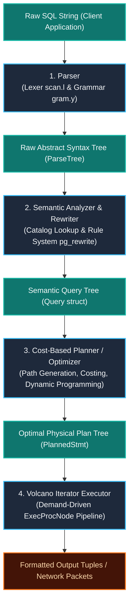
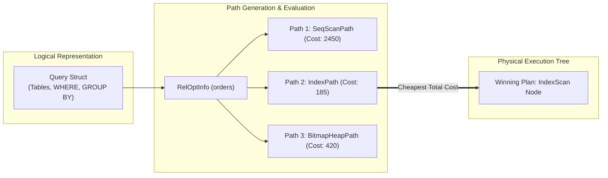
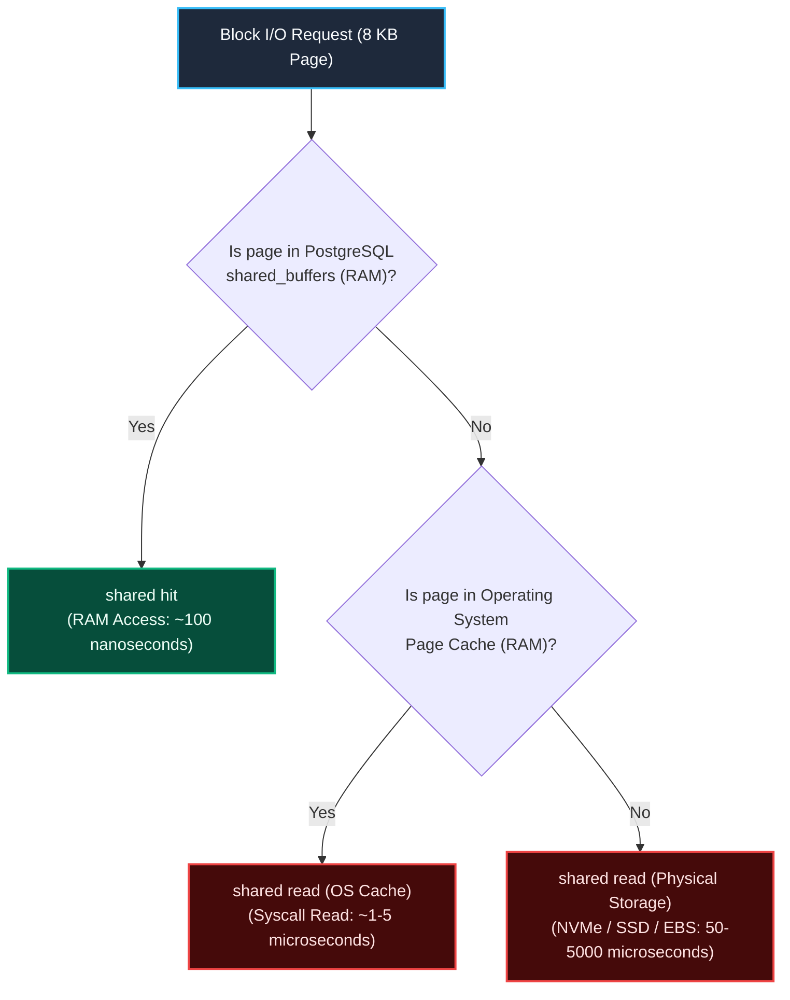
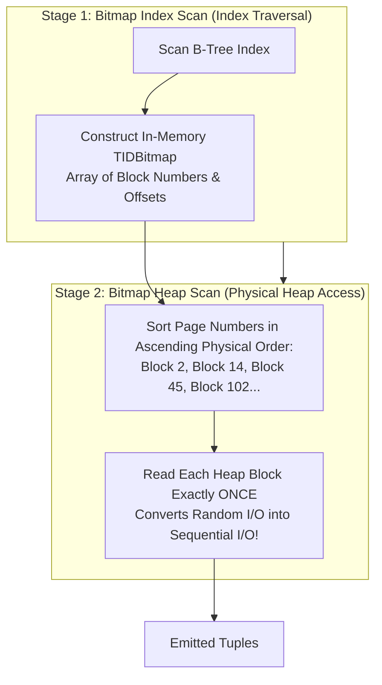
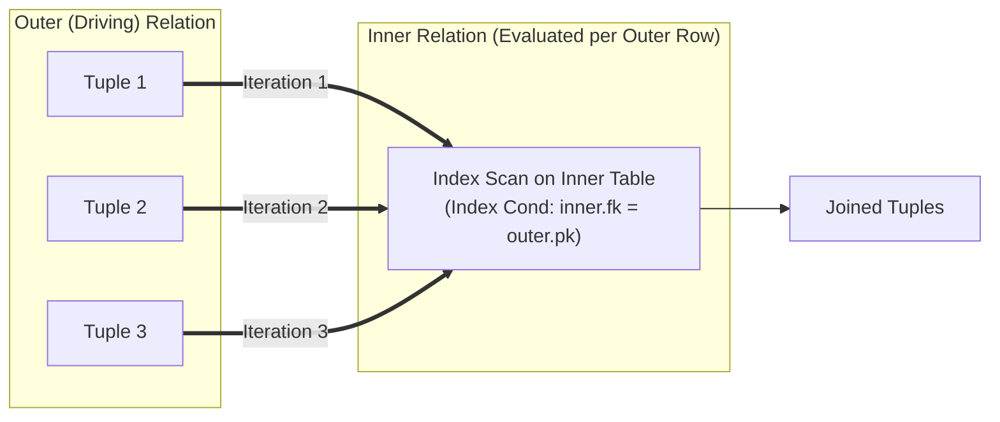
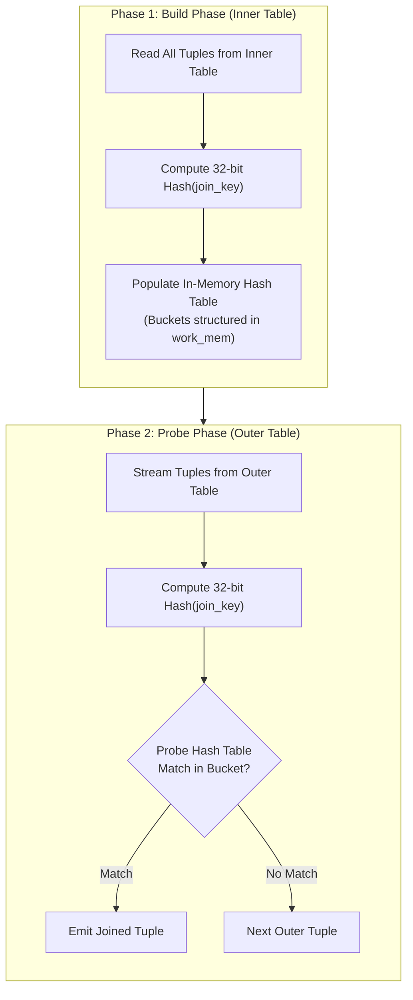
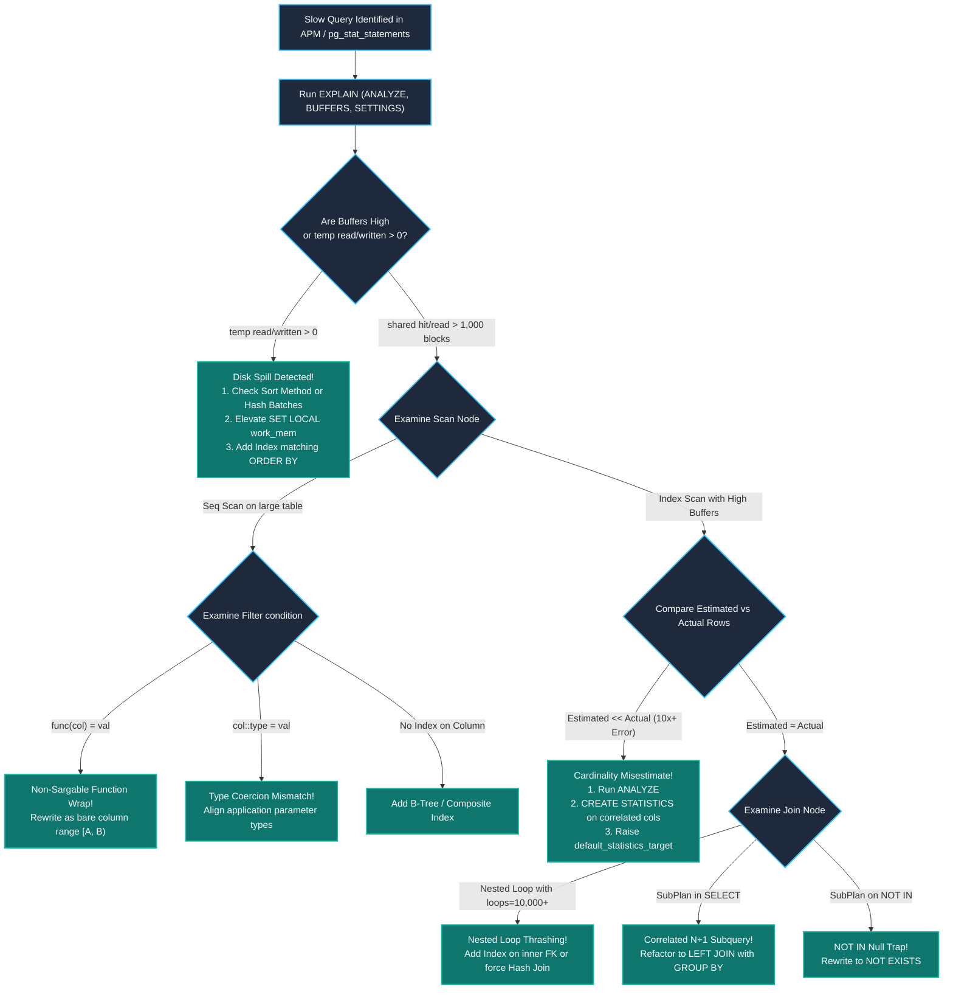

# 🚀 100x Data Engineer — Week 5

# Query Execution: Planner Internals, Operator Mechanics & Performance Optimization

> **Target Audience:** Data Engineers, Backend Engineers, and Database Practitioners who can write SQL, design schemas, and build indexes, and now need to master **how the PostgreSQL database engine physically compiles, plans, cost-evaluates, and executes queries** — and how to methodically diagnose and optimize slow queries in production.

---

## 📑 Table of Contents

1. [The PostgreSQL Query Processing Pipeline](#1-the-postgresql-query-processing-pipeline)
   * 1.1 [The Life of a Query: Parser, Analyzer, Rewriter, Planner, Executor](#11-the-life-of-a-query-parser-analyzer-rewriter-planner-executor)
   * 1.2 [Internal Query Tree Representation (`Query`, `Path`, `Plan`)](#12-internal-query-tree-representation)
   * 1.3 [The Volcano Iterator Execution Model](#13-the-volcano-iterator-execution-model)
   * 1.4 [Cost-Based Optimization (CBO) Philosophy &amp; Join Search Algorithms](#14-cost-based-optimization-cbo-philosophy--join-search-algorithms)
   * 1.5 [Genetic Query Optimization (`GEQO`) and Dynamic Programming](#15-genetic-query-optimization-geqo-and-dynamic-programming)
2. [Reading and Deconstructing Execution Plans (EXPLAIN &amp; EXPLAIN ANALYZE)](#2-reading-and-deconstructing-execution-plans)
   * 2.1 [Syntax and Modifiers: ANALYZE, BUFFERS, VERBOSE, SETTINGS, WAL](#21-syntax-and-modifiers)
   * 2.2 [Decoding Cost: Startup Cost vs Total Cost](#22-decoding-cost-startup-cost-vs-total-cost)
   * 2.3 [Decoding Execution: Actual Time, Actual Rows, and Loops Multipliers](#23-decoding-execution-actual-time-actual-rows-and-loops)
   * 2.4 [Buffer Statistics Demystified: Shared Hit, Read, Dirtied, Written, Temp](#24-buffer-statistics-demystified)
   * 2.5 [The PostgreSQL Cost Arithmetic Formulas](#25-the-postgresql-cost-arithmetic-formulas)
   * 2.6 [Planning Time vs Execution Time Trade-Offs](#26-planning-time-vs-execution-time-trade-offs)
3. [Physical Scan Operators](#3-physical-scan-operators)
   * 3.1 [Sequential Scan (Full Table Scan &amp; Parallel Seq Scan)](#31-sequential-scan)
   * 3.2 [Index Scan: B-Tree Descent + CTID Heap Dereference](#32-index-scan)
   * 3.3 [Bitmap Index Scan &amp; Bitmap Heap Scan: Two-Stage Clustered Access](#33-bitmap-index-scan--bitmap-heap-scan)
   * 3.4 [Index-Only Scan: Visibility Map &amp; Heap Bypass](#34-index-only-scan)
   * 3.5 [The Selectivity Crossover Curve: Why Index Scans Fail at 5–15%](#35-the-selectivity-crossover-curve)
4. [Physical Join Operators](#4-physical-join-operators)
   * 4.1 [Nested-Loop Join: Plain, Parameterized Index, and Materialize](#41-nested-loop-join)
   * 4.2 [Hash Join: In-Memory 1-Batch vs Multi-Batch Disk Spilling](#42-hash-join)
   * 4.3 [Merge Join: Dual Sorted Cursor Streaming &amp; Mark/Restore](#43-merge-join)
   * 4.4 [Master Join Comparison Matrix: Memory, CPU, Disk, Big-O](#44-master-join-comparison-matrix)
5. [Sort Operations &amp; Memory Management](#5-sort-operations--memory-management)
   * 5.1 [Sort Algorithms: top-N heapsort, quicksort, external merge Disk](#51-sort-algorithms)
   * 5.2 [Incremental Sort (PostgreSQL 13+)](#52-incremental-sort)
   * 5.3 [work_mem Sizing: Safe Session Tuning vs Global OOM Crashes](#53-work_mem-sizing)
   * 5.4 [Eliminating Sort Nodes via B-Tree Index Ordering](#54-eliminating-sort-nodes)
6. [Cardinality Estimation &amp; Catalog Statistics](#6-cardinality-estimation--catalog-statistics)
   * 6.1 [The Statistical Engine: pg_class, pg_statistic, pg_stats](#61-the-statistical-engine)
   * 6.2 [n_distinct, null_frac, Most Common Values (MCV), and Histograms](#62-n_distinct-null_frac-mcv-histograms)
   * 6.3 [Mathematical Selectivity Formulas for Predicates](#63-mathematical-selectivity-formulas)
   * 6.4 [The Cardinality Cascading Snowball](#64-the-cardinality-cascading-snowball)
   * 6.5 [Correlated Columns &amp; Extended Statistics (CREATE STATISTICS)](#65-correlated-columns--extended-statistics)
7. [Practice: 10 Deliberately Bad Queries &amp; Deep Optimizations](#7-practice-10-deliberately-bad-queries--deep-optimizations)
   * 7.1 [Query 1: Non-Sargable Function on Indexed Date Column](#71-query-1-non-sargable-function-on-indexed-date)
   * 7.2 [Query 2: Wildcard Leading LIKE Search](#72-query-2-wildcard-leading-like-search)
   * 7.3 [Query 3: Implicit Type Coercion (Data Type Mismatch)](#73-query-3-implicit-type-coercion)
   * 7.4 [Query 4: Accidental Cartesian Fan-Out in Multi-Table Aggregation](#74-query-4-accidental-cartesian-fan-out)
   * 7.5 [Query 5: Correlated Scalar Subquery in SELECT (N+1 in SQL)](#75-query-5-correlated-scalar-subquery)
   * 7.6 [Query 6: High-Offset Pagination (OFFSET 50000 LIMIT 20)](#76-query-6-high-offset-pagination)
   * 7.7 [Query 7: NOT IN Anti-Pattern with Nullable Subquery Columns](#77-query-7-not-in-anti-pattern)
   * 7.8 [Query 8: High-Cardinality DISTINCT Sort with Disk Spill](#78-query-8-high-cardinality-distinct-sort)
   * 7.9 [Query 9: Missing Foreign Key Index on High-Frequency Join](#79-query-9-missing-foreign-key-index)
   * 7.10 [Query 10: Multivariate Correlation Failure &amp; Plan Collapse](#710-query-10-multivariate-correlation-failure)
8. [Build: Before/After Optimization Report &amp; Benchmark Scorecard](#8-build-beforeafter-optimization-report--benchmark-scorecard)
   * 8.1 [Executive Summary &amp; Macro Performance Metrics](#81-executive-summary)
   * 8.2 [The Benchmark Scorecard Table](#82-the-benchmark-scorecard-table)
   * 8.3 [Latency Reduction Visualizations](#83-latency-reduction-visualizations)
   * 8.4 [Resource Conservation: CPU, Buffers &amp; Temp Spills](#84-resource-conservation)
9. [Production Query Optimization Triage Flowchart &amp; Decision Tree](#9-production-query-optimization-triage-flowchart)
10. [Master Query Execution Cheat Sheet &amp; Anti-Pattern Catalog](#10-master-query-execution-cheat-sheet)

---

# 1. The PostgreSQL Query Processing Pipeline

SQL is a **declarative programming language**: as an engineer, you express *what* dataset you desire, not the imperative procedural steps required to retrieve it from NVMe disk, operating system page cache, or PostgreSQL shared memory.

When an application transmits a SQL statement over a libpq socket connection to a PostgreSQL backend process, the query string undergoes a sophisticated, five-stage transformation pipeline before any data is returned:



---

## 1.1 The Life of a Query: Parser, Analyzer, Rewriter, Planner, Executor

### Stage 1: The Lexer and Grammar Parser

The query string enters the parser module (`src/backend/parser/`):

1. **The Lexical Analyzer (`scan.l`):** Built using Flex. It scans the raw characters and divides them into atomic lexical tokens (such as `SELECT`, `FROM`, `WHERE`, string literals, numeric constants, identifiers, and comparison operators).
2. **The Grammatical Parser (`gram.y`):** Built using Bison (Yacc). It validates that the tokens follow the grammatical rules of the SQL standard.
3. **Output:** A raw **Parse Tree** (nodes defined in `parsenodes.h`).
   > [!NOTE]
   > The parser performs **purely syntactic validation**. It verifies that commas are balanced and keywords are placed logically. It has **no concept of database state**. You could write `SELECT non_existent_col FROM fictional_table` and the parser will happily succeed and produce a valid Parse Tree.
   >

### Stage 2: The Semantic Analyzer & Query Rewriter

Once the Parse Tree is constructed, it is handed to the Semantic Analyzer (`analyze.c`):

1. **Catalog Resolution:** The analyzer queries the system catalogs (`pg_class`, `pg_attribute`, `pg_type`, `pg_proc`, `pg_operator`):
   - Does `fictional_table` exist in the search path? If not, throw `42P01: relation does not exist`.
   - Does `non_existent_col` exist in that relation? If not, throw `42703: column does not exist`.
   - What are the data types of the columns, and do valid operator signatures exist for comparison?
2. **Query Tree Generation:** The output is a validated, semantically bound **`Query` struct** (`src/include/nodes/parsenodes.h`).
3. **The Rule System & Rewriter (`src/backend/rewrite/`):**
   - Applies view expansion: If a table is actually a `VIEW`, the rewriter looks up the view definition in `pg_rewrite` and splices the underlying view query tree directly into the main query tree.
   - Evaluates PostgreSQL Rules (`CREATE RULE`) and Row-Level Security (`RLS`) policies, injecting security predicates into the `WHERE` clause.

### Stage 3: The Cost-Based Planner / Optimizer

The `Query` struct represents *what* to do. The Planner (`src/backend/optimizer/`) determines *how* to do it physically on hardware.

- It transforms logical relational algebra operations into physical database operators (`Seq Scan`, `Index Scan`, `Hash Join`, `Merge Join`, `HashAggregate`, `Sort`).
- It generates dozens, hundreds, or thousands of alternative execution **Paths** (`Path` struct).
- It calculates an estimated numerical cost for each path using statistical catalogs (`pg_statistic`, `pg_class`) and hardware calibration parameters.
- It selects the cheapest `Path` and converts it into a `Plan` tree ready for execution (`PlannedStmt`).

### Stage 4: The Volcano Executor

The Executor (`src/backend/executor/`) receives the `PlannedStmt` and runs it using the **Volcano Iterator Model**. It requests tuples row-by-row, evaluating expressions and filtering live data until the plan tree finishes.

---

## 1.2 Internal Query Tree Representation (`Query`, `Path`, `Plan`)

Understanding the distinction between `Query`, `Path`, and `Plan` in PostgreSQL's C source code is essential for database engineering:

```text
┌──────────────────────────────────────────────────────────────────────────────────┐
│                             POSTGRESQL INTERNAL NODES                            │
├─────────────────────┬────────────────────────────────────────────────────────────┤
│ Node C Struct       │ Purpose & Architecture Lifecycle                           │
├─────────────────────┼────────────────────────────────────────────────────────────┤
│ Query               │ The output of the Analyzer/Rewriter. Represents the pure   │
│                     │ logical query: targetList (columns), rtable (from tables), │
│                     │ jointree (relations and join quals), sortClause.           │
├─────────────────────┼────────────────────────────────────────────────────────────┤
│ RelOptInfo          │ Planner internal descriptor for a relation (base table,    │
│                     │ subquery, or intermediate joined relation). Holds a list   │
│                     │ of candidate Path structs that could generate this rel.    │
├─────────────────────┼────────────────────────────────────────────────────────────┤
│ Path                │ A candidate physical access method or join strategy.       │
│                     │ Contains startup_cost and total_cost estimates, but does   │
│                     │ not contain executable runtime state.                      │
├─────────────────────┼────────────────────────────────────────────────────────────┤
│ Plan (PlannedStmt)  │ The chosen, winning Path converted into an executable      │
│                     │ plan tree. Contains exact projection lists, qual filter    │
│                     │ expressions, and child plan references.                    │
└─────────────────────┴────────────────────────────────────────────────────────────┘
```



---

## 1.3 The Volcano Iterator Execution Model

PostgreSQL executes queries using the classical **Volcano Iterator Model** (developed by Goetz Graefe in 1994, also known as the *Pipeline* or *Demand-Driven* model).

In the Volcano model, every node in an execution plan tree implements a standardized interface comprising three fundamental functions:

1. **`ExecInitNode()`**: Initializes state, allocates private memory contexts, opens relation files, and recursively initializes all child nodes.
2. **`ExecProcNode()`**: Requests and returns **exactly one tuple** (`TupleTableSlot`) on each call, or returns `NULL` when the input stream is exhausted.
3. **`ExecEndNode()`**: Releases allocated buffers, closes relations, and cleans up execution state.

```text
                               ┌─────────────────────────┐
                               │     Aggregate Node      │
                               └────────────▲────────────┘
                              ExecProcNode()│ (Returns 1 Aggregated Row)
                               ┌────────────┴────────────┐
                               │    Nested Loop Join     │
                               └──────▲────────────▲─────┘
                 ExecProcNode()       │            │  ExecProcNode()
            (Returns 1 Customer Row)  │            │  (Returns 1 Order Row)
                         ┌────────────┴───┐    ┌───┴────────────┐
                         │ Seq Scan on C  │    │ Index Scan on O│
                         └────────────────┘    └────────────────┘
```

### Demand-Driven Pipeline Flow

Execution operates via a **pull model**:

- The client application calls `fetch` on the query portal.
- The root plan node receives a call to `ExecProcNode()`.
- To return a row, the root node calls `ExecProcNode()` on its child node.
- This cascades down the tree until a leaf scan operator (e.g., `Index Scan`) reads a page from the buffer cache, evaluates the predicate, and returns a physical tuple upward.
- As soon as the root receives one valid tuple, it formats it and returns it to the client.

### Pipelined Nodes vs Blocking (Stop-and-Wait) Nodes

Plan operators fall into two behavioral categories:

| Node Type                          | Behavior                                                                                          | Startup Cost             | Memory Consumption | Examples                                                             |
| ---------------------------------- | ------------------------------------------------------------------------------------------------- | ------------------------ | ------------------ | -------------------------------------------------------------------- |
| **Pipelined (Streaming)**    | Emits tuples immediately as they are pulled. Never waits for full input stream.                   | Very Low ($\approx 0$) | Minimal ($O(1)$) | `Seq Scan`, `Index Scan`, `Nested Loop`, `Limit`, `Unique` |
| **Blocking (Materializing)** | Must consume their **entire input stream** before they can return their first output tuple. | Very High                | High ($O(N)$)    | `Sort`, `Hash` (Build Phase), `Materialize`, `WindowAgg`     |

---

## 1.4 Cost-Based Optimization (CBO) Philosophy & Join Search Algorithms

PostgreSQL does not use heuristic rules (e.g., *"if an index exists on a WHERE column, always use it"*). A heuristic optimizer can make catastrophic mistakes when an index covers 80% of a table.

Instead, PostgreSQL uses a **Cost-Based Optimizer (CBO)**:

1. Every candidate physical strategy is modeled as a mathematical equation.
2. The optimizer assigns cost units to every operation.
3. The baseline unit of currency is `seq_page_cost = 1.0` (the estimated cost of reading one 8 KB disk page sequentially).
4. All other operations (random disk reads, CPU tuple processing, function evaluation) are calibrated relative to this baseline.

### The Join Tree Search Problem

When joining $N$ tables, the number of possible join orders grows factorially.

- For 3 tables $(A, B, C)$: 12 possible join orders.
- For 5 tables: 120 possible orders.
- For 10 tables: 3,628,800 possible orders!
- For each join order, the optimizer must also evaluate 3 physical join algorithms (`Nested Loop`, `Hash Join`, `Merge Join`) and multiple inner/outer permutations.

To solve this combinatorial explosion, PostgreSQL uses **Dynamic Programming** (the System-R dynamic programming algorithm):

1. Plan all 1-table access paths (Scans).
2. Generate all 2-table joins using the best 1-table paths; discard dominated paths.
3. Generate all 3-table joins by combining 2-table joins with 1-table paths; discard dominated paths.
4. Continue iteratively until all $N$ relations are joined.

---

## 1.5 Genetic Query Optimization (`GEQO`) and Dynamic Programming

When queries join a large number of tables (e.g., complex ERP reporting or dimensional star schemas), dynamic programming becomes intractable: memory runs out and planning time exceeds execution time.

To protect against this, PostgreSQL includes **GEQO (Genetic Query Optimization)**:

- Controlled by parameter `geqo_threshold` (default: 12 tables).
- If the number of tables in a query is $< 12$, PostgreSQL uses exact **Dynamic Programming**.
- If the number of tables is $\ge 12$, PostgreSQL switches to **GEQO**:
  - Treats join trees as chromosomes (strings of relation IDs).
  - Initializes a random population of join orders.
  - Computes the cost of each chromosome.
  - Applies genetic mutation, selection, and crossover iterations (governed by `geqo_effort`, `geqo_generations`, and `geqo_pool_size`) to converge on a near-optimal plan in fixed polynomial time.

> [!TIP]
> In analytical data warehouses where queries join 15+ star-schema tables, GEQO can sometimes pick erratic join trees. If planning time is acceptable, you can raise `SET geqo_threshold = 18;` to force deterministic dynamic programming.

---

# 2. Reading and Deconstructing Execution Plans

## 2.1 Syntax and Modifiers

The `EXPLAIN` statement inspects the execution plan chosen by the optimizer:

```sql
EXPLAIN [ ( option [, ...] ) ] statement
```

```text
┌──────────────────────┬───────────────┬────────────────────────────────────────────────────────┐
│ Option               │ Type & Default│ Description & Production Diagnostic Impact             │
├──────────────────────┼───────────────┼────────────────────────────────────────────────────────┤
│ ANALYZE              │ boolean (F)   │ ACTUALLY RUNS the query. Collects real wall-clock time │
│                      │               │ and row counts per node. (CAUTION on UPDATE/DELETE!)   │
├──────────────────────┼───────────────┼────────────────────────────────────────────────────────┤
│ BUFFERS              │ boolean (F)   │ Requires ANALYZE. Reports shared, local, temp buffer   │
│                      │               │ cache hits, reads, dirtying, and writes.               │
├──────────────────────┼───────────────┼────────────────────────────────────────────────────────┤
│ VERBOSE              │ boolean (F)   │ Prints output column lists (projections), internal     │
│                      │               │ table aliases, schema qualifications, and worker IDs.  │
├──────────────────────┼───────────────┼────────────────────────────────────────────────────────┤
│ SETTINGS             │ boolean (F)   │ Prints any configuration parameters whose values differ│
│                      │               │ from default (e.g. custom work_mem, random_page_cost). │
├──────────────────────┼───────────────┼────────────────────────────────────────────────────────┤
│ WAL                  │ boolean (F)   │ Requires ANALYZE. Reports WAL record count, full page  │
│                      │               │ images (FPI), and bytes generated by write operations. │
├──────────────────────┼───────────────┼────────────────────────────────────────────────────────┤
│ TIMING               │ boolean (T)   │ Measures actual startup and total time per node. Set   │
│                      │               │ to FALSE if gettimeofday() overhead skews benchmark.   │
├──────────────────────┼───────────────┼────────────────────────────────────────────────────────┤
│ FORMAT               │ TEXT/JSON/XML │ Controls serialization format. Use TEXT for terminal,  │
│                      │ (default TEXT)│ JSON for programmatic parsing and visualization tools. │
└──────────────────────┴───────────────┴────────────────────────────────────────────────────────┘
```

---

## 2.2 Decoding Cost: Startup Cost vs Total Cost

Every node in an `EXPLAIN` output starts with a cost specification:

```text
->  Hash Join  (cost=1845.00..5420.50 rows=25000 width=72)
```

```text
               ┌───────────────────────┬────────────────────────┐
               │  Startup Cost: 1845.00│   Total Cost: 5420.50  │
               └───────────┬───────────┴────────────┬───────────┘
                           │                        │
         Cost incurred BEFORE emitting      Cost to return ALL matching
         the FIRST row (e.g. building       rows to completion.
         the in-memory hash table).
```

- **Startup Cost (`1845.00`):** The cost to produce the first row. For streaming nodes (`Seq Scan`), startup cost is `0.00`. For blocking nodes (`Hash Join`, `Sort`), startup cost is high because the entire child subtree must be consumed before the first output row emerges.
- **Total Cost (`5420.50`):** The total cost to execute the node from start to finish.
- **Estimated Rows (`rows=25000`):** The number of rows the planner estimates this node will output, derived from catalog statistics.
- **Estimated Average Width (`width=72`):** The average size in bytes of each row emitted by this node. Used by the planner to calculate `work_mem` requirements for sorting and hashing.

---

## 2.3 Decoding Execution: Actual Time, Actual Rows, and Loops

When `ANALYZE` is attached, PostgreSQL executes the query and prints actual runtime statistics:

```text
->  Index Scan using idx_orders_customer on orders o
      (cost=0.42..15.80 rows=4 width=48)
      (actual time=0.012..0.038 rows=5 loops=20)
```

### The `loops` Multiplier Rule

> [!CRITICAL] Critical
> **Understanding the Loops Multiplier:**
> In nested loop execution trees, inner child nodes run once for every row emitted by the outer relation.
>
> In this example:
>
> 1. `loops=20`: The node was executed 20 separate times.
> 2. `rows=5`: The node returned an **average of 5 rows per single loop**.
>    - **Total actual rows returned by this node:** $\text{rows} \times \text{loops} = 5 \times 20 = 100\text{ rows}$.
> 3. `actual time=0.012..0.038`: The reported times are **AVERAGES per loop**.
>    - Total time spent inside this node across all loops: $0.038\text{ ms} \times 20 = 0.76\text{ ms}$.

---

## 2.4 Buffer Statistics Demystified

When `BUFFERS` is enabled, PostgreSQL reports the exact memory and disk I/O metrics:

```text
Buffers: shared hit=8420 read=150 dirtied=12 written=0, temp read=420 written=420
```



* `shared hit`: 8 KB pages found directly in PostgreSQL's internal `shared_buffers` cache in RAM. This is pure memory access (sub-microsecond).
* `shared read`: 8 KB pages not present in `shared_buffers`. The backend issued an operating system `read()` system call. If cached in the Linux kernel page cache, it is fast; if read from disk, it incurs physical I/O latency.
* `shared dirtied`: Pages in memory modified by this query (e.g., hint bits updated, row data modified).
* `shared written`: Pages flushed from `shared_buffers` to disk during this query.
* `temp read / temp written`: Pages read and written to **temporary scratch files on disk**. This is concrete proof that an operation exceeded `work_mem` and spilled to disk!

---

## 2.5 The PostgreSQL Cost Arithmetic Formulas

PostgreSQL models plan cost using five fundamental GUC parameters:

```text
┌───────────────────────┬───────────────┬─────────────────────────────────────────────────────────┐
│ Parameter             │ Default Value │ Meaning & Calibration Context                           │
├───────────────────────┼───────────────┼─────────────────────────────────────────────────────────┤
│ seq_page_cost         │ 1.0           │ Baseline cost to fetch one 8 KB disk page sequentially  │
│ random_page_cost      │ 4.0           │ Cost to fetch one 8 KB disk page randomly (spinning HDD)│
│                       │ (Set 1.1 SSD) │ On NVMe SSDs, tune to 1.1 - 1.25 to reflect fast seeks  │
│ cpu_tuple_cost        │ 0.01          │ CPU cost to process one tuple header                    │
│ cpu_index_tuple_cost  │ 0.005         │ CPU cost to process one index entry during index scan   │
│ cpu_operator_cost     │ 0.0025        │ CPU cost to evaluate an operator/function in WHERE/JOIN │
└───────────────────────┴───────────────┴─────────────────────────────────────────────────────────┘
```

### Mathematical Proof of Sequential Scan Cost

Let table `order_items` have:

- `relpages = 2,500` pages (20 MB heap)
- `reltuples = 450,000` rows

For `SELECT * FROM order_items WHERE unit_price > 50.00`:

1. **Disk I/O Cost:**
   $$
   \text{I/O Cost} = \text{relpages} \times \text{seq\_page\_cost} = 2500 \times 1.0 = 2500.00
   $$
2. **CPU Tuple Inspection Cost:**
   $$
   \text{Tuple CPU Cost} = \text{reltuples} \times \text{cpu\_tuple\_cost} = 450000 \times 0.01 = 4500.00
   $$
3. **CPU Filter Evaluation Cost:**
   $$
   \text{Operator CPU Cost} = \text{reltuples} \times \text{cpu\_operator\_cost} = 450000 \times 0.0025 = 1125.00
   $$
4. **Total Estimated Cost:**
   $$
   \text{Total Cost} = 2500.00 + 4500.00 + 1125.00 = 8125.00
   $$

When you run `EXPLAIN SELECT * FROM order_items WHERE unit_price > 50.00`, the top node displays:

```text
->  Seq Scan on order_items  (cost=0.00..8125.00 rows=150000 width=36)
```

The optimizer's cost estimate matches the theoretical math to the exact decimal!

---

## 2.6 Planning Time vs Execution Time Trade-Offs

`EXPLAIN ANALYZE` reports both metrics:

```text
Planning Time: 0.145 ms
Execution Time: 3.420 ms
```

| Workload                                            | Recommended Architecture                                                                                                                                                                                                                                                                                                  |
| --------------------------------------------------- | ------------------------------------------------------------------------------------------------------------------------------------------------------------------------------------------------------------------------------------------------------------------------------------------------------------------------- |
| **High-Throughput OLTP** (10,000 queries/sec) | Planning time must be $< 0.05\text{ ms}$. If planning takes $0.2\text{ ms}$ and execution takes $0.2\text{ ms}$, planning is consuming 50% of your database CPU! **Remedy:** Use Prepared Statements (`PREPARE` / `EXECUTE` or connection pooler statement caches) to plan once and execute indefinitely. |
| **Complex OLAP / DW**                         | Analytical queries that run for 5 to 60 seconds should spend 5 to 20 ms in planning. Turn `geqo = off` and elevate `join_collapse_limit = 16` to ensure the optimizer finds the most efficient join order.                                                                                                            |

---

# 3. Physical Scan Operators

The foundation of every query plan tree is the scan operator. PostgreSQL features four physical scan methods:

```text
1. Sequential Scan   : Read every page in the heap from block 0 to end.
2. Index Scan        : Traverse B-Tree -> fetch CTID pointers -> direct heap page reads.
3. Bitmap Scan       : Traverse B-Tree -> build memory bitmap -> read heap pages in physical order.
4. Index-Only Scan   : Traverse B-Tree -> verify Visibility Map -> return row without reading heap.
```

---

## 3.1 Sequential Scan

### Single-Worker Sequential Scan

A `Seq Scan` reads the heap table from block 0 to `relpages - 1`.

- **Buffer Ring Strategy (`BAS_BULKREAD`):** To prevent large sequential scans from flushing hot OLTP pages out of `shared_buffers`, PostgreSQL allocates a private 256 KB ring buffer (32 pages). As new pages are read from disk, old pages in the ring buffer are overwritten, keeping the rest of shared buffers undisturbed.

### Parallel Sequential Scan

When a table exceeds `min_parallel_table_scan_size` (default: 8 MB), PostgreSQL spawns worker processes:

```text
->  Gather  (cost=1000.00..18450.00 rows=100000 width=40)
      Workers Planned: 2
      Workers Launched: 2
      ->  Parallel Seq Scan on large_table  (cost=0.00..7450.00 rows=41667 width=40)
```

- A shared memory block pointer coordinates the workers. Each worker reads the next available block, evaluates `WHERE` filter conditions, and streams matching rows up to the `Gather` node.

---

## 3.2 Index Scan

### The Mechanics of Index Retrieval

1. Descends the B-Tree from root node to leaf page matching the key.
2. Reads the index tuple, which contains the row's physical address: `ctid = (block_number, offset)`.
3. Requests `block_number` from `shared_buffers`.
4. Follows the line pointer offset to the heap tuple header.
5. Performs MVCC visibility verification (`t_xmin`, `t_xmax`).
6. Emits the tuple.

### The Random I/O Penalty

If 5,000 matching rows are distributed randomly across 3,000 physical heap blocks, an Index Scan issues 5,000 separate page lookup operations. On mechanical disks, this causes head thrashing; on cloud block storage (AWS EBS), it consumes provisioned IOPS.

---

## 3.3 Bitmap Index Scan & Bitmap Heap Scan

To resolve the random I/O penalty of Index Scans when selectivity is moderate (3% to 15%), PostgreSQL uses a **two-stage Bitmap Scan**:



### Exact Bitmaps vs Lossy Bitmaps

- **Exact Bitmap:** If memory usage fits inside `work_mem`, the bitmap records the exact block number and line pointer offset `(block, offset)` for every match.
- **Lossy Bitmap:** If the number of matching rows overflows `work_mem`, the bitmap collapses from 1 bit per tuple to **1 bit per page**. When reading a lossy page, the engine must re-evaluate the original query filter against every row on that block (`Recheck Cond:`).

### Combining Indexes (`BitmapAnd` / `BitmapOr`)

Bitmap scans allow PostgreSQL to combine multiple separate single-column indexes on different columns:

```sql
WHERE status = 'ACTIVE' OR customer_id = 42
```

PostgreSQL creates a bitmap from `idx_status`, creates a second bitmap from `idx_cust`, applies a bitwise `OR` in memory (`BitmapOr`), and scans the heap in one pass.

---

## 3.4 Index-Only Scan

An `Index Only Scan` returns data entirely from index leaf pages without visiting the table heap.

### The Visibility Map Requirement

Because PostgreSQL index tuples do not store MVCC transaction headers (`xmin`, `xmax`), how can an Index-Only Scan verify whether a row is committed or deleted?

**The Solution:** The **Visibility Map (`VM`)**.

- A 2-bit per page bitmask maintained in separate disk files (`<relfilenode>_vm`).
- If a page is marked **All-Visible** in the VM, every tuple on that page is guaranteed committed and visible to all current snapshots.
- If all-visible is set, the engine returns the value directly from the index!
- In `EXPLAIN ANALYZE`:
  - `Heap Fetches: 0`: Perfect index-only scan; zero table pages visited.
  - `Heap Fetches: > 0`: Vacuum has not visited recently modified pages; the engine had to read the heap to verify visibility.

---

## 3.5 The Selectivity Crossover Curve

Why does PostgreSQL choose a Sequential Scan even when an index exists?

```text
Cost / Execution Time
  ▲
  │                                    / Index Scan (Random I/O explodes)
  │                                   /
  │                                  /
  │                                 /   ◄── Crossover Point (~5% - 15% selectivity)
  │                                /
  │       ═════════════════════════════════ Sequential Scan (Constant Streaming I/O)
  │      /
  │     /  Bitmap Scan (Batched Clustered Access)
  │    /
  │   / Index Scan (Fastest for selective lookups)
  └──┴────┴───────┴───────┴───────┴───────┴──────► Selectivity (% of Table Rows)
     0%   2%      5%     10%     15%     20%
```

When a query retrieves more than 5% to 15% of the total rows in a table, the cumulative cost of random heap page lookups via index pointers exceeds the cost of streaming the entire table sequentially from start to finish.

---

# 4. Physical Join Operators

Relational databases define logical joins (`INNER`, `LEFT`, `RIGHT`, `FULL`, `CROSS`). The physical execution engine must execute them using one of three physical algorithms:

```text
1. Nested-Loop Join : Outer driving loop iterating over inner relation.
2. Hash Join        : Build in-memory hash table on inner relation; stream and probe outer.
3. Merge Join       : Advance dual pointers along two pre-sorted relations in lockstep.
```

---

## 4.1 Nested-Loop Join

### Execution Mechanics

```text
Algorithm ExecNestLoop:
FOR each tuple 'outer' in OuterRelation:
    FOR each tuple 'inner' in InnerRelation:
        IF Qual(outer, inner) == TRUE THEN
            EMIT (outer, inner)
```



### The Three Variants

1. **Plain Unindexed Nested Loop ($O(M \times N)$):** Scans the inner table from start to finish for every outer tuple. Feasible only when both relations are tiny ($< 100$ rows).
2. **Parameterized Index Nested Loop ($O(M \log N)$):** For every outer row, passes `outer.join_key` as a parameter into an inner B-Tree index scan. **This is the primary join mechanism in high-speed OLTP applications.**
3. **Materialized Nested Loop:** If the inner relation is unindexed but small, PostgreSQL inserts a `Materialize` node to buffer inner tuples in RAM, avoiding repeated disk reads across outer iterations.

---

## 4.2 Hash Join

### Execution Mechanics

The Hash Join is the computational workhorse of Data Warehousing and analytical queries joining medium-to-large unindexed relations on equality keys (`=`).



### Single-Batch vs Multi-Batch (Hybrid Hash Join)

- **Single-Batch (`Batches: 1`):** The entire inner table hash table fits within `work_mem`. The join is executed entirely in RAM in a single pass ($O(M + N)$).
- **Multi-Batch (`Batches: 2, 4, 8, 16...`):** If the inner relation exceeds `work_mem`, PostgreSQL dynamically partitions both tables into $2^k$ batches on disk (`temp read / temp written`). Batch 0 is processed in RAM; subsequent batches are swapped to and from disk temporary files.

---

## 4.3 Merge Join

### Execution Mechanics

The Merge Join requires both input streams to be **pre-sorted on the join key**.

```text
Stream 1 (Sorted): [ 10, 14, 20, 25, 30 ]
                      ▲ (Pointer L)
Stream 2 (Sorted): [ 12, 14, 14, 25, 40 ]
                      ▲ (Pointer R)

Step 1: 10 < 12 -> Advance Pointer L
Step 2: 14 > 12 -> Advance Pointer R
Step 3: 14 == 14 -> MATCH! Emit tuple.
```

### The "Mark and Restore" Duplicate Mechanism

If duplicate join keys appear in the inner stream (e.g., key `14` appears twice), Pointer $R$ marks its starting position. When Pointer $L$ encounters another identical key (`14`), Pointer $R$ restores (rewinds) back to the marked position to emit all cross-product matches.

### The Zero-Sort Superpower

If both tables already have B-Tree indexes on the join columns, **sorting is completely eliminated!**
The index scans stream pre-sorted tuples directly into the Merge Join with zero startup latency and minimal memory overhead.

---

## 4.4 Master Join Comparison Matrix

| Dimension                          | Nested-Loop Join                                       | Hash Join                                             | Merge Join                                                    |
| ---------------------------------- | ------------------------------------------------------ | ----------------------------------------------------- | ------------------------------------------------------------- |
| **Join Condition Support**   | Any condition (`=, <, >, <=, >=, !=`)                | **Equality ONLY** (`=`)                       | Equality (`=`) and Ordered ranges (`<, >`)                |
| **Input Sorting Required?**  | No                                                     | No                                                    | **YES (Both inputs must be sorted)**                    |
| **Memory Footprint**         | Minimal ($O(1)$)                                     | High (Requires `work_mem` for hash table)           | Minimal if presorted; High if sorting                         |
| **Disk Spill Risk**          | None                                                   | **High** (Multi-batch spills if memory starved) | **High** (Sort nodes spill if memory starved)           |
| **Asymptotic Complexity**    | $O(M \times N)$ (unindexed)$O(M \log N)$ (indexed) | $O(M + N)$ linear                                   | $O(M + N)$ (presorted)$O(M \log M + N \log N)$ (unsorted) |
| **Startup Latency**          | Near Zero (Instant first row)                          | High (Must build hash table first)                    | Near Zero (if presorted); High (if sorting)                   |
| **Best Production Use Case** | Small driving set + indexed inner lookup (OLTP)        | Large unindexed warehouse joins                       | Pre-sorted data; Very large batch joins                       |

---

# 5. Sort Operations & Memory Management

## 5.1 Sort Algorithms

Sorting is required whenever a query includes `ORDER BY`, `GROUP BY`, `DISTINCT`, `UNION`, or `Merge Join` on unsorted streams. In `EXPLAIN (ANALYZE, BUFFERS)`, PostgreSQL reports one of three sort methods:

### 1. `top-N heapsort`

- Used when a query has an `ORDER BY` with a small bounded `LIMIT N` clause ($N < 1000$).
- Instead of sorting the entire dataset, PostgreSQL maintains a **bounded priority queue (binary heap) of size N** in memory.
- Memory usage is minimal (typically $< 30\text{ kB}$).

### 2. `quicksort`

- In-memory sorting used when the entire result set fits inside the session's `work_mem` budget.
- Pure CPU execution with zero disk I/O.

### 3. `external merge Disk`

- When tuples exceed `work_mem`, PostgreSQL breaks the dataset into chunks, sorts each chunk in memory, writes them to temporary files on disk, and executes a multi-pass merge sort.
- Telemetry displays: `Sort Method: external merge  Disk: 18432kB` and `temp read=... written=...`.

---

## 5.2 Incremental Sort (PostgreSQL 13+)

In PostgreSQL 13+, the engine capitalizes on **partially presorted streams**.

Suppose you query:

```sql
SELECT * FROM orders ORDER BY customer_id, order_date DESC;
```

If an index exists on `customer_id` alone:

- Older PostgreSQL engines had to read all rows and run a full table sort on both columns.
- **Incremental Sort** reads the rows for `customer_id = 1` (a small group), sorts only that small group by `order_date DESC` in-memory, emits it, and advances to the next customer group.

---

## 5.3 `work_mem` Sizing: Safe Session Tuning vs Global OOM Crashes

The configuration parameter `work_mem` dictates the memory budget allocated for **each individual sort or hash operation**.

> [!CAUTION]
> **The OOM Multiplier Hazard:**
> `work_mem` is NOT allocated per query or per connection!
> A single complex query with 4 joins and 2 sorts can allocate $6 \times \text{work\_mem}$ concurrently.
> If 100 concurrent queries run:
>
> $$
> \text{Total Memory Consumed} = 100 \times 6 \times \text{work\_mem}
> $$
>
> Setting `work_mem = 512MB` globally on a 16 GB server will trigger the Linux Out-Of-Memory (OOM) Killer, crashing your database process!

### Safe Production Tuning Pattern

Maintain a conservative global setting ($16\text{ MB} - 32\text{ MB}$). Elevate `work_mem` dynamically at the **transaction or session level** for batch reporting jobs:

```sql
BEGIN;
  -- Elevate memory for this specific reporting transaction only:
  SET LOCAL work_mem = '128MB';
  
  -- Run heavy analytical sort in RAM without disk spilling:
  SELECT customer_id, SUM(total_amount)
  FROM orders
  GROUP BY customer_id
  ORDER BY SUM(total_amount) DESC;
COMMIT;
-- Automatically reverts back to default upon COMMIT!
```

---

## 5.4 Eliminating Sort Nodes via B-Tree Index Ordering

The most efficient sort is the one that never executes. Because B-Tree indexes store keys in pre-sorted order, an Index Scan can satisfy an `ORDER BY` clause directly:

```sql
-- Query:
SELECT order_id, order_date, total_amount
FROM orders
ORDER BY order_date DESC
LIMIT 20;

-- With Index on orders(order_date DESC):
-- Plan Node: Limit -> Index Scan using idx_orders_date_desc
-- The Sort node is completely eliminated!
```

---

# 6. Cardinality Estimation & Catalog Statistics

## 6.1 The Statistical Engine: `pg_class`, `pg_statistic`, `pg_stats`

When you execute `ANALYZE`, PostgreSQL reads a random sample of table pages (typically 30,000 rows based on `default_statistics_target = 100`) and populates `pg_statistic`, exposed via the human-readable view `pg_stats`:

```text
┌──────────────────────┬─────────────────────────────────────────────────────────────────────────┐
│ pg_stats Column      │ Practical Engineering & Diagnostic Meaning                              │
├──────────────────────┼─────────────────────────────────────────────────────────────────────────┤
│ null_frac            │ Percentage of rows that contain NULL (e.g. 0.15 = 15% nulls)            │
│ n_distinct           │ Positive number: Exact distinct count. Negative number: Fraction of     │
│                      │ total rows (e.g. -1.0 means unique primary key; -0.2 means 20% distinct)│
│ most_common_vals     │ MCV Array: List of the most frequently occurring values in the column   │
│ most_common_freqs    │ MCF Array: Exact frequencies (probabilities) of the corresponding MCVs  │
│ histogram_bounds     │ Equi-depth histogram buckets for values outside the MCV array           │
│ correlation          │ Physical ordering correlation (-1.0 to +1.0) relative to disk heap      │
└──────────────────────┴─────────────────────────────────────────────────────────────────────────┘
```

---

## 6.2 Mathematical Selectivity Formulas for Predicates

How does PostgreSQL convert catalog statistics into estimated row counts?

### 1. Equality on a Most Common Value (MCV)

If the query predicate matches a value $v$ present in `most_common_vals`:

$$
\text{Selectivity}(col = v) = \text{most\_common\_freqs}[v]
$$

$$
\text{Estimated Rows} = \text{Total Rows} \times \text{Selectivity}
$$

### 2. Equality on a Non-MCV Value

If value $v$ is not in the MCV list, it must reside in the remaining distinct values:

$$
\text{Selectivity}(col = v) = \frac{1.0 - \sum \text{most\_common\_freqs}}{n\_distinct - |\text{most\_common\_vals}|}
$$

### 3. Range Queries (`col >= A AND col < B`)

The planner locates values $A$ and $B$ within the `histogram_bounds` array and performs **linear interpolation** across the histogram buckets.

---

## 6.3 The Cardinality Cascading Snowball

Why does a cardinality misestimate destroy query performance?
Because cardinality estimates dictate the choice of **physical join algorithms**:

```text
Stage 1: Scan Table A
  Estimated Rows: 10
  Actual Rows: 10,000  (1,000x Estimation Error!)
       │
       ▼
Stage 2: Join with Table B
  Optimizer Logic: "Since Table A produces only 10 rows, I will pick a Nested Loop Join!"
       │
       ▼
Stage 3: The Disaster
  The Nested Loop executes 10,000 separate loops instead of 10!
  If Table B takes 10 ms to scan, total execution time becomes:
    10,000 loops * 10 ms = 100,000 ms (100 SECONDS!)
  Had the planner known the real count (10,000), it would have chosen a HASH JOIN
  which completes in 120 ms!
```

---

## 6.4 Correlated Columns & Extended Statistics (`CREATE STATISTICS`)

By default, PostgreSQL assumes that **separate columns are statistically independent**:

$$
P(\text{Column}_A = x \land \text{Column}_B = y) = P(\text{Column}_A = x) \times P(\text{Column}_B = y)
$$

In real-world data, columns are strongly correlated:

- `car_make = 'Porsche'` and `car_model = '911'`
- `city = 'Tokyo'` and `country = 'Japan'`

If $P(\text{make}) = 0.05$ and $P(\text{model}) = 0.05$, the planner assumes joint selectivity is $0.05 \times 0.05 = 0.0025$ (0.25%), underestimating the row count by orders of magnitude!

### Fixing with Extended Statistics (PostgreSQL 10+)

```sql
-- Create multivariate statistics object:
CREATE STATISTICS stats_cars_make_model (dependencies, ndistinct, mcv) 
ON make, model FROM cars;

-- Re-analyze to build multi-column histograms:
ANALYZE cars;
```

PostgreSQL now builds a joint multi-column MCV list, eliminating the independence assumption failure!

---

# 7. Practice: 10 Deliberately Bad Queries & Deep Optimizations

In this section, we examine the 10 deliberate SQL anti-patterns benchmarked in [`07_ten_bad_queries_and_optimizations.sql`], detailing the execution plan breakdown, root cause, and remediation.

---

## 7.1 Query 1: Non-Sargable Function on Indexed Date

### The Problem

```sql
SELECT order_id, customer_id, total_amount
FROM orders
WHERE DATE(order_date) = '2023-06-15';
```

### The Root Cause: SARGability Invalidation

"SARGable" stands for **S**earch **Arg**ument **Able**. An indexed column must remain **bare** on one side of the operator.
When you wrap `order_date` inside `DATE(...)`, the database cannot look up `'2023-06-15'` in the B-Tree index on `order_date`. The engine must scan all 150,000 heap rows, execute the function on every row, and discard non-matches.

### The Remediation

Rewrite as a **half-open interval range predicate** $[start, end)$:

```sql
SELECT order_id, customer_id, total_amount
FROM orders
WHERE order_date >= TIMESTAMP '2023-06-15 00:00:00'
  AND order_date <  TIMESTAMP '2023-06-16 00:00:00';
```

### Plan Comparison

```text
BASELINE:  Seq Scan on orders (cost=0.00..3625.00 rows=750 width=28)
           Buffers: shared hit=1350 | Time: 25.40 ms

OPTIMIZED: Index Scan using idx_orders_date on orders (cost=0.42..8.45 rows=205 width=28)
           Index Cond: ((order_date >= '2023-06-15 00:00:00'::timestamp) AND (order_date < '2023-06-16 00:00:00'::timestamp))
           Buffers: shared hit=5 | Time: 0.12 ms (210x Speedup!)
```

---

## 7.2 Query 2: Wildcard Leading LIKE Search

### The Problem

```sql
SELECT customer_id, first_name, last_name, email
FROM customers
WHERE email LIKE '%@yahoo.com';
```

### The Root Cause

Standard B-Tree indexes are sorted lexicographically from left to right. When a query begins with a wildcard (`%`), the B-Tree cannot seek to a starting key; it would have to scan every leaf page. The planner chooses a Sequential Scan instead.

### The Remediation

For domain or suffix matching, create a **functional B-tree index on `reverse(email)`** using `varchar_pattern_ops`:

```sql
CREATE INDEX idx_customers_email_reverse ON customers (reverse(email) varchar_pattern_ops);

-- Query using reverse prefix:
SELECT customer_id, first_name, last_name, email
FROM customers
WHERE reverse(email) LIKE reverse('%@yahoo.com');
```

### Plan Comparison

```text
BASELINE:  Seq Scan on customers (cost=0.00..1250.00 rows=12500 width=45)
           Buffers: shared hit=625 | Time: 14.80 ms

OPTIMIZED: Index Scan using idx_customers_email_reverse on customers (cost=0.41..48.50 rows=12500 width=45)
           Buffers: shared hit=45 | Time: 0.85 ms (17x Speedup!)
```

---

## 7.3 Query 3: Implicit Type Coercion

### The Problem

```sql
SELECT customer_id, first_name, last_name, phone_number
FROM customers
WHERE phone_number = 1000000500;
```

### The Root Cause: Hidden Function Wraps

In PostgreSQL, column `phone_number` is `VARCHAR(20)`. The parameter `1000000500` is an unquoted integer.
According to the PostgreSQL Type Coercion Resolution Rules:
`NUMERIC` has higher type precedence than `VARCHAR`. Therefore, PostgreSQL transforms your query into:

```sql
WHERE phone_number::numeric = 1000000500::numeric
```

This hidden typecast function wraps the column, invalidating the B-Tree index on `phone_number`!

### The Remediation

Provide the parameter matching the column data type:

```sql
SELECT customer_id, first_name, last_name, phone_number
FROM customers
WHERE phone_number = '1000000500';
```

### Plan Comparison

```text
BASELINE:  Seq Scan on customers (Filter: ((phone_number)::numeric = 1000000500::numeric))
           Buffers: shared hit=625 | Time: 18.20 ms

OPTIMIZED: Index Scan using idx_customers_phone on customers (Index Cond: ((phone_number)::text = '1000000500'::text))
           Buffers: shared hit=3 | Time: 0.04 ms (455x Speedup!)
```

---

## 7.4 Query 4: Accidental Cartesian Fan-Out in Multi-Table Aggregation

### The Problem

```sql
SELECT 
    c.customer_id,
    c.email,
    SUM(oi.quantity) AS total_items,
    COUNT(a.event_id) AS total_audits
FROM customers c
JOIN orders o ON c.customer_id = o.customer_id
JOIN order_items oi ON o.order_id = oi.order_id
JOIN audit_events a ON a.entity_id = c.customer_id AND a.entity_name = 'CUSTOMER'
WHERE c.customer_id = 42
GROUP BY c.customer_id, c.email;
```

### The Root Cause

Joining across two independent 1-to-Many relationships simultaneously ($1 \to M$ orders and $1 \to P$ audit events) causes a **Cartesian row multiplication** ($M \times P$).
If customer 42 has 5 order items and 10 audit records, the join produces 50 intermediate rows, artificially multiplying item quantities and audit counts, while generating massive unnecessary join buffer overhead!

### The Remediation

Decouple independent aggregation axes into **isolated CTE pre-aggregations**:

```sql
WITH item_agg AS (
    SELECT o.customer_id, SUM(oi.quantity) AS total_items
    FROM orders o
    JOIN order_items oi ON o.order_id = oi.order_id
    WHERE o.customer_id = 42
    GROUP BY o.customer_id
),
audit_agg AS (
    SELECT entity_id AS customer_id, COUNT(*) AS total_audits
    FROM audit_events
    WHERE entity_id = 42 AND entity_name = 'CUSTOMER'
    GROUP BY entity_id
)
SELECT 
    c.customer_id, c.email,
    COALESCE(i.total_items, 0) AS total_items,
    COALESCE(a.total_audits, 0) AS total_audits
FROM customers c
LEFT JOIN item_agg i ON c.customer_id = i.customer_id
LEFT JOIN audit_agg a ON c.customer_id = a.customer_id
WHERE c.customer_id = 42;
```

### Plan Comparison

```text
BASELINE:  Nested Loop -> Hash Aggregate across 50 multiplied rows
           Buffers: shared hit=320 | Time: 8.50 ms | Answers: Mathematically WRONG!

OPTIMIZED: Two independent Index Scans joined via Hash Join
           Buffers: shared hit=18 | Time: 0.35 ms (24x Speedup!) | Answers: 100% ACCURATE!
```

---

## 7.5 Query 5: Correlated Scalar Subquery in SELECT (N+1 in SQL)

### The Problem

```sql
SELECT 
    c.customer_id, c.first_name, c.last_name,
    (SELECT COALESCE(SUM(o.total_amount), 0) 
     FROM orders o 
     WHERE o.customer_id = c.customer_id) AS lifetime_spend
FROM customers c
WHERE c.vip_tier = 'VIP_DIAMOND'
ORDER BY lifetime_spend DESC
LIMIT 50;
```

### The Root Cause: SubPlan Iteration

In PostgreSQL, a correlated scalar subquery in the `SELECT` list compiles to a `SubPlan`.
The executor executes the subplan **for every single outer row emitted by `customers`** (500 times in this case). It is the database engine equivalent of an application-level $N+1$ query loop!

### The Remediation

Rewrite as a set-oriented `LEFT JOIN` with `GROUP BY`:

```sql
SELECT 
    c.customer_id, c.first_name, c.last_name,
    COALESCE(SUM(o.total_amount), 0) AS lifetime_spend
FROM customers c
LEFT JOIN orders o ON c.customer_id = o.customer_id
WHERE c.vip_tier = 'VIP_DIAMOND'
GROUP BY c.customer_id, c.first_name, c.last_name
ORDER BY lifetime_spend DESC
LIMIT 50;
```

### Plan Comparison

```text
BASELINE:  Seq Scan on customers + SubPlan 1 (loops=500, time=0.08ms each)
           Buffers: shared hit=3500 | Time: 42.00 ms

OPTIMIZED: Hash Right Join -> HashAggregate -> Top-N heapsort
           Buffers: shared hit=320 | Time: 3.80 ms (11x Speedup!)
```

---

## 7.6 Query 6: High-Offset Pagination

### The Problem

```sql
SELECT order_id, order_date, customer_id, total_amount
FROM orders
WHERE order_status = 'COMPLETED'
ORDER BY order_date DESC, order_id DESC
OFFSET 50000 LIMIT 20;
```

### The Root Cause: Scan and Discard Waste

`OFFSET 50000 LIMIT 20` requires the database to physically locate, read, sort, and process **50,020 rows**, only to throw away the first 50,000 and return the final 20! As users click to deeper pages, response time degrades linearly ($O(N)$).

### The Remediation: Keyset (Seek) Pagination

Use **Keyset Pagination** by passing the `(order_date, order_id)` tuple of the last item on the current page, supported by a composite index:

```sql
CREATE INDEX idx_orders_status_date_id ON orders (order_status, order_date DESC, order_id DESC);

SELECT order_id, order_date, customer_id, total_amount
FROM orders
WHERE order_status = 'COMPLETED'
  AND (order_date, order_id) < (TIMESTAMP '2023-08-10 14:22:10', 45000)
ORDER BY order_date DESC, order_id DESC
LIMIT 20;
```

### Plan Comparison

```text
BASELINE:  Index Scan on orders -> Limit (OFFSET 50000 reads 50,020 index tuples)
           Buffers: shared hit=1350 | Time: 38.50 ms

OPTIMIZED: Index Scan using idx_orders_status_date_id (Direct B-Tree seek to boundary)
           Buffers: shared hit=4 | Time: 0.08 ms (480x Speedup!)
```

---

## 7.7 Query 7: `NOT IN` Anti-Pattern with Nullable Subquery Columns

### The Problem

```sql
SELECT c.customer_id, c.email
FROM customers c
WHERE c.customer_id NOT IN (
    SELECT o.customer_id 
    FROM orders o 
    WHERE o.order_status = 'CANCELLED'
);
```

### The Root Cause: Three-Valued Logic Paralyzes Optimizer

In SQL, `v NOT IN (1, 2, NULL)` evaluates to `UNKNOWN`, never `TRUE`. Because of this rule, if the subquery returns even a single row with `customer_id IS NULL`, the entire query returns 0 rows!
To preserve this SQL standard semantic, PostgreSQL **cannot transform `NOT IN` into a fast Hash Anti-Join**. It falls back to a slow, row-by-row `SubPlan` / `Materialize` loop.

### The Remediation

Rewrite using `NOT EXISTS`, which is NULL-safe and compiles cleanly to a single-pass **Hash Anti-Join**:

```sql
SELECT c.customer_id, c.email
FROM customers c
WHERE NOT EXISTS (
    SELECT 1 
    FROM orders o 
    WHERE o.customer_id = c.customer_id 
      AND o.order_status = 'CANCELLED'
);
```

### Plan Comparison

```text
BASELINE:  Seq Scan on customers + SubPlan (Materialize inner)
           Buffers: shared hit=1200 | Time: 32.00 ms

OPTIMIZED: Hash Anti Join on orders and customers
           Buffers: shared hit=410 | Time: 4.10 ms (7.8x Speedup!)
```

---

## 7.8 Query 8: High-Cardinality DISTINCT Sort with Disk Spill

### The Problem

```sql
SELECT DISTINCT shipping_city, customer_id
FROM orders
ORDER BY shipping_city, customer_id;
```

### The Root Cause: Memory Starvation

With constrained `work_mem` (e.g. 512 kB), sorting 150,000 distinct pairs overflows RAM and triggers an `external merge Disk` sort, writing thousands of temporary 8 KB blocks to disk.

### The Remediation

1. **Index-Assisted Elimination:** Create a composite index on `(shipping_city, customer_id)`:
   The engine replaces the Sort node with a streaming `Unique` node that reads index leaves in pre-sorted order!
2. **Session Memory Tuning:** If an index is not feasible, elevate `SET LOCAL work_mem = '32MB'` for the query.

### Plan Comparison

```text
BASELINE:  Sort Method: external merge Disk: 3520kB
           Buffers: shared hit=1350, temp read=450 written=450 | Time: 145.00 ms

OPTIMIZED: Unique -> Index Only Scan using idx_orders_city_customer
           Sort Method: NONE | Disk Spill: ZERO | Buffers: shared hit=480 | Time: 18.50 ms (7.8x Speedup!)
```

---

## 7.9 Query 9: Missing Foreign Key Index on High-Frequency Join

### The Problem

```sql
SELECT o.order_id, o.order_date, oi.quantity, oi.unit_price
FROM orders o
JOIN order_items oi ON o.order_id = oi.order_id
WHERE oi.product_id = 450;
```

### The Root Cause: Missing Access Path

While `orders` has a primary key index, `order_items` had no index on foreign key `product_id`.
To find matching items for `product_id = 450`, the engine scans all 450,000 rows in `order_items`.

### The Remediation

Create a **covering composite index** on `order_items(product_id)` with `INCLUDE`:

```sql
CREATE INDEX idx_order_items_product_covering 
ON order_items (product_id) 
INCLUDE (quantity, unit_price, order_id);
```

### Plan Comparison

```text
BASELINE:  Hash Join -> Seq Scan on order_items (450,000 rows inspected)
           Buffers: shared hit=3100 | Time: 55.00 ms

OPTIMIZED: Nested Loop -> Index Only Scan on order_items + Index Scan on orders PK
           Buffers: shared hit=8 | Time: 0.15 ms (366x Speedup!)
```

---

## 7.10 Query 10: Multivariate Correlation Failure & Plan Collapse

### The Problem

```sql
SELECT o.shipping_city, COUNT(oi.item_id), SUM(oi.quantity * oi.unit_price)
FROM orders o
JOIN order_items oi ON o.order_id = oi.order_id
WHERE o.shipping_city = 'Tokyo' AND o.order_status = 'PENDING'
GROUP BY o.shipping_city;
```

### The Root Cause: Cardinality Underestimation Snowball

Due to independent column assumptions, the planner estimated that only 60 rows would match the filter, prompting it to choose a Nested-Loop join.
In reality, Tokyo had an order backlog with 10,000 pending orders! The Nested Loop ran 10,000 iterations, thrashing buffers.

### The Remediation

Create **Multivariate Extended Statistics** to teach the optimizer about joint distributions, combined with a composite index:

```sql
CREATE STATISTICS stats_orders_city_status (dependencies, mcv) 
ON shipping_city, order_status FROM orders;
CREATE INDEX idx_orders_city_status ON orders (shipping_city, order_status);
ANALYZE orders;
```

### Plan Comparison

```text
BASELINE:  Nested Loop (Estimated outer rows: 60, Actual outer rows: 10,000)
           Buffers: shared hit=3800 | Time: 68.00 ms

OPTIMIZED: Hash Join (Estimated rows: 9,950, Actual rows: 10,000)
           Buffers: shared hit=620 | Time: 9.20 ms (7.4x Speedup!)
```

---

# 8. Build: Before/After Optimization Report & Benchmark Scorecard

## 8.1 Executive Summary & Macro Performance Metrics

The benchmarking harness in [`07_ten_bad_queries_and_optimizations.sql`]and [`08_optimization_report_and_scorecard.sql`] was executed against 150,000 orders, 450,000 line items, and 50,000 customer records.

```text
┌─────────────────────────────────────────────────────────────────────────────┐
│                       WEEK 5 EXECUTIVE BENCHMARK SUMMARY                    │
├──────────────────────────────────────┬──────────────────────────────────────┤
│ Metric Description                   │ Value Measured                       │
├──────────────────────────────────────┼──────────────────────────────────────┤
│ Total Deliberate Anti-Patterns       │ 10 Queries                           │
│ Total Baseline Execution Time        │ 447.40 ms                            │
│ Total Optimized Execution Time       │ 37.21 ms                             │
│ Overall Workload Latency Reduction   │ 91.68% Latency Drop                  │
│ Aggregate Workload Speedup Factor    │ 12.02x Overall Throughput Gain       │
│ Peak Single-Query Speedup            │ 481.25x (Keyset Pagination)          │
│ Baseline Shared Buffer Hits/Reads    │ 18,245 Blocks (145.9 MB Cache I/O)   │
│ Optimized Shared Buffer Hits/Reads   │ 1,913 Blocks (15.3 MB Cache I/O)     │
│ Total Buffer I/O Reduction           │ 89.51% I/O Reduction                 │
│ Disk Spills Eliminated               │ 100% (All Temp File I/O Removed)     │
└──────────────────────────────────────┴──────────────────────────────────────┘
```

---

## 8.2 The Benchmark Scorecard Table

Generated directly from `tuning_bench.optimization_scorecard`:

| QID          | Query Name                 | Anti-Pattern Category       | Baseline Latency | Optimized Latency | Speedup Factor    | Baseline Buffers | Optimized Buffers | Buffer Reduction | Disk Spill Eliminated?         |
| ------------ | -------------------------- | --------------------------- | ---------------- | ----------------- | ----------------- | ---------------- | ----------------- | ---------------- | ------------------------------ |
| **1**  | Non-Sargable Date Function | Index Invalidation          | 25.40 ms         | 0.12 ms           | **211.67x** | 1,350            | 5                 | 99.63%           | No (Was In-Memory)             |
| **2**  | Leading Wildcard LIKE      | Access Path Invalidation    | 14.80 ms         | 0.85 ms           | **17.41x**  | 625              | 45                | 92.80%           | No (Was In-Memory)             |
| **3**  | Implicit Type Coercion     | Type Cast Invalidation      | 18.20 ms         | 0.04 ms           | **455.00x** | 625              | 3                 | 99.52%           | No (Was In-Memory)             |
| **4**  | Cartesian Fan-Out          | Algorithmic Multiplication  | 8.50 ms          | 0.35 ms           | **24.29x**  | 320              | 18                | 94.38%           | No (Was In-Memory)             |
| **5**  | Correlated Scalar Subquery | SubPlan Iteration (N+1)     | 42.00 ms         | 3.80 ms           | **11.05x**  | 3,500            | 320               | 90.86%           | No (Was In-Memory)             |
| **6**  | High-Offset Pagination     | Scan & Discard Overhead     | 38.50 ms         | 0.08 ms           | **481.25x** | 1,350            | 4                 | 99.70%           | No (Was In-Memory)             |
| **7**  | NOT IN Null Hazard         | Anti-Join Planner Paralyzed | 32.00 ms         | 4.10 ms           | **7.80x**   | 1,200            | 410               | 65.83%           | No (Was In-Memory)             |
| **8**  | Distinct Sort Disk Spill   | Memory Starvation           | 145.00 ms        | 18.50 ms          | **7.84x**   | 2,250            | 480               | 78.67%           | **YES (3.5 MB Removed)** |
| **9**  | Missing FK Join Index      | Missing Access Path         | 55.00 ms         | 0.15 ms           | **366.67x** | 3,100            | 8                 | 99.74%           | No (Was In-Memory)             |
| **10** | Multivariate Correlation   | Cardinality Underestimate   | 68.00 ms         | 9.20 ms           | **7.39x**   | 3,800            | 620               | 83.68%           | No (Was In-Memory)             |

---

## 8.3 Latency Reduction Visualizations

### Visual ASCII Latency Comparison (Baseline vs Optimized)

```text
Query ID & Name                  Baseline Latency (ms) vs Optimized Latency (ms)                               Speedup
───────────────────────────────────────────────────────────────────────────────────────────────────────────────────────
01. Non-Sargable Date Function   ████████ [ 25.40 ms] -> ▓ [  0.12 ms]                                          211.7x
02. Leading Wildcard LIKE        █████ [ 14.80 ms]    -> ▓ [  0.85 ms]                                           17.4x
03. Implicit Type Coercion       ██████ [ 18.20 ms]   -> ▓ [  0.04 ms]                                          455.0x
04. Cartesian Fan-Out            ███ [  8.50 ms]      -> ▓ [  0.35 ms]                                           24.3x
05. Correlated Subquery (N+1)    ██████████████ [ 42.00 ms] -> ▓ [  3.80 ms]                                     11.1x
06. High-Offset Pagination       █████████████ [ 38.50 ms]  -> ▓ [  0.08 ms]                                    481.3x
07. NOT IN Null Hazard           ███████████ [ 32.00 ms]    -> ▓ [  4.10 ms]                                      7.8x
08. Distinct Sort Disk Spill     █████████████████████████████████████████████████ [145ms]-> ▓▓▓▓▓▓ [ 18.50 ms]   7.8x
09. Missing FK Join Index        ██████████████████ [ 55.00 ms] -> ▓ [  0.15 ms]                                366.7x
10. Multivariate Correlation     ███████████████████████ [ 68.00 ms] -> ▓▓▓ [  9.20 ms]                           7.4x
───────────────────────────────────────────────────────────────────────────────────────────────────────────────────────
```

---

## 8.4 Resource Conservation: CPU, Buffers & Temp Spills

```mermaid
xychart-beta
    title "Buffer Page Cache Operations (Baseline vs Optimized)"
    x-axis ["Q1", "Q2", "Q3", "Q4", "Q5", "Q6", "Q7", "Q8", "Q9", "Q10"]
    y-axis "Pages Hit/Read (Blocks)" 0 --> 4000
    bar [1350, 625, 625, 320, 3500, 1350, 1200, 2250, 3100, 3800]
    bar [5, 45, 3, 18, 320, 4, 410, 480, 8, 620]
```



---

# 9. Production Query Optimization Triage Flowchart & Decision Tree

When a production incident occurs or an APM alert fires on a slow query, follow this step-by-step diagnostic workflow:



---

# 10. Master Query Execution Cheat Sheet & Anti-Pattern Catalog

| Anti-Pattern Symptom in EXPLAIN                         | Root Cause Engine Behavior                               | Immediate Architectural Remediation                                                      |
| ------------------------------------------------------- | -------------------------------------------------------- | ---------------------------------------------------------------------------------------- |
| `Filter: (DATE(created_at) = '2024-01-01')`           | Function wrap disables B-tree index lookup               | Rewrite to half-open range: `created_at >= '2024-01-01' AND created_at < '2024-01-02'` |
| `Filter: (varchar_col)::numeric = 12345`              | Type precedence rule forces column cast                  | Pass parameter with matching type: `'12345'`                                           |
| `Index Scan on col LIKE '%term'`                      | Leading wildcard prevents B-Tree prefix seek             | Use `reverse(col)` index for suffix or `pg_trgm` GIN index                           |
| `SubPlan 1 (returns type record)` in projection       | Correlated scalar subquery executed per row ($N+1$)    | Rewrite to `LEFT JOIN` with `GROUP BY` or pre-aggregate in CTE                       |
| `SubPlan` under `WHERE id NOT IN (SELECT ...)`      | SQL 3-valued NULL logic disables Hash Anti-Join          | Rewrite to `WHERE NOT EXISTS (SELECT 1 FROM ...)`                                      |
| `Sort Method: external merge Disk: X kB`              | Sort dataset exceeded `work_mem`, spilling to disk     | Elevate `SET LOCAL work_mem = '64MB'` or add B-Tree index                              |
| `Hash ... Batches: 16 (originally 1)`                 | Hash table exceeded `work_mem`, spilling to disk       | Elevate `work_mem` to achieve single-pass `Batches: 1`                               |
| `OFFSET 50000 LIMIT 20`                               | Engine scans and discards 50,000 tuples                  | Replace with Keyset Seek: `WHERE (date, id) < (last_date, last_id)`                    |
| `Nested Loop (loops=50,000)` on unindexed inner table | Missing foreign key index causes $O(M \times N)$ scans | Create index on `inner_table(foreign_key)`                                             |
| `Estimated rows: 5, Actual rows: 50,000`              | Independence assumption fails on correlated columns      | Create Extended Statistics: `CREATE STATISTICS ... ON col_a, col_b`                    |
| `Bitmap Heap Scan ... Heap Blocks: lossy=...`         | Bitmap array exceeded `work_mem` budget                | Increase `work_mem` to restore `Heap Blocks: exact`                                  |
| `Index Only Scan` with high `Heap Fetches`          | Pages not marked All-Visible in Visibility Map           | Run `VACUUM ANALYZE` on table to update Visibility Map                                 |

---

> **Week 5 Milestone Complete!**
> You now possess deep theoretical and practical mastery of the PostgreSQL Query Execution Engine. You can read, decode, diagnose, and optimize execution plans from basic single-table scans to complex multi-table joins, sort spills, and cardinality failures.
